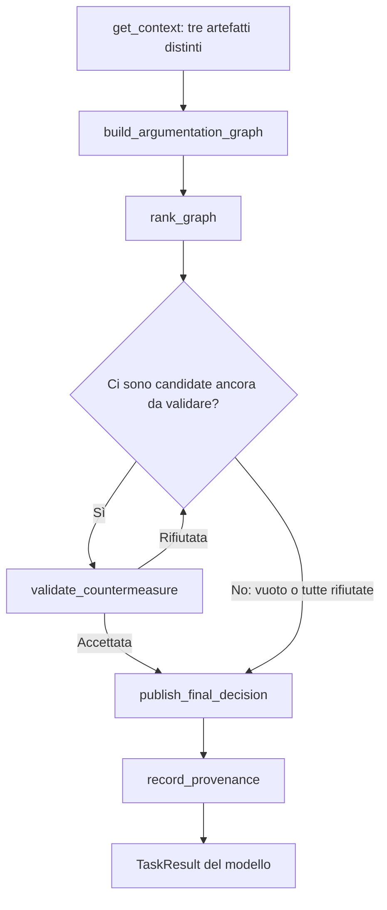

# Pubblicazione della telemetria e fasi dello Strategic

Questo incremento affronta i due errori descritti nelle
[prove precedenti](ollama-contract-tests.md): metadati OTel generati per un
input statico e chiamate finali dello Strategic scritte nel testo senza essere
eseguite. Quattro agenti CAMEL, dipendenze del DAG, pipeline predefinita e
`ArtifactSession` restano presenti. I backend esterni non vengono modificati.

**Il collaudo funzionale è completato: quattro inferenze Ollama complete,
due per percorso, con tutti gli audit superati.** Le due prove positive
selezionano strategie diverse; il completamento del flusso non dimostra
ripetibilità o validità scientifica della raccomandazione.

## Contratto di pubblicazione secondo la fonte

`RuntimeEvidence` rimane il formato dell'artefatto salvato e ricevuto dagli
altri agenti. Il modello vede invece una specializzazione Pydantic del contratto
di pubblicazione coerente con l'input della sessione:

| Input | Schema del payload | Vincolo sulla fonte |
|---|---|---|
| `StaticTelemetry` | `StaticRuntimeEvidence` | `telemetry` può essere solo `null`; i due flag restano booleani |
| `TelemetryInput` | `OTelRuntimeEvidence` | `telemetry` è obbligatorio; i flag sconosciuti possono restare `null` |

La stessa specializzazione compare nello schema del tool e in
`get_context().schemas.runtime_evidence`. Il nome pubblico del tool rimane
`publish_runtime_evidence`. La Workforce seleziona anche un prompt specifico
per la fonte, così il worker statico non riceve istruzioni di acquisizione OTel.

Per OTel il modello deve acquisire e pubblicare l'evidenza esatta restituita
dal tool. Pydantic verifica struttura e tipi; la sessione confronta l'intero
payload con quello acquisito e ricontrolla lo snapshot. Nel caso statico la
sessione conserva il confronto con software, versione e fatti dell'input.
Un metadato inventato non viene rimosso o corretto per accettare la richiesta.

Codice: [schemi](../thesis_agents/schemas/telemetry.py),
[adapter delle pubblicazioni](../thesis_agents/orchestration/publication_tools.py),
[prompt Telemetry](../thesis_agents/agents/telemetry.py),
[contesto e controlli](../thesis_agents/orchestration/artifacts.py).

## Fasi dello Strategic

`StrategicToolPolicy` legge lo stato validato per determinare quale tool esporre
alla prossima richiesta del modello. Ogni clone deve prima chiamare
`get_context`, anche quando riprende una sessione parzialmente completata.



Nelle richieste allo Strategic viene esposto un tool alla volta, accompagnato
da una breve indicazione della fase. Il modello produce ancora gli argomenti
e la chiamata effettiva; la policy non esegue tool, non calcola score, non
valida candidate e non pubblica al posto dell'agente. Ordine delle validazioni
e selezione ammessa continuano a essere verificati da `ArtifactSession`.

La disponibilità cambia solo dopo risultati salvati. Un errore lascia la fase
invariata. Una chiamata fuori fase viene respinta prima di eseguire la funzione,
anche se il modello propone un nome non presente nei tool pubblicizzati.
Nei retry vengono letti gli artefatti esistenti e riprese le pubblicazioni
mancanti; non viene rigenerato lo stato valido.

Una risposta testuale prematura attiva un recupero nel ciclo `ChatAgent` tramite
il punto di estensione `ResponseTerminator` di CAMEL. Alla seconda risposta
prematura consecutiva senza una chiamata riuscita il tentativo termina;
`ArtifactTaskHandler` continua a rifiutarlo se mancano artefatti. Restano i
limiti di iterazioni, timeout e budget e il retry della Workforce. Il JSON
scritto nella prosa non viene interpretato come una funzione da eseguire.

Questa modifica introduce un vincolo di esecuzione interno al worker Strategic.
Il DAG fra agenti non cambia, mentre la scelta dei tool dentro il task è più
vincolata. La memoria rimane integrale, separata fra worker; i cloni condividono
la sessione degli artefatti e hanno uno stato di lettura/fase indipendente.
La guida di fase inviata per ciascuna richiesta rientra nel budget del backend.

Codice: [policy](../thesis_agents/orchestration/strategic_policy.py),
[ChatAgent](../thesis_agents/orchestration/chat_agent.py),
[Workforce](../thesis_agents/orchestration/workforce.py).
L'adattamento riguarda il ciclo non streaming usato dalla CLI e verificato
con CAMEL `0.2.90`; l'uso di hook dell'SDK richiede regressioni prima di aggiornare
la dipendenza. Non è una nuova semantica BWAF.

## Verifiche automatiche

La suite completa conclude con **270 test passati in 56,89 secondi**.
Ruff verifica il codice e la formattazione. I nuovi casi attraversano i tool
CAMEL e verificano:

- schema statico senza riferimento OTel e rifiuto dei metadati inventati;
- riferimento OTel obbligatorio, acquisizione preventiva e immutabilità dei dati;
- percorso con strategia accettata, tutte rifiutate o nessuna candidata;
- recupero dopo prosa prematura e pubblicazione respinta, senza avanzare fase;
- rifiuto dei tool fuori fase nei percorsi sincrono e asincrono;
- nuovo `get_context` per ogni clone e blocco del falso successo persistente.

I test degli agenti usano inferenza programmata, distinta dalle prove Ollama.
I risultati del modello vanno verificati sugli artefatti e sulle conversazioni effettive.

```sh
.venv/bin/pytest -q
.venv/bin/ruff check .
.venv/bin/ruff format --check .
```

Test principali: [pubblicazioni](../tests/test_publication_tools.py),
[OTel](../tests/test_telemetry.py), [fasi](../tests/test_strategic_policy.py)
e [Workforce CAMEL](../tests/test_camel_integration.py).

## Metodo delle prove Ollama

Le nuove prove usano `tesi-qwen3:4b`, quantizzazione `Q4_K_M`, temperatura zero,
`LLM_MAX_TOKENS=2048` e contesto di 16.384 token, configurato anche sul modello
Ollama. Il digest del modello è
`31475760af12be9b5c1621f74b389d3f0a764dc521aca4f55c32cc2f5363f2fc`.
La versione del server restituita da `/api/version` è `0.40.2`.
Si mantengono i due percorsi delle prove precedenti:

| Percorso | Telemetria | SBOM | Lookup e risultato atteso |
|---|---|---|---|
| Con finding | Input statico, Log4j Core 2.14.1 | File dimostrativo dichiarato | CTI reale e OSV live; candidate da generare e validare |
| OTel senza finding | Log SDK conservati dell'applicazione, Log4j Core 2.26.1 | Inventario della stessa build Maven | CTI reale e OSV live; candidate vuote, decisione e provenienza comunque obbligatorie |

Ogni prova avvia un processo CLI e una sessione CAMEL nuovi, senza importare
artefatti o conversazioni da altre prove. Le fonti sono invece riutilizzate:
`output/cti-positive-sources-20261009` e
`output/observed-app-sources-20261007-02`. Il secondo percorso non esegue una
nuova build Java o una nuova raccolta a ogni ripetizione. Il gateway legge
osservazioni registrate; il riferimento OTel conserva questo fatto.

CTI e OSV vengono consultati nella nuova sessione; i retry interni possono
riusare gli snapshot già acquisiti. Ollama può conservare modello e cache tra
le esecuzioni. I file `ollama-before.json` e `ollama-after.json` registrano
la residenza osservabile, senza azzerare o attestare lo stato delle cache.
Le durate comprendono l'intero processo, tool e valutazioni CAMEL: non sono
benchmark dell'inferenza né una misura isolata dell'effetto della policy.

Le directory preparate hanno il suffisso `20261011`; i manifest registrano
gli istanti effettivi di avvio, anche quando la prova viene eseguita nei giorni seguenti.
Le prove storiche restano conservate con i loro fallimenti e hash dei sorgenti.
Il confronto fra revisioni è descrittivo: non isola il contributo di ciascuna
modifica a schema, prompt e disponibilità dei tool. Anche il server Ollama
riportato dai manifest è diverso: `0.34.4` nelle prove precedenti, `0.40.2`
in questa serie, pur con lo stesso digest del modello. Non si può quindi
attribuire l'intera differenza di comportamento alla sola policy.

## Risultati delle nuove inferenze

Le quattro prove sono complete, con audit degli artefatti e delle fasi superati.
Il [riepilogo verificabile](../output/phase-tools-20261011/summary.json)
conserva misure e confronti. I manifest confermano gli stessi hash dei sorgenti
del MAS, digest del modello, versioni delle librerie, parametri e timeout.
Per ciascuna coppia coincidono anche input e configurazione dei backend;
quest'ultima viene confrontata escludendo soltanto `run_id`, diverso per ogni
sessione. Gli hash dei file integrali restano nel riepilogo.

| Percorso | Ripetizione | Esito verificato | Durata | Richieste LLM |
|---|---|---|---:|---:|
| Statico con finding | [r1](../output/cti-phase-tools-20261011-r1/audit.json) | `selected`, `S_UPGRADE` | 398,01 s | 23 |
| Statico con finding | [r2](../output/cti-phase-tools-20261011-r2/audit.json) | `selected`, `S_ISOLATE` | 389,44 s | 23 |
| OTel senza finding | [r1](../output/otel-phase-tools-20261011-r1/audit.json) | `no_findings`, strategia `null` | 316,20 s | 23 |
| OTel senza finding | [r2](../output/otel-phase-tools-20261011-r2/audit.json) | `no_findings`, strategia `null` | 324,01 s | 23 |

Ogni prova completa i quattro task al primo tentativo. Non compaiono retry
qualitativi, errori dei tool, risposte testuali premature dello Strategic,
riassunti automatici, superamenti del budget o risposte troncate per il limite
di generazione. Ogni pubblicazione richiesta è una chiamata effettiva.
Quattro successi su questa serie circoscritta non stimano un tasso generale
di affidabilità e non sostituiscono la matrice storica dei quattro scenari demo.

Il modello risultava residente soltanto prima di `cti-r2`; prima delle altre
tre prove `/api/ps` non riportava modelli caricati. Non si attribuisce quindi
la differenza dei tempi a una sola causa. Il massimo prompt riportato dal
provider è 13.260 token nei casi positivi e 10.794 in quelli OTel; la maggiore
sottostima osservata nel conteggio offline è 703 token. Sono osservazioni
di questa serie, non garanzie sulla capienza di qualsiasi futura richiesta.

Nel caso positivo il report conserva i tre finding restituiti dal dataset:
`CVE-2025-68161`, `CVE-2026-34477` e `CVE-2026-34480`. Il modello genera tre
candidate; lo Strategic legge separatamente i tre artefatti dei produttori,
invoca grafo e ranking, valida la prima candidata e pubblica decisione e
provenienza. I dati statici conservano `telemetry=null`.

**Le due ripetizioni positive completano il flusso, ma non scelgono la stessa
strategia.** Countermeasure produce insiemi diversi: upgrade/isolamento/blocco
in `r1`, upgrade/isolamento/monitoraggio in `r2`. L'impatto stimato
dell'isolamento scende da `0.2` a `0.1`, mentre il beneficio rimane `0.7`.
Il [ranking mock](../thesis_agents/tools/ranking_mock.py), invariato, assegna
quindi all'isolamento `0.75` in `r1` e `0.8` in `r2`. Nella seconda prova
l'upgrade ha anch'esso `0.8`: il criterio deterministico di spareggio per ID
pone `S_ISOLATE` per primo. La validazione mock lo accetta e lo Strategic
rispetta quell'ordine. Non è una modifica della formula o una scelta inserita
manualmente, ma variabilità negli input generati per il ranking.

Temperatura zero, stesso modello e stessi sorgenti non rendono identiche le
conversazioni: cambiano anche ID e metadati delle acquisizioni. Queste prove
non isolano la causa della variabilità e non dimostrano ripetibilità della
raccomandazione. Le stime LLM richiedono criteri di valutazione indipendenti
prima di essere interpretate come misure di efficacia.

Nel caso OTel il modello acquisisce e pubblica l'evidenza esatta, poi conserva
il risultato `no_findings` e la lista vuota delle candidate. Lo Strategic
pubblica grafo e ranking vuoti, salta la validazione di candidate inesistenti
e chiama comunque `publish_final_decision` e `record_provenance`.
`no_findings` resta limitato alle regole valutate: non certifica la sicurezza
del software.

## Perimetro della verifica

Gli audit rileggono i file Pydantic, confrontano acquisizioni e pubblicazioni,
verificano hash e produttori e controllano le conversazioni CAMEL. In particolare,
la presenza dei tre artefatti in `get_context` viene verificata nei messaggi
effettivamente ricevuti dallo Strategic. Un audit separato ricostruisce le fasi
dalle risposte dei tool, senza invocare la policy di produzione; controlla
gli schemi esposti e conta eventuali risposte testuali premature.

Countermeasure riceve il contesto SBOM/OSV direttamente dalla risposta di
`collect_countermeasure_context`. Nei run verificati non esegue la seconda
lettura di `get_context` richiesta dal prompt: resta una deviazione
dall'istruzione, pur avendo ricevuto i dati esatti verificati dall'audit.
Per lo Strategic la consegna dei tre artefatti e del contesto aggiuntivo
avviene invece tramite `get_context`, come richiesto.

Il successo di questi controlli non certifica ogni frase generata. Descrizioni
delle candidate, stime di beneficio/impatto e `agent_commentary` rimangono
contributi del modello, distinti dalla spiegazione finale derivata dagli
artefatti. Nel primo caso positivo la descrizione dell'isolamento promette
di prevenire lo sfruttamento: è una formulazione generata, non una proprietà
dimostrata dal validatore. Il commento dello Strategic parla inoltre di due
CVE vulnerabili, mentre il report ne pubblica tre, e attribuisce all'upgrade
garanzie di sicurezza e continuità non dimostrate. Queste frasi rimangono nel
campo `agent_commentary` con `verification=unverified`; non sono state corrette
retroattivamente. La spiegazione autorevole riporta i tre finding, qualifica
gli score come stime e chiarisce che nessuna mitigazione è eseguita.
Nella seconda prova la candidata di upgrade qualifica `2.25.4` come versione
supportata dal fornitore: la versione compare nei limiti `fixed` di due
advisory OSV acquisiti, ma quel dato non attesta supporto del fornitore,
compatibilità o sicurezza complessiva. Il controllo strutturale delle
candidate non verifica semanticamente la prosa dei loro vincoli.

Ranking, validazione semantica e provenienza usano ancora i mock locali.
Queste prove non eseguono BWAF reale, Tiny-ME, smart contract, PROV-O, Fabric
o mitigazioni. Il controllo del contesto rimane una stima basata sul contatore
OpenAI, non il tokenizer esatto Qwen. La policy, le specializzazioni degli
schemi e il limite di recupero sono scelte implementative del prototipo,
verificate sul codice CAMEL installato; non provengono da un algoritmo BWAF.

## Ripetere la verifica

Gli artefatti di dominio non vengono modificati dagli audit. Per rileggere una
prova completata, senza avviare il modello o i servizi:

```sh
.venv/bin/python output/cti-phase-tools-20261011-r1/audit.py
.venv/bin/python output/phase-tools-20261011/audit_phases.py \
  output/cti-phase-tools-20261011-r1
.venv/bin/python output/phase-tools-20261011/report.py
```

Sostituire la directory per gli altri run. `audit.json` verifica completezza
e coerenza del dominio; `phase-audit.json` verifica schemi e fasi osservate.
Il secondo non è sufficiente, da solo, a dichiarare completo un run interrotto.
Il riepilogo confronta anche hash dei sorgenti, parametri e digest del modello.
Gli script e le conversazioni sotto `output/` sono evidenze locali escluse da Git;
questo documento conserva nel repository gli esiti principali.

A collaudo concluso sono stati fermati i quattro gateway temporanei sulle
porte 8003–8006, verificando i relativi processi; Ollama preesistente è rimasto
attivo. Il [verbale di chiusura](../output/phase-tools-20261011/cleanup.json)
registra il controllo. `.env`, i repository esterni e i materiali della
relazione/presentazione non sono stati modificati in questo incremento.

Per una nuova inferenza, avviare i servizi descritti nella
[guida degli ingressi](observed-app-integration.md#ripetere-il-collaudo):
CTI sulla porta 8003, OTel sulla 8004 e SBOM della build sulla 8005. Il caso
con finding richiede il [gateway SBOM dimostrativo sulla porta 8006](ollama-contract-tests.md#riproduzione-e-riferimenti).
Ollama deve avere già installato il modello locale con `num_ctx=16384`.
Eseguire le prove una alla volta, dalla radice del repository, usando directory
nuove. Per esempio, per il percorso OTel:

```sh
demo_run="output/otel-phase-tools-$(date -u +%Y%m%dT%H%M%SZ)-r1"
mkdir "$demo_run"
cp output/otel-phase-tools-20261011-r1/run.py "$demo_run/run.py"
cp output/otel-phase-tools-20261011-r1/audit.py "$demo_run/audit.py"
LLM_MODEL=tesi-qwen3:4b LLM_TEMPERATURE=0 \
LLM_CONTEXT_TOKENS=16384 LLM_MAX_TOKENS=2048 \
  .venv/bin/python "$demo_run/run.py"
.venv/bin/python "$demo_run/audit.py"
.venv/bin/python output/phase-tools-20261011/audit_phases.py "$demo_run"
```

Per il percorso statico usare il prefisso `cti-phase-tools-` e copiare i due
script da `output/cti-phase-tools-20261011-r1/`. I runner leggono la relativa
directory di fonti conservata, verificano che l'endpoint sia Ollama locale e
rifiutano di sovrascrivere una prova con manifest già presente. Nessuna
variabile del comando modifica `.env`. Un errore resta un esito da conservare,
non una ragione per completare manualmente gli artefatti.

## Confine di questa prima parte

| Componente esercitato | Implementazione usata nelle prove |
|---|---|
| Agenti e inferenza | Quattro worker CAMEL con Ollama locale, nuovi a ogni run |
| Telemetry | Gateway HTTP su log SDK registrati; input statico dichiarato nel caso positivo |
| Vulnerability | Servizio CTI esterno via MCP, database cve2owl reale |
| Countermeasure | Gateway HTTP, SBOM della build o demo dichiarata, interrogazioni OSV reali |
| Ranking e validazione | Tool mock locali, con controlli di coerenza nella sessione |
| Provenienza | Record JSON e hash locali; nessuna registrazione su Fabric o esportazione PROV-O |

Questa fase verifica acquisizione, passaggio degli artefatti fra agenti e
completamento delle pubblicazioni. Le stime e la qualità delle raccomandazioni
restano da valutare separatamente. Prima di sostituire i tool strategici
occorre definire il mapping dei contratti esterni e della provenienza PROV-O;
ogni servizio va poi collaudato isolatamente e collegato tramite MCP.
Il ledger conserva il ruolo di audit concordato, con ricevute effettive del
servizio esterno. Il [piano di integrazione](mcp-integration-plan.md) mantiene
separati questi incrementi dall'attuazione delle mitigazioni.
