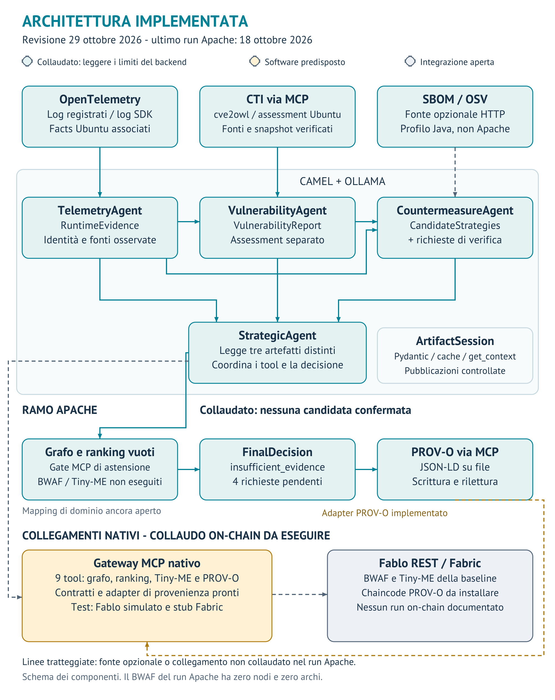
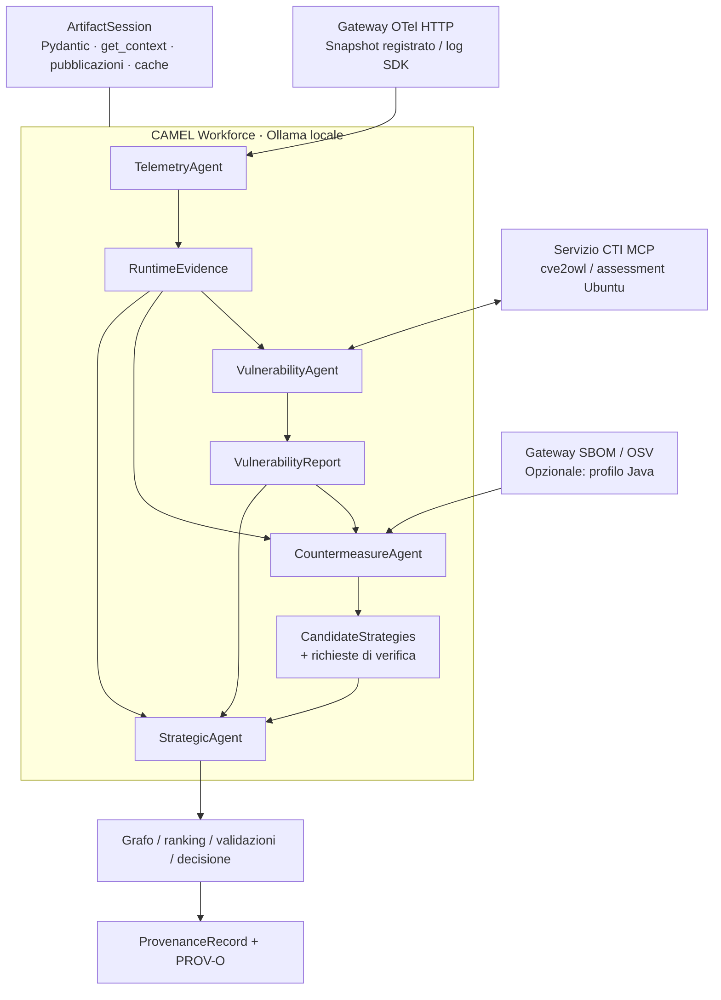
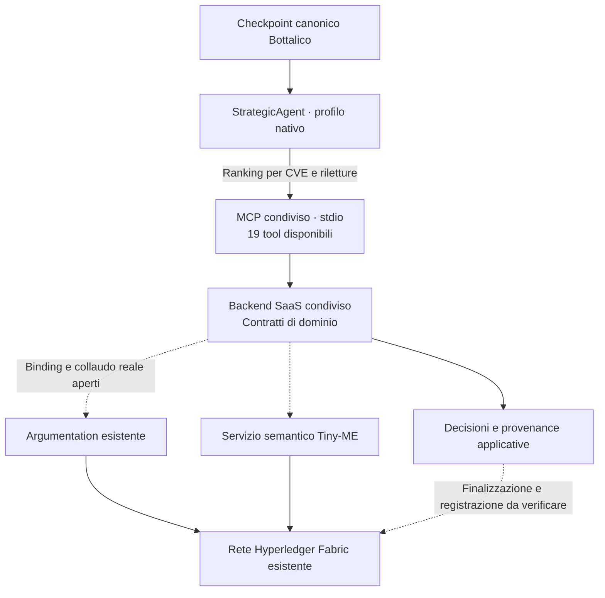
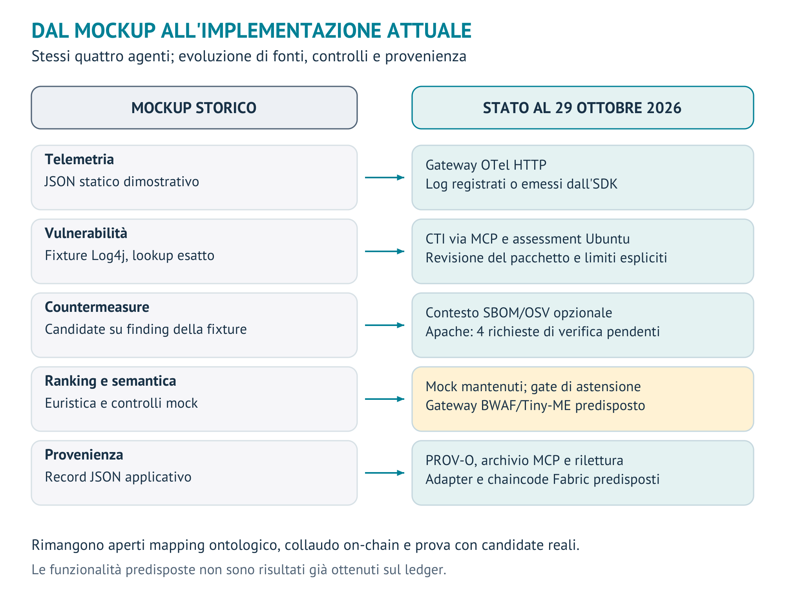

# Architettura del progetto

Aggiornamento del percorso principale: il [porting condiviso](porting-principe-costa.md)
ha reso disponibili bridge MCP e backend SaaS sui branch esterni costa-thesis.
Il collegamento al framework comprende ranking, validazione, selezione e finalizzazione
condivisa per CVE, con switch applicativo `--backend-mode mockup|real` e DAG composto.
La [guida aggiornata del percorso completo](integrazioni/strategic-selection-dag.md)
descrive dipendenze, contratti, comandi e limiti; la [finalizzazione condivisa](integrazioni/strategic-finalization.md)
verifica commit e rilettura tramite backend, collaudati con servizi simulati. Le figure del 29 ottobre
conservano lo stato precedente; per le priorita correnti leggere
[prossime azioni](prossime-azioni.md).

La mappa distingue il percorso collaudato e i collegamenti condivisi da completare.
La precedente figura del solo profilo strategico mock è conservata in
[architettura-profilo-mock.md](archivio/architettura-profilo-mock.md).
La [guida allo stato del progetto](stato-progetto.md) raccoglie confronto,
risultati e ordine di studio.

La data indica la revisione documentale. Il caso Apache con Ollama e l'ultimo
incremento Fabric descritti qui sono del **18 ottobre 2026**. Non si assume che
i servizi siano accesi oggi e non è stato eseguito un nuovo collaudo on-chain.

Versioni per il report: [SVG modificabile](materiali/architettura-aggiornata.svg)
e [PDF vettoriale](materiali/architettura-aggiornata.pdf).
La figura rappresenta componenti e dipendenze, non il BWAF del caso Apache.

## Agenti e stato condiviso

Le frecce nel DAG indicano dipendenze dati. I quattro agenti pubblicano tramite
tool nella stessa `ArtifactSession`; le loro memorie conversazionali non sono
una memoria condivisa. Lo Strategic legge separatamente i tre artefatti dei
produttori. Il report CTI non sostituisce la telemetria e la generazione delle
candidate non sostituisce il ranking o la validazione.

La Workforce contiene anche ruoli gestionali CAMEL. Gli otto artefatti principali
rimangono `runtime_evidence`, `vulnerability_report`, `candidate_strategies`,
`argumentation_graph`, `ranking`, `semantic_validation`, `final_decision` e
`provenance`. Input, snapshot, contesti, export RDF e ricevute sono file aggiuntivi.

## Profili e livello di verifica

| Profilo | Ingressi | Percorso strategico | Provenienza e verifica |
|---|---|---|---|
| Default / `backends.local-mock.json` | Input statico e fixture Log4j | Ranking e semantica mock locali | JSON e ricevuta mock |
| `backends.mcp-strategic-mock.json` | Input statico, lookup mock locale | Ranking e semantica mock su MCP HTTP | SQLite sul server mock; trasporto collaudato |
| `backends.otel-cti.json` | OTel registrato e cve2owl MCP | Tool strategici mock | Percorso di acquisizione e correlazione collaudato |
| Profilo generato dall'applicazione Java | Log SDK, SBOM della build, CTI e OSV | Tool strategici mock | Prove CAMEL programmate e Ollama; caso negativo documentato |
| `backends.otel-apache-ubuntu.json` | Log Apache verificati e inventario Ubuntu; assessment MCP | Candidate vuote e richieste pendenti; mock strategici | Collaudo programmato |
| `backends.otel-apache-strategic.json` | Stessi ingressi Apache | Gate MCP di astensione sul grafo vuoto; nessuna semantica invocata | PROV-O su file via MCP, rilettura e audit; Ollama r2 completato |
| `backends.otel-apache-fabric-provenance.json` | Stessi ingressi Apache | Mantiene l'astensione sul grafo vuoto | Adapter PROV-O/Fabric configurato; rete effettiva ancora da collaudare |

`real` nella configurazione indica il servizio atteso e deve concordare con la
risposta. Non certifica da solo l'autenticità del backend o l'esecuzione BWAF.
Il gate Apache è un servizio effettivo che si astiene, non un motore di ranking.
Un profilo configurabile non è automaticamente un esperimento già eseguito.

## Percorso Apache effettivamente collaudato

```mermaid
flowchart LR
    A["OTel registrato<br/>+ facts Ubuntu associati"] --> T["TelemetryAgent"]
    T --> V["VulnerabilityAgent<br/>assessment Ubuntu MCP"]
    V --> C["CountermeasureAgent<br/>4 richieste pendenti"]
    C --> S["StrategicAgent<br/>3 artefatti distinti in ingresso"]
    S --> R["Grafo vuoto<br/>Gate MCP di astensione"]
    R --> D["insufficient_evidence<br/>Nessuna selezione"]
    D --> P["PROV-O JSON-LD<br/>Archivio MCP + rilettura"]
```

Questo secondo diagramma sintetizza l'ordine delle attività: le dipendenze
dirette Telemetry → Countermeasure e Telemetry/Vulnerability → Strategic restano
quelle del DAG precedente. Il caso conserva 120 CVE classificate sul pacchetto
inventariato: 34 `fixed`, 28 `not_affected`, 46 `potentially_affected`, 12 `unknown`.
I facts successivi ai log non attestano lo stato storico del processo.

Il contratto restituisce `not_evaluable`, che la sessione traduce in
`insufficient_evidence`. Le quattro richieste interessano 58 CVE uniche e
restano fuori da strategie e ranking. Il run non seleziona né esegue azioni.
Il servizio semantico non viene chiamato, anche se il profilo conserva un
backend locale per compatibilità. Dettagli: [prova Ollama](esperimenti.md).

## Percorso strategico condiviso e profilo nativo

Bridge MCP e backend SaaS sono stati importati nei due repository esterni su
`costa-thesis`: compilazione, discovery e 66 test del backend sono passati.
I test simulano Fabric. Il framework usa ora il client condiviso dal profilo
Strategic nativo sul checkpoint canonico: ranking e due riletture per CVE,
score originali, binding MAS/KG e pin di tenant/snapshot/ontologia.
[Contratto e limiti](integrazioni/strategic-native.md).

I tool principali sono `rank_remediations`, `validate_countermeasure`,
`get_decision` e `get_provenance`. Lo Strategic usa contratti di dominio;
la configurazione Fabric rimane nel backend. Il mapping canonico e implementato;
Il [profilo di validazione](integrazioni/strategic-validation.md) invia ora IRI e
contesto operativo, con esiti Tiny-ME e policy SaaS separati. Restano selezione
e inserimento nel DAG principale.
I binding configurabili dei chaincode e `ExplainAffinity` sono stati corretti il
31 ottobre e collaudati con Fabric simulato. Deployment, ontologia e TLS reali
richiedono ancora verifica.

La lettura della provenance applicativa non dimostra da sola il commit della
raccomandazione finale sul ledger. Finalizzazione, ricevuta e rilettura devono
essere collaudate. Le azioni rimangono raccomandazioni in dry-run.

Il precedente [gateway Fabric sperimentale](archivio/fabric-native-integration.md)
e il chaincode PROV-O dedicato rimangono conservati per confronto, con i relativi
test; non sono il percorso principale di integrazione. Dettagli del trasferimento
nel [porting verificato](porting-principe-costa.md).

## Differenze rispetto al mockup e lavoro aperto

Sono cambiati soprattutto ingressi, contratti, controllo delle pubblicazioni e
provenienza. Restano quattro agenti e lo stesso DAG. I backend mock sono ancora
disponibili per i confronti storici e per i rami non sostituiti.

Restano collegamento MCP condiviso, integrazione del componente generativo,
adapter canonico, ranking/validazione reali e provenance con commit e rilettura.
Seguono quattro scenari controllati, dashboard ed esperimenti, secondo la
[roadmap](prossime-azioni.md). Raccolta continua e applicazione automatica delle
contromisure non sono requisiti della dimostrazione finale in dry-run.

Riferimenti per studiare: [stato del progetto](stato-progetto.md),
[guida al codice](reading-guide.md), [contratti](tecnica/architecture.md),
[report aggiornato](materiali/aggiornamento-relazione-20261029.md).
