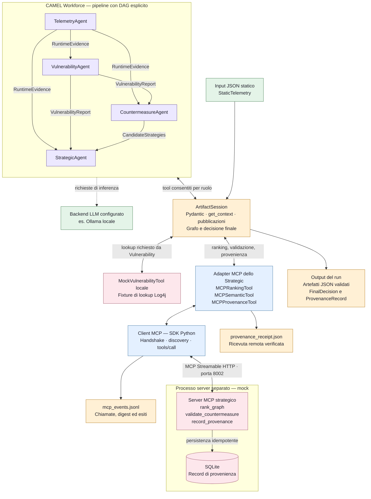
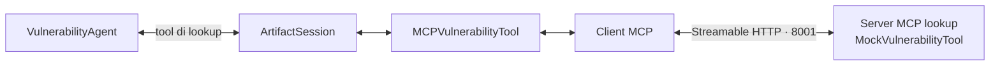

# Architettura attualmente implementata

Il grafo rappresenta `--mode camel --workflow pipeline` con il profilo
`config/backends.mcp-strategic-mock.json`: lookup locale e tre backend dello
Strategic su MCP. È un profilo implementato e collaudato; il default senza
`--backends` rimane interamente locale. Il diagramma non attesta che i server
siano attualmente accesi.

È disponibile anche il [profilo cve2owl reale](cti-workforce.md): usa un servizio
CTI MCP separato per il lookup e mantiene locali i mock strategici. Il diagramma
seguente continua a rappresentare specificamente il profilo strategico mock.

Il [profilo OTel + CTI](opentelemetry-integration.md#flusso-implementato) aggiunge
un ingresso HTTP per il TelemetryAgent, con export registrati del Collector
della baseline e snapshot validati. Il collegamento è separato dal MCP Tool
Layer dello Strategic; il relativo grafo è nella guida dedicata.

L'[ingresso SBOM/OSV](sbom-osv-integration.md#architettura-e-responsabilità)
aggiunge al CountermeasureAgent un contesto da gateway HTTP. Il profilo
`backends.cti-sbom-osv.json` usa CTI e OSV reali con SBOM dimostrativa e
telemetria statica; non modifica il diagramma del profilo strategico mock qui sotto.

La [demo con applicazione osservata](observed-app-integration.md) combina log
SDK e SBOM della stessa build con CTI e OSV reali. La relativa
[inferenza Ollama](observed-app-ollama.md) è conclusa e verificata, con decisione
`no_findings`, retry qualitativi e una chiamata errata respinta. Anche quel
profilo mantiene i tool strategici mock, locali.

Le frecce tra agenti rappresentano **dipendenze dati**, non messaggi che
sostituiscono gli output precedenti. Gli agenti pubblicano nella stessa
`ArtifactSession` e leggono tramite `get_context()`. La memoria conversazionale
dei ChatAgent non è condivisa: lo stato autorevole comune è la sessione.

Telemetry produce `RuntimeEvidence`. Vulnerability lo usa per il lookup e
pubblica un `VulnerabilityReport` separato. Countermeasure usa entrambi per
generare `CandidateStrategies`. Strategic legge tutti e tre, costruisce il
grafo tramite il tool locale, richiede ranking e validazioni, pubblica la
decisione e infine registra la provenienza.

Nel riquadro CAMEL sono mostrati i quattro ruoli di dominio. La Workforce ha
anche agenti gestionali dell'SDK per coordinamento e assegnazione; non sono
ulteriori produttori di evidenze di dominio.

Il server MCP riusa `MockRankingTool` e `MockSemanticTool`. Il ranking è
l'euristica dimostrativa a un passo; la validazione verifica capacità e policy.
La registrazione scrive il documento JSON in SQLite e restituisce una ricevuta
mock. Nel profilo rappresentato, il processo degli agenti chiama queste tre
operazioni tramite contratti pubblici senza eseguirne localmente i backend.

## Profili alternativi implementati

La selezione avviene in `backends.py`, prima di avviare la Workforce. Ogni
servizio può avere un proprio endpoint; nel profilo illustrato i tre tool
strategici condividono il server ma hanno sessioni client MCP distinte.

| Profilo in `config/` | Lookup | Ranking e validazione | Provenienza |
|---|---|---|---|
| Nessun profilo, oppure `backends.local-mock.json` | Mock locale | Mock locali | JSON locale |
| `backends.mcp-mock.json` | Server MCP mock, porta 8001 | Mock locali | JSON locale |
| **`backends.mcp-strategic-mock.json`** | **Mock locale** | **Server MCP mock, porta 8002** | **SQLite sul server e ricevuta locale** |
| `backends.mcp-all-mock.json` | Server MCP mock, porta 8001 | Server MCP mock, porta 8002 | SQLite sul server e ricevuta locale |

Nel profilo `all-mock` il ramo del lookup diventa:

Gli altri collegamenti restano quelli del grafo principale. `all-mock` riguarda
i quattro backend attualmente configurabili, non tutti i servizi dell'architettura
finale della tesi. La modalità `fixtures` è invece una prova deterministica
senza CAMEL/LLM e accetta soltanto backend locali.

## Confine con l'architettura finale

Sono collegati ingressi OTel delimitati, il servizio cve2owl sullo snapshot
reale e SBOM/OSV per un componente Maven. Questo non comprende monitoraggio
continuo, ragionamento OWL completo o valutazione di tutto l'inventario.
Non sono ancora collegati Argumentation SC, Semantic Validation SC/Tiny-ME
e Hyperledger Fabric reali.
`ProvenanceRecord` non è ancora un documento PROV-O; SQLite non rappresenta
Fabric. La decisione seleziona una mitigazione ma non la applica al sistema.
Non sono implementati store/retrieve remoto degli asset generici né feedback
runtime dell'azione applicata.

## Corrispondenza con il codice

| Elemento | Implementazione |
|---|---|
| CLI e creazione del run | [main.py](../thesis_agents/main.py) |
| Agenti, scheduling e DAG | [workforce.py](../thesis_agents/orchestration/workforce.py) e [agents/](../thesis_agents/agents/) |
| Stato validato, contesto e tool | [artifacts.py](../thesis_agents/orchestration/artifacts.py) |
| Pubblicazioni strutturate per CAMEL | [publication_tools.py](../thesis_agents/orchestration/publication_tools.py) |
| Selezione e connessione dei backend | [backends.py](../thesis_agents/backends.py) |
| Adapter strategici | [strategic_mcp.py](../thesis_agents/tools/strategic_mcp.py) |
| Client e contratti MCP | [client.py](../thesis_agents/mcp/client.py), [contracts.py](../thesis_agents/mcp/contracts.py) |
| Server strategico e persistenza mock | [strategic_mock_server.py](../thesis_agents/mcp/strategic_mock_server.py) |
| Server di lookup opzionale | [mock_server.py](../thesis_agents/mcp/mock_server.py) |

Avvio, test e ricevute sono descritti nella [guida MCP dello Strategic](mcp-strategic.md).
Il grafo descrive il profilo strategico mock implementato; non è una figura
ripresa da un paper. I backend reali dei profili alternativi sono rappresentati
nelle guide degli ingressi collegate sopra.
