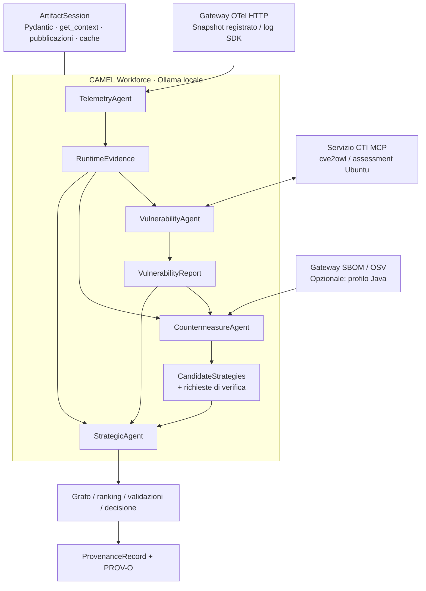
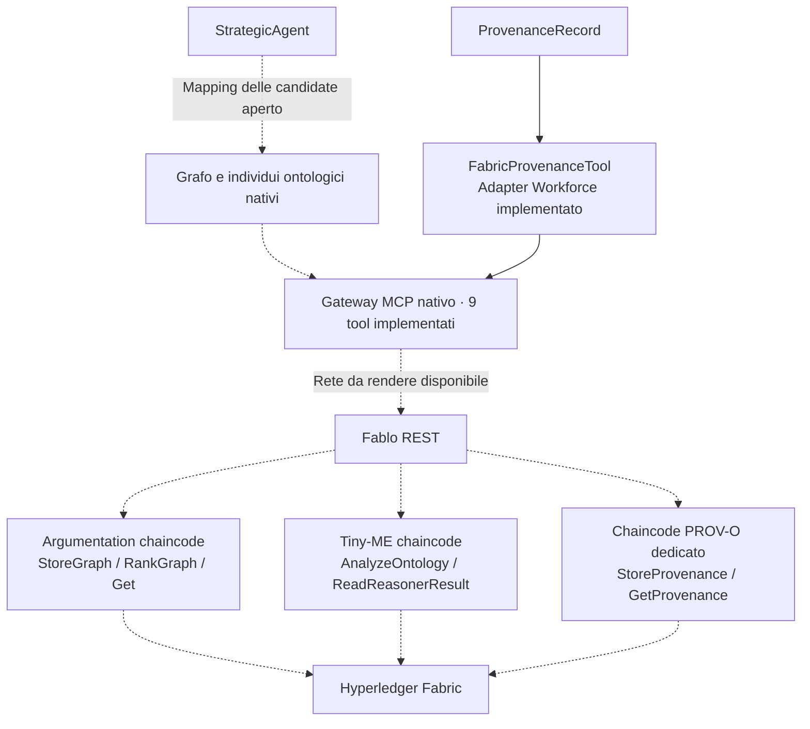

# Architettura implementata al 29 ottobre 2026

Questa è la mappa corrente dei componenti, aggiornata rispetto al mockup.
La precedente figura del solo profilo strategico mock è conservata in
[architettura-profilo-mock.md](architettura-profilo-mock.md).
La [guida allo stato del progetto](stato-progetto.md) raccoglie confronto,
risultati e ordine di studio.

La data indica la revisione documentale. Il caso Apache con Ollama e l'ultimo
incremento Fabric descritti qui sono del **18 ottobre 2026**. Non si assume che
i servizi siano accesi oggi e non è stato eseguito un nuovo collaudo on-chain.

Versioni per il report: [SVG modificabile](materiali/architettura-aggiornata.svg)
e [PDF vettoriale](materiali/architettura-aggiornata.pdf).
La figura rappresenta componenti e dipendenze, non il BWAF del caso Apache.

## Agenti e stato condiviso

Le frecce nel DAG indicano dipendenze dati. I quattro agenti pubblicano tramite
tool nella stessa `ArtifactSession`; le loro memorie conversazionali non sono
una memoria condivisa. Lo Strategic legge separatamente i tre artefatti dei
produttori. Il report CTI non sostituisce la telemetria e la generazione delle
candidate non sostituisce il ranking o la validazione.

La Workforce contiene anche ruoli gestionali CAMEL. Gli otto artefatti principali
rimangono `runtime_evidence`, `vulnerability_report`, `candidate_strategies`,
`argumentation_graph`, `ranking`, `semantic_validation`, `final_decision` e
`provenance`. Input, snapshot, contesti, export RDF e ricevute sono file aggiuntivi.

## Profili e livello di verifica

| Profilo | Ingressi | Percorso strategico | Provenienza e verifica |
|---|---|---|---|
| Default / `backends.local-mock.json` | Input statico e fixture Log4j | Ranking e semantica mock locali | JSON e ricevuta mock |
| `backends.mcp-strategic-mock.json` | Input statico, lookup mock locale | Ranking e semantica mock su MCP HTTP | SQLite sul server mock; trasporto collaudato |
| `backends.otel-cti.json` | OTel registrato e cve2owl MCP | Tool strategici mock | Percorso di acquisizione e correlazione collaudato |
| Profilo generato dall'applicazione Java | Log SDK, SBOM della build, CTI e OSV | Tool strategici mock | Prove CAMEL programmate e Ollama; caso negativo documentato |
| `backends.otel-apache-ubuntu.json` | Log Apache verificati e inventario Ubuntu; assessment MCP | Candidate vuote e richieste pendenti; mock strategici | Collaudo programmato |
| `backends.otel-apache-strategic.json` | Stessi ingressi Apache | Gate MCP di astensione sul grafo vuoto; nessuna semantica invocata | PROV-O su file via MCP, rilettura e audit; Ollama r2 completato |
| `backends.otel-apache-fabric-provenance.json` | Stessi ingressi Apache | Mantiene l'astensione sul grafo vuoto | Adapter PROV-O/Fabric configurato; rete effettiva ancora da collaudare |

`real` nella configurazione indica il servizio atteso e deve concordare con la
risposta. Non certifica da solo l'autenticità del backend o l'esecuzione BWAF.
Il gate Apache è un servizio effettivo che si astiene, non un motore di ranking.
Un profilo configurabile non è automaticamente un esperimento già eseguito.

## Percorso Apache effettivamente collaudato

```mermaid
flowchart LR
    A["OTel registrato<br/>+ facts Ubuntu associati"] --> T["TelemetryAgent"]
    T --> V["VulnerabilityAgent<br/>assessment Ubuntu MCP"]
    V --> C["CountermeasureAgent<br/>4 richieste pendenti"]
    C --> S["StrategicAgent<br/>3 artefatti distinti in ingresso"]
    S --> R["Grafo vuoto<br/>Gate MCP di astensione"]
    R --> D["insufficient_evidence<br/>Nessuna selezione"]
    D --> P["PROV-O JSON-LD<br/>Archivio MCP + rilettura"]
```

Questo secondo diagramma sintetizza l'ordine delle attività: le dipendenze
dirette Telemetry → Countermeasure e Telemetry/Vulnerability → Strategic restano
quelle del DAG precedente. Il caso conserva 120 CVE classificate sul pacchetto
inventariato: 34 `fixed`, 28 `not_affected`, 46 `potentially_affected`, 12 `unknown`.
I facts successivi ai log non attestano lo stato storico del processo.

Il contratto restituisce `not_evaluable`, che la sessione traduce in
`insufficient_evidence`. Le quattro richieste interessano 58 CVE uniche e
restano fuori da strategie e ranking. Il run non seleziona né esegue azioni.
Il servizio semantico non viene chiamato, anche se il profilo conserva un
backend locale per compatibilità. Dettagli: [prova Ollama](apache-ollama-use-case.md).

## Nuovo collegamento Fabric: implementato e da collaudare

I nove tool implementati coprono grafo, ranking, recupero dei risultati,
abduzione/bonus/contrazione Tiny-ME e provenienza. Gateway e adapter sono
verificati con Fablo HTTP simulato, MCP effettivo e stub Fabric; il chaincode
PROV-O è compilato anche per Linux amd64. Nessuna ricevuta on-chain è stata
generata nelle prove documentate. L'ultima verifica della disponibilità di rete
è del 18 ottobre: Docker e Fablo sulle porte 8800/8801 non erano raggiungibili.

Il formato nativo `nodes(id,type)` / `edges(from,to)` non rappresenta direttamente
segno e pesi del grafo MVP. Non viene quindi applicata una conversione implicita.
Gli score nativi sono conservati senza normalizzazione a `[0,1]`.
La coerenza di un'ontologia Tiny-ME non equivale all'accettazione di una strategia.
Il tool nativo `analyze_ontology` non è ancora il validatore di dominio delle
candidate nella Workforce.

L'adapter Fabric della provenienza verifica canale, chaincode, documento,
hash e ID della transazione, poi effettua una nuova lettura MCP. La ricevuta
prevista dichiara `peer_readback_verified`, con `block_commit_verified=false`:
rilettura dal peer e verifica indipendente del commit sono livelli distinti.
Questa logica è collaudata con servizi simulati, non ancora sul deployment reale.
Dettagli: [integrazione nativa Fabric](fabric-native-integration.md).

## Differenze rispetto al mockup e lavoro aperto

Sono cambiati soprattutto ingressi, contratti, controllo delle pubblicazioni e
provenienza. Restano quattro agenti e lo stesso DAG. I backend mock sono ancora
disponibili per i confronti storici e per i rami non sostituiti.

Restano da completare rete e deployment Fabric, probe nativo effettivo, mapping
ontologico e una prova con candidate non vuote e validazione reale. Seguono
il caso controllato con fonti coerenti e la valutazione comparativa. Sono
proposte, non funzionalità già realizzate: scelta di piani di verifica,
raccolta continua, attuazione delle mitigazioni e feedback dell'azione.

Riferimenti per studiare: [stato del progetto](stato-progetto.md),
[guida al codice](reading-guide.md), [contratti](architecture.md),
[report aggiornato](materiali/aggiornamento-relazione-20261029.md).
