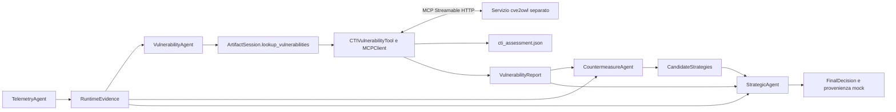

# cve2owl nella Workforce CAMEL

Il profilo `config/backends.cti-real.json` collega il VulnerabilityAgent al
servizio MCP `assess_software` della copia di
`agent-based-cti-argumentation-pipeline`, branch `costa-thesis`. Il processo
`tesi` conserva soltanto il contratto pubblico, il client e il mapping degli
artefatti: non importa il matcher, non legge SQLite e non avvia il backend.

Il default senza `--backends` rimane il mock locale. Il nuovo profilo usa CTI
reale e ranking, validazione e provenienza mock locali. CAMEL mantiene quattro
ruoli, `pipeline` e lo stesso DAG; cambiano il backend del lookup e la capacità
dei contratti di rappresentare dati incompleti.

## Flusso e contratti



Il tool chiamato dall'agente continua a ricevere `{}`. La sessione ricava
`package`, `version` ed `evidence_id` da `RuntimeEvidence`, li invia immutati
al servizio e restituisce un report da pubblicare esattamente. Non sono
implementati alias automatici, arricchimento vendor, purl o correzioni delle
regole di versione. I nomi canonici usati nelle prove sono **input distinti**,
non sostituzioni implicite di `log4j-core`.

`CTIVulnerabilityTool` usa `cve2owl-assessment-v1`, con mapping locale identificato
da `cve2owl-to-vulnerability-v1`. È una policy conservativa del prototipo,
non un nuovo algoritmo scientifico di matching. Un solo candidato restituito,
con confidenza `high`, consente di trattare l'identità come risolta nel risultato
della ricerca. Non prova che il dataset contenga tutte le identità possibili.

| `lookup_status` | Condizione del mapping | Decisione senza candidate |
|---|---|---|
| `matched` | Identità risolta e almeno una regola valutata che conferma un finding | La scelta segue ranking e validazione |
| `ambiguous` | Più identità o candidato non `high` | `insufficient_evidence` |
| `no_match` | Nessuna identità restituita | `insufficient_evidence` |
| `not_evaluable` | Identità risolta, nessun finding confermato e regole insufficienti per un esito negativo completo | `insufficient_evidence` |
| `no_findings` | Identità risolta, regole presenti e tutte valutate, nessun finding nelle voci restituite | `no_findings` |
| `unsupported` | Esito storico del lookup mock non coperto | `insufficient_evidence` |

Una regola positiva può fondare un finding anche quando altre regole restano
non valutabili: il report conserva `rule_coverage=partial`. Al contrario,
un aggregato negativo con regole non valutabili non diventa `no_findings`.
Nessuno degli esiti certifica l'assenza globale di vulnerabilità.

CVSS e confidenza numerica assenti sono `null`; CWE assenti sono `[]` e
`cti.missing_metadata` ne esplicita la mancanza. La confidenza categoriale e lo
score del matcher rimangono separati, senza convertirli in probabilità.
Gli artefatti mock storici restano leggibili con `cti=null` implicito e i loro
metadati numerici obbligatori.

I contratti MCP precedenti sono congelati in `mcp/v1_domain.py`; un test
confronta gli hash degli schemi di lookup, ranking, semantica e provenienza.
Il profilo cve2owl **richiede per ora `semantic: local-mock`**: il contratto
`semantic-validation-v1` non rappresenta il report esteso. La configurazione
rifiuta l'accoppiamento incompatibile, senza eliminare metadati per farlo
passare. Un futuro servizio semantico CTI richiederà un contratto versionato.

## Evidenze e controlli

- `cti_assessment.json`: risposta strutturata completa e validata del servizio,
  con candidati, regole, IRI, riferimenti al dataset e hash del motore.
- `vulnerability_report.json`: finding e sintesi `cti`, con identificazione,
  copertura, valutazioni CVE, metadati mancanti e riferimento/hash dello snapshot.
- `mcp_events.jsonl` e `backends.json`: chiamate, esiti tecnici, digest e profilo.
- `provenance.json`: include lo snapshot come entità e una dipendenza dal lookup;
  resta un audit JSON mock, senza PROV-O, firma o ricevuta Fabric.

La discovery verifica gli schemi. Prima di accettare una risposta vengono
controllati richiesta, osservazione, tipo di backend/dataset, identità e
riferimenti CVE coerenti fra matching e valutazione. Il profilo reale fissa
anche lo SHA-256 del dataset atteso. Gli hash dichiarati dal server sono
controlli di coerenza, non attestazioni indipendenti della sua autenticità.

`ArtifactSession` verifica che lo snapshot rimanga coerente con il report alla
pubblicazione, alla decisione, alla provenienza e al controllo finale. Lo
Strategic riceve separatamente i tre artefatti originali tramite `get_context`.
Con finding vuoti vengono pubblicate candidate vuote, ranking vuoto e report
semantico vuoto; non si inventano contromisure né si richiedono validazioni
senza candidati. Un errore MCP non viene convertito in un esito di dominio e
non attiva fallback locale.

## Comandi

Dal repository del backend, con l'ambiente dedicato descritto in
[owl-cti-integration.md](owl-cti-integration.md):

```sh
PYTHONPATH=app/src app/.venv/bin/python -m cti_mcp.server \
  --sqlite app/data/cve2owl_20260523_143950.affected.sqlite \
  --dataset-id cve2owl_20260523_143950 --dataset-kind real --port 8003
```

Per il collaudo locale già eseguito è stato usato l'interprete
`/Users/reucalion/tesi/.venv/bin/python` al posto di `app/.venv/bin/python`.
È comunque un processo separato. L'ambiente dedicato resta da verificare.

Dalla radice di `tesi`, discovery senza inferenza:

```sh
.venv/bin/python -m thesis_agents.mcp.probe \
  --backends config/backends.cti-real.json --check-config
```

Lookup con mapping nel contratto di dominio, senza agenti o LLM:

```sh
.venv/bin/python -m thesis_agents.mcp.probe \
  --backends config/backends.cti-real.json \
  --package 'Apache Log4j Core' --version 2.14.1 \
  --output-dir output/cti-adapter-probe-01
```

Collaudo CAMEL con inferenza programmata, cinque casi e artefatti separati:

```sh
.venv/bin/python tests/support/cti_workforce_smoke.py \
  --backends config/backends.cti-real.json
```

Questo runner richiede le dipendenze di sviluppo e il servizio già acceso.
Non esegue inferenza LLM e le candidate prefissate non sono raccomandazioni
di aggiornamento per le CVE reali. La CLI applicativa rimane distinta:

```sh
.venv/bin/python main.py --mode camel --workflow pipeline \
  --backends config/backends.cti-real.json --output output/cti-ollama-01
```

L'ultimo comando usa il modello configurato in `.env`: per inferenza locale
serve Ollama configurato come nella [guida principale](../README.md).
Senza `--input` viene usato `log4j-core 2.14.1`, per cui il lookup osservato
è ambiguo; un run concluso con `insufficient_evidence` è coerente con questi dati.
I comandi con output richiedono directory nuove. La modalità `fixtures` resta
senza rete e non accetta questo profilo MCP.

## Risultati verificati

La suite completa conclude con **187 test superati**; Ruff e formattazione
sono verificati. I test HTTP automatici usano un server di replay dichiarato
mock. Il collaudo aggiuntivo ha invece attraversato CAMEL e il servizio sul
dataset reale, conservando `model=scripted-test-only` e `llm_used=false`:

[summary.json](../output/cti-workforce-20261006T085138Z-ab450b7a/summary.json).

| Osservazione di test | Lookup | Decisione |
|---|---|---|
| `log4j-core 2.14.1` | `ambiguous` | `insufficient_evidence` |
| `Apache Log4j2 2.14.1` | `not_evaluable` | `insufficient_evidence` |
| `Apache Log4j Core 2.14.1` | `matched`, tre finding | `selected`, su candidate e tool strategici di prova |
| `Apache Log4j Core 2.25.4` | `no_findings` | `no_findings` |
| Prodotto di test assente | `no_match` | `insufficient_evidence` |

Per ogni caso sono salvati artefatti, audit MCP, log e `strategic_context.json`.
Il modello programmato non copre l'analisi qualitativa gestionale dell'SDK:
CAMEL emette avvisi e usa il proprio fallback per quella valutazione. La prova
si fonda sulla pubblicazione validata, sulle risposte HTTP e sul contenuto
effettivamente ricevuto dagli agenti, non sui quality score del gestore.

La prova non misura l'affidabilità dell'LLM né l'efficacia delle strategie.
Il successivo [collaudo Ollama combinato](observed-app-ollama.md) usa lo stesso
adapter CTI insieme a log SDK e SBOM della medesima applicazione: ha concluso
con `no_findings`, artefatti validi e criticità gestionali documentate. Non è
una ripetizione LLM dei cinque casi della tabella. OpenTelemetry e SBOM/OSV
sono descritti nelle rispettive guide; ragionamento OWL completo,
Argumentation SC, Tiny-ME, ledger reale, PROV-O e mitigazioni restano successivi.

Le fonti del servizio e i limiti del dataset sono documentati in
[integrazione cve2owl](owl-cti-integration.md) e
[primo collaudo reale](cti-real-runs.md). Il mapping descritto qui è una scelta
implementativa originale del prototipo e non viene attribuito a un paper.
