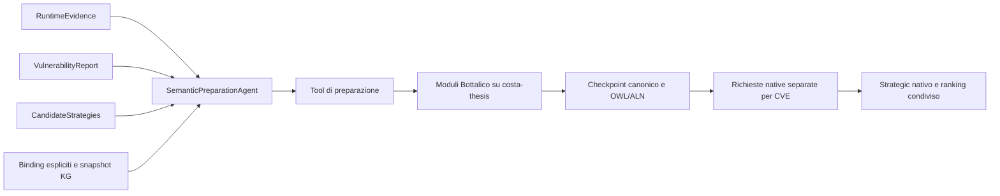

# Checkpoint di preparazione semantica e grafo canonico

Implementato il 1 novembre 2026. Il checkpoint riusa i moduli Bottalico
identificati nell'[ispezione](../../output/generator-inspection-20261031/report.md)
e produce richieste native per CVE, conservando il collegamento agli artefatti MAS.

## Ruolo e confine del lavoro

`SemanticPreparationAgent` legge `runtime_evidence`, `vulnerability_report` e
`candidate_strategies`, poi chiama `prepare_argumentation` senza argomenti.
I binding e i percorsi sono impostati dall'operatore prima dell'esecuzione.
Il tool coordina asserzioni OWL, grafo e proiezione ALN deterministici.
L'estrazione LLM degli asset resta a monte; questa fase non la ripete.

Il ruolo CAMEL e il suo contratto sono in `thesis_agents/canonical/agent.py`, il
prompt in `thesis_agents/agents/semantic_preparation.py`. I cloni hanno soltanto
`get_context` e `prepare_argumentation`, con ordine imposto dalla policy.
Il testo del modello non pubblica il checkpoint.



E un checkpoint autonomo, eseguibile anche da artefatti precedentemente salvati.
Il percorso mock conserva i quattro ruoli esistenti. Il checkpoint e ora
consumato dal [profilo Strategic nativo](strategic-native.md) per ranking e riletture
per CVE; dal 3 novembre validazione e selezione sono collegate nel
[DAG del comando principale](strategic-selection-dag.md). Il checkpoint
non sceglie una contromisura e non pubblica una decisione o una ricevuta ledger.

## Porting sui repository esterni

Ogni integrazione esterna e applicata esclusivamente su **costa-thesis**, come
richiesto dall'utente. I riferimenti `origin/main` e `origin/principe-thesis` sono
soltanto fonti. Nessun commit, push o cambio di branch e stato effettuato.

Nella pipeline e aggiunta la directory isolata `app/semantic_preparation/`:

- cinque file originali copiati dal commit `090b6844d95841e01046c60d18af049ceb03d9fd`;
- `upstream-manifest.json` con provenienza e hash dei file originali;
- `runner.py`, schema della richiesta, README e manifest dell'installazione.

I cinque file sono i costruttori OWL/grafo, lo script ALN e i due helper delle
metriche importati da quest'ultimo. I loro byte sono quelli della sorgente.
I moduli esistenti in app/src, Identity/Ubuntu, l'estrattore, il bridge e le
credenziali sono preservati. Il runner e l'adapter verificano il branch
`costa-thesis`; ogni invocazione verifica anche manifest, file e digest del KG.

Nel ledger sono ripristinati i due archi mancanti di `graph_test_4_reordered.json`
e corretti i conteggi del grafo 1 nel README. La coppia 4 contiene ora gli stessi
43 archi. Le versioni precedenti sono conservate nei backup dell'applicazione.

## Contratti e binding

La richiesta `semantic-preparation-v1` comprende:

| Campo | Responsabilita |
| --- | --- |
| run_id, asset_id | Correlazione del checkpoint; il run ID e confrontato con provenance quando presente |
| input_digests | SHA-256 dei byte dei tre artefatti MAS, tutti obbligatori |
| assessments | Dati selezionati dell'assessment: asset, match high, CVE e versioni valutate/confermate |
| bindings | Tuple CVE, ID candidata MAS, individuo ontologico esatto |

L'adapter rilegge i tre file, ne verifica hash e schemi e controlla identita
dell'asset, osservazione software/versione/evidenza e insieme delle CVE confermate.
Richiede la copertura esatta delle coppie candidata/CVE del MAS e delle strategie
Solutions/Workarounds trovate nel KG. Una proposta priva di binding o una strategia
KG omessa causa un errore; non avviene associazione per nome simile o sottostringa.

Il generatore controlla inoltre che gli individui affected appartengano alla CVE
e che i riferimenti version siano collegati esplicitamente agli affected nel KG.
Il verdetto sulle versioni viene riusato dal report/assessment fornito: il
checkpoint non ricalcola il matcher CTI e non dimostra da solo la correttezza di
un binding configurato dall'operatore. Origine e digest restano nell'artefatto.

Dal 6 novembre il profilo accetta anche `ranking_ontology_version`: riferimento
operatore all'ontologia effettivamente distribuita e leggibile dal SaaS, inoltrato
nel campo gia esistente `ontology_version` delle richieste canoniche. Evita che
il SaaS calcoli l'assurance sul file di benchmark predefinito quando il processo
nativo usa una proiezione diversa. Il percorso del processo argumentation e
configurabile tramite `ARGUMENTATION_ONTOLOGY_PATH` sul costa-thesis, con default
originale preservato. I digest ricevuti restano controllati dal framework.

La proiezione ALN contiene individui CVE e rimedi, non l'asset osservato. Le
asserzioni `observed_assets.owl` gia prodotte dal generatore possono essere
distribuite insieme alla proiezione per rendere disponibile quell'individuo:
non aggiungono automaticamente un profilo ALN dell'asset o nuove semantiche
d'azione. Gli esiti Tiny-ME mancanti restano prerequisiti, non accettazioni.

Nel raccordo automatico successivo il CountermeasureAgent dovra conoscere le
remediation del KG prima di proporre le candidate: una proposta libera come
"monitorare" non riceve automaticamente un individuo ontologico equivalente.
La copertura esatta richiesta qui rende visibili queste corrispondenze mancanti.

Gli ID MAS non vengono rinominati nel checkpoint. Il grafo inviabile al servizio
usa gli ID degli individui KG, conservando la tabella esplicita di corrispondenza.
Questo evita di chiedere al reasoner descrizioni ontologiche di ID locali come
S_UPGRADE che non siano presenti nella conoscenza distribuita.

## Semantica della rappresentazione canonica

Il profilo di topologia e **bottalico-directed-ring-v1**, fedele al generatore
selezionato. Ogni grafo contiene una CVE e le sue strategie del KG.

- Gli archi CVE -> strategia sono tratti da hasSolutions/hasWorkarounds e marcati
  `origin: kg_remediation`.
- Gli archi fra strategie formano l'anello diretto ordinato per ID del generatore
  e sono marcati `origin: generator_comparison_ring`. Sono confronti introdotti
  dalla policy topologica; non dimostrano una relazione operativa fra due azioni.
- Ogni arco porta `polarity: deferred_to_shared_reasoner`. Il checkpoint non
  attribuisce segni di supporto/attacco o pesi numerici e non importa le stime
  security_benefit/operational_impact del modello come pesi BWAF.

Nodi, archi e richieste vengono ordinati canonicamente senza cambiare la topologia.
Restano distinte la rappresentazione verificata e la validazione scientifica della
topologia: il consolidamento offline del 5 novembre ha qualificato l'anello come
policy sperimentale dipendente dagli ID, con aspettative documentate per i cinque
casi e per il caso simmetrico. La validazione nel dominio e il ranking numerico
reale restano aperti. Il costruttore automatico SaaS usa una direzione opposta; le richieste del
checkpoint includono quindi sempre il grafo esplicito.

La demo produce quattro candidate con la stessa descrizione ALN asserita: verifica
il collegamento, ma non una preferenza semantica fra azioni diverse. Runtime e
vincoli non sono ancora nodi autonomi del BWAF. La
[guida scientifica](../tecnica/consolidamento-scientifico-grafo.md) distingue questi
limiti dal corretto funzionamento di binding, selezione e provenance.

L'artefatto dichiara `backend_weights: not_computed` e `deployment_verified: false`.

Anche con una sola strategia il checkpoint esporta il grafo senza attribuire uno
score convenzionale 1.0. Il client storico Bottalico trattava questo caso fuori
dal ranking remoto: il comportamento del backend con quel grafo dovra essere
collaudato nella verifica reale finale, mantenendo esplicita l'origine degli score.

L'ALN generato e il KG sorgente hanno digest distinti. La corrispondenza con
ontologia distribuita, snapshot attivo e IRI della validazione Tiny-ME dovra
essere verificata nel collaudo live. Il contratto di validazione con IRI e
contesto operativo e implementato: [guida](strategic-validation.md). La policy
SaaS non dimostra da sola che gli stessi vincoli siano rappresentati nell'ontologia.

## Esecuzione

Il profilo `config/canonical-preparation.example.json` indica repository,
interprete Python, KG sorgente, digest, snapshot e timeout. Sostituire il digest
del KG composto da zeri con quello effettivo e verificare il percorso del file.
Il manifest del generatore e gia fissato al porting applicato; la libreria
jsonschema e disponibile nel venv del framework usato dall'esempio.

```bash
.venv/bin/python -m thesis_agents.canonical \
  --source-run /percorso/run-MAS \
  --request /percorso/preparation-request.json \
  --profile config/canonical-preparation.example.json \
  --output output/preparazione
```

La directory di output deve essere nuova. `--mode tool`, predefinito, esegue il
generatore reale senza inferenza; `--mode camel` usa il nuovo agente e il modello
configurato in .env. L'interprete esterno e un processo senza shell, con ambiente
essenziale; i timeout terminano il processo. Questa e un'invocazione locale del
generatore riutilizzato. Ranking e validazione mantengono il collegamento MCP/SaaS
gia implementato; il ranking e ora raccordato dal profilo Strategic nativo.

Sono conservati:

- copie dei tre artefatti di ingresso, richiesta e profilo;
- risposta originale del processo, stderr e audit con digest/esito;
- `observed_assets.owl`, frammento ABox, e `aln_ontology.owl`, proiezione ALN;
- `canonical_preparation.json`, pubblicato soltanto dopo generazione e controlli;
- `ranking-requests/<CVE>.json`, payload nativi per rank_remediations.

Le richieste esportate sono preparate; la loro presenza non certifica che il KG
generato sia stato distribuito al backend. Il checkpoint non invoca automaticamente
il servizio di ranking. La rilettura ricontrolla i file semantici, i payload e gli
artefatti MAS; la ripetizione restituisce il checkpoint gia pubblicato.

## Verifica di questo incremento

28 test nuovi: processo reale con moduli originali, CAMEL programmato e cloni,
piu CVE, ordinamento, binding errati, sorgenti cambiati, branch errato, timeout e
assenza di pubblicazioni dopo guasti. La CLI e inoltre eseguita contro il modulo
installato nel repository esterno costa-thesis su KG e ingressi sintetici:
una CVE, quattro strategie, cinque nodi e otto archi. Nessuna nuova inferenza
LLM, chiamata di rete/Fabric o valutazione dei pesi.

Evidenze: `output/canonical-preparation-20261101/`, inclusi piano/applicazione,
backup, demo, log dei test e manifest. Il primo tentativo dei test aggiuntivi e
conservato; due errori d'import del test sono stati corretti prima dell'applicazione.
