# Strategic e ranking canonico condiviso

Implementato il 1 novembre 2026. Il profilo nativo dello **StrategicAgent** consuma
il [checkpoint canonico](canonical-preparation.md), invia le richieste per CVE al
client MCP condiviso e pubblica `native_strategic_ranking.json`. I punteggi restano
quelli del servizio, senza normalizzazione in [0,1] o ordinamento per ID MAS.

```mermaid
flowchart LR
  P[Checkpoint canonico e tre input MAS] --> S[StrategicAgent: profilo nativo]
  S --> R[rank_remediations: una CVE per richiesta]
  R --> M[MCP stdio condiviso]
  M --> B[SaaS e servizi di dominio]
  B --> D[get_decision e get_provenance]
  D --> C[Checkpoint ranking nativo con binding MAS/KG]
  C -. fase successiva .-> V[Vincoli operativi, validazione e selezione]
```



## Contratto e responsabilita

`thesis_agents/strategic/agent.py` definisce il contratto dello stesso ruolo
Strategic, il costruttore CAMEL e la policy. Il prompt e in `agents/strategic_native.py`.
La sessione espone un tool per operazione; il modello passa soltanto la CVE
indicata. Il grafo, le candidate, lo snapshot e l'ID SaaS sono risolti dai dati
validati. Una risposta testuale non puo pubblicare il risultato.

La sequenza obbligatoria e `get_context`, poi per ciascuna CVE, in ordine:
`rank_remediations`, `get_decision`, `get_provenance`; infine
`publish_native_ranking`. I cloni rileggono il contesto e proseguono dalle
operazioni completate nella sessione condivisa. Tutte le CVE usano la stessa
connessione/processo MCP. Anche una candidata unica richiede la chiamata remota;
non viene assegnato uno score convenzionale.

Il caricamento del checkpoint rilegge schemi, richiesta, profilo, tre input MAS,
digest OWL/ALN, esportazioni native e associazioni MAS/KG. I binding sono confrontati
indipendentemente dall'ordine. Il nuovo output conserva una copia di questi file;
ogni operazione ricontrolla sorgenti, copie e risposte gia ricevute.
`get_context` mantiene separati i quattro artefatti e i rispettivi produttori.

Per ogni CVE si conservano binding, ranking nativo, decisione riletta e provenance
riletta. Run e asset restano quelli della preparazione; gli ID SaaS sono correlati
localmente a queste identita. Non si dichiara che il backend persista il run ID MAS,
che non fa parte dell'attuale richiesta nativa. Un ID SaaS riusato per un ranking
diverso e un errore. Non si aggregano punteggi di CVE differenti.

## Configurazione ed esecuzione

Servono due profili: quello MCP condiviso gia disponibile e
`config/strategic-native-ranking.example.json`. Quest'ultimo richiede tenant,
snapshot ID/digest e digest ontologico attesi. I valori d'esempio vanno sostituiti
con quelli dello scenario configurato; il confronto e esatto.

```bash
.venv/bin/python -m thesis_agents.strategic \
  --prepared output/preparazione \
  --mcp-profile config/mcp.shared-stdio.example.json \
  --ranking-profile config/strategic-native-ranking.example.json \
  --output output/strategic-nativo
```

La directory deve essere nuova. `--mode tool`, predefinito, invoca gli stessi
tool senza inferenza. `--mode camel` usa lo StrategicAgent e il modello di `.env`.
La validazione iniziale precede l'avvio del processo MCP. Restano disponibili
gli ingressi e i log anche se il backend fallisce; il checkpoint finale viene
scritto solo quando tutte le CVE e le riletture sono complete.

Sono registrati profili, copie della preparazione, risposte `native/<CVE>/`,
audit MCP e Strategic e stderr del processo. Un errore remoto blocca la sessione:
non si ritenta automaticamente una mutazione di esito incerto. La ripetizione
della pubblicazione completata rilegge i file senza chiamate remote; ripartire
con una nuova sessione puo invece creare nuovi record SaaS. Non e ancora una
garanzia di idempotenza distribuita o di ripresa dopo un crash.

## Esiti e limiti espliciti

- Gli score sono numeri nativi finiti: valori sopra 1, zero e negativi sono
  preservati. I pareggi mantengono l'ordine del backend per ID KG.
- Identita CVE/candidate, digest dell'input REST equivalente, tenant, snapshot,
  ontologia, revisione, stato CURRENT e assurance devono restare coerenti.
  Uno stato STALE alla rilettura fallisce il task.
- I pin di deployment sono configurazioni dell'operatore. Il digest del KG,
  quello dell'ALN generato e quello dichiarato dal backend rimangono distinti:
  non viene attestata automaticamente una relazione tra loro.
- `deployment_verified=false`, `semantic_validation=pending`,
  `recommendation=pending`, `provenance_scope=saas_ranking_record` e
  `action_execution=not_performed` sono invarianti del checkpoint.

Il tool `validate_countermeasure` del client condiviso resta disponibile per il
successivo [contratto di validazione](strategic-validation.md), implementato il
2 novembre: richiede IRI asset/azione e contesto operativo esplicito, valutato dal
SaaS separatamente dall'esito Tiny-ME. Non si ricava una raccomandazione dal solo ranking. La
provenance letta ora riguarda il record SaaS del ranking e non certifica la
finalizzazione della raccomandazione MAS o un commit on-chain.

Il percorso mock conserva il precedente MVP a quattro ruoli. Dal 3 novembre il
[DAG nativo e lo switch dei backend](strategic-selection-dag.md) collegano
preparazione, ranking, validazione e selezione nel comando principale. Gli score
nativi rimangono nei contratti distinti dallo schema MVP con intervallo [0,1].
I due repository esterni non sono stati modificati in questo incremento.

## Verifica

522 test Python passati, di cui 40 nuovi; Ruff e controllo whitespace passati.
Due warning RDFLib preesistenti. I 40 test nativi sono stati rieseguiti dopo il
riordino finale del modulo prompt/tool. Test su piu CVE, score originali, pareggi,
score negativi, candidata unica con
score zero, errori e riletture incoerenti, pin sbagliati, alterazioni degli input,
ordine dei tool, cloni CAMEL e impossibilita di pubblicare tramite sola prosa.
Il processo MCP e effettivo; il SaaS e il modello dei test sono simulati.
La demo CLI riusa il checkpoint prodotto dal generatore esterno installato su
costa-thesis, collegandolo al server stdio di test. Nessuna rete Fabric, LLM
reale o certificazione dei pesi del reasoner.

La suite completa richiede `.venv/bin/python -m pytest -q` e il permesso di
aprire porte loopback per i servizi HTTP simulati. I primi lanci con entrypoint
pytest e sandbox hanno evidenziato rispettivamente un errore di import di services
e il divieto di bind; la riesecuzione completa con il permesso locale e passata.

Evidenze, compresi i primi test falliti e corretti:
`output/strategic-native-20261101/`. La verifica live resta alla fine della
progettazione, come richiesto dall'utente.
