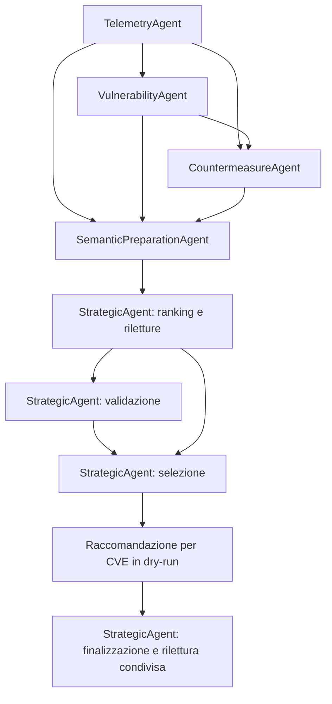

# Selezione nativa, DAG e switch dei backend

Aggiornamento: 5 novembre 2026. Il comando principale collega acquisizione,
preparazione canonica, ranking, validazione, raccomandazione e finalizzazione
condivisa in dry-run. La [nuova fase](strategic-finalization.md) controlla commit e
rilettura tramite backend; il collaudo disponibile usa Fabric/Tiny-ME simulati.
Nessuna contromisura viene applicata.

## Selezione della candidata

`NativeSelectionSession` legge un checkpoint completo di validazione. Verifica
ranking/preparazione, digest, profilo operatore, richieste IRI, risposte e ordine
dei tentativi. Input incompleti, modificati o guasti tecnici impediscono la
pubblicazione; non diventano un esito di dominio.

Per ciascuna CVE, `first-effective-accepted-per-cve-v1` sceglie la prima candidata
con `effectiveStatus=accepted` nell'ordine nativo. Score, pari merito, ID MAS,
individui KG e IRI rimangono invariati. `valid=true` da solo non basta. Tutte le
candidate vengono prima validate: il checkpoint conserva anche gli esiti successivi
alla candidata selezionata; non effettua uno short-circuit delle chiamate.

| Condizione per la singola CVE | Esito | Strategia selezionata |
| --- | --- | --- |
| Esiste almeno una accettazione effettiva | `recommended` | Prima accettata nel ranking |
| Nessuna accettazione; almeno una candidata richiede revisione | `requires_review` | `null` |
| Nessuna accettazione/revisione; almeno una richiede prerequisiti | `requires_prerequisites` | `null` |
| Tutte le candidate sono rigettate | `no_valid_strategy` | `null` |
| Checkpoint mancante/incoerente o errore di servizio | Fallimento tecnico | Nessuna pubblicazione |

La precedenza degli esiti di astensione nella tabella aggrega **candidate diverse**.
Non modifica la precedenza semantica/operativa che costruisce `effectiveStatus`
all'interno di una singola validazione. Tutti i dettagli restano consultabili.
Non si sceglie un vincitore globale tra CVE diverse e non si deduce che una strategia
di monitoraggio elimini la vulnerabilita.

`native_strategic_recommendation.json` conserva per CVE ranking originale, tutti
i tentativi, disposizioni (`selected`, `not_acceptable`, `lower_ranked_acceptable`),
ID della decisione SaaS e digest dei checkpoint. Dichiara `status=dry_run_completed`,
`shared_finalization=pending`, `provenance_scope=local_artifact_lineage`,
`deployment_verified=false` e `action_execution=not_performed`.
Le precedenti pubblicazioni di ranking e validazione rimangono checkpoint storici:
il loro campo `recommendation=pending` non viene riscritto retroattivamente.
Anche la raccomandazione locale conserva il proprio `shared_finalization=pending`:
la fase successiva pubblica un artefatto distinto `native_strategic_finalization.json`
e aggiorna `execution.json` soltanto dopo tutte le riletture verificate.

## DAG eseguibile



La figura abbrevia gli archi convergenti: i tre artefatti di origine sono
prerequisiti espliciti anche di ranking, validazione e selezione; preparazione
e ranking sono riletti dai passaggi successivi. Gli otto contratti e gli archi
completi sono in `thesis_agents/orchestration/native_dag.py` e in `dag.json` del run.

Si tratta di un DAG composto: la Workforce CAMEL esegue i tre produttori; il
coordinatore del DAG avvia poi agenti CAMEL con policy dei tool per ogni fase
nativa. Non sono otto ruoli diversi, ne una singola Workforce estesa: i quattro
task strategici appartengono allo stesso ruolo StrategicAgent. Si mantiene
SemanticPreparationAgent come ruolo aggiuntivo dedicato al riuso Bottalico.

Ogni nodo passa da `pending` a `running` e `completed` soltanto dopo una
pubblicazione valida. Si ricontrollano gli input prima e dopo l'esecuzione;
un nodo fallito blocca i discendenti (`failed`, `blocked`). I produttori CAMEL
sono registrati dopo la verifica delle loro pubblicazioni; la loro gestione
interna degli errori rimane nella Workforce. Output assenti non sono sostituiti
dal riepilogo testuale del modello. Nessun retry dei tool nativi dopo un guasto.

Con candidate vuote si conservano i tre artefatti di origine, si marcano le
fasi native `skipped` e si conclude con `assessment_completed`, `no_findings`
oppure `insufficient_evidence`, secondo il rapporto. Non si inventano un grafo,
un ranking o validazioni. Il lookup wire v1 non esprime `no_findings`: il suo
`unsupported` rimane evidenza insufficiente.

## Comando di switch richiesto dal professore

Lo switch e un'opzione della stessa applicazione e non cambia branch Git.

```bash
# Solo mock locali; fixture senza inferenza
.venv/bin/python main.py --backend-mode mockup --mode fixtures

# Stessi mock, con agenti CAMEL e modello configurato in .env
.venv/bin/python main.py --backend-mode mockup --mode camel --workflow pipeline

# Backend reali configurati e agenti CAMEL, fino alla finalizzazione condivisa
.venv/bin/python main.py --backend-mode real --mode camel \
  --backends config/backends.real.example.json \
  --input percorso/telemetry-input.json --output output/run-reale
```

Il profilo di esempio contiene placeholder: configurare sorgenti OTel/CTI/SBOM,
servizio OSV, percorsi Python/repository Bottalico, snapshot/digest, assessment
e binding esatti MAS/KG/IRI, policy operativa e bridge MCP stdio. Gli assessment
e i binding sono configurazione esplicita dell'operatore, non dati inventati
dal modello. Il profilo e l'input devono dichiarare le stesse capacita/divieti.
Run ID e digest degli artefatti vengono collegati automaticamente dopo ogni
pubblicazione; non occorre conoscerli in anticipo.

`--backend-mode real` richiede ingressi acquisiti, CTI atteso reale, SBOM fornita,
OSV atteso live e bridge condiviso atteso reale. Non costruisce tool mock e non
ripiega sul mockup in caso di errore. La preflight e locale e verifica anche
branch `costa-thesis`, manifest e digest dell'ontologia del generatore; non
verifica disponibilita o deployment remoto. `expected_kind=real` e una
dichiarazione controllata del servizio, non una attestazione crittografica.

`--mode` seleziona l'inferenza, `--backend-mode` i backend; `real` non accetta
`--mode fixtures`. Senza il nuovo switch i profili storici e misti mantengono
il precedente comportamento (`backend_mode=configured` se e passato un profilo).
`--workflow auto` riguarda la decomposizione dei produttori CAMEL; le dipendenze
e le fasi native restano esplicite e protette dal DAG.

## Consultazione degli esiti

Nel run principale:

- `execution.json`: modalita, stato globale, fasi concluse, esiti per CVE e percorso della raccomandazione.
- `dag.json`: ruoli, input/output, dipendenze e stato di ciascun nodo.
- `sources/`: tre artefatti MAS, snapshot e audit delle sorgenti.
- `preparation/`: OWL/ALN, binding e richieste native per CVE.
- `strategic/native_strategic_ranking.json`: ranking SaaS e riletture.
- `validation/native_strategic_validation.json`: tentativi e validazioni ordinate.
- `recommendation/native_strategic_recommendation.json`: scelta o astensione per CVE, con dettagli e lineage.
- `shared_mcp_events.jsonl`, stderr e audit per fase: chiamate riuscite/fallite.

Per selezionare da un checkpoint gia salvato, senza contattare servizi:

```bash
.venv/bin/python -m thesis_agents.strategic.selection \
  --validation-run output/validazione-nativa --output output/selezione-nativa
```

La directory di output deve essere nuova. `--mode camel` usa invece un agente
Strategic con gli stessi tool deterministici e il modello configurato in `.env`.
I tool di pubblicazione non accettano un ID scelto dal modello. Gli archivi di
input vengono copiati e verificati; i run precedenti non sono modificati.

## Prove e limiti

Regressione completa: 617 test Python passati, 55 nuovi rispetto al precedente
incremento; due warning RDFLib preesistenti. Ruff, pip check e diff workspace passati.

Le prove usano SDK CAMEL, pubblicazioni reali dei tool, processi MCP stdio e server
HTTP locali, con inferenza, CTI, OSV, Fabric e Tiny-ME simulati. I test del launcher
attraversano anche il generatore Bottalico installato, copiato in un repository
temporaneo costa-thesis; sono saltati se il modulo esterno non e disponibile.
Le prove di selezione e DAG non dipendono da quel modulo installato.

Evidenze in `output/selection-dag-20261103/`, inclusi log intermedi falliti e
raccomandazioni ottenute offline dai quattro checkpoint del precedente smoke
SaaS. La verifica dei servizi disponibili rimane rinviata a fine progettazione.
La finalizzazione condivisa e implementata e verificata con fixture. Restano commit/rilettura sul
ledger, validazione live dell'ontologia/IRI, giustificazione scientifica degli
archi dell'anello, vincoli ontologici e Bonus, dashboard e sperimentazione reale.
Nell'incremento di sola selezione del 3 novembre i due repository esterni erano invariati.

L'utente ha confermato la pipeline ibrida Bottalico e autorizzato l'estensione
dopo l'ispezione completa. La fase successiva e ora [implementata](strategic-finalization.md)
nei componenti condivisi esistenti, su costa-thesis. Le prove e i conteggi sopra
riguardano l'incremento di selezione del 3 novembre; la nuova guida raccoglie
la verifica della finalizzazione completata il 5 novembre.
