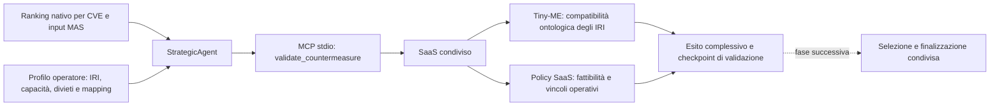

# Strategic: vincoli operativi e IRI nella validazione

Implementato il 2 novembre 2026. Lo Strategic consuma il
[ranking nativo](strategic-native.md), risolve i binding MAS/KG/IRI e chiama
`validate_countermeasure` con il contesto operativo completo. Il SaaS conserva
separatamente l'esito Tiny-ME e quello della policy operativa.



## Perché estendere il contratto

La precedente richiesta conteneva solo asset IRI, contromisura IRI e chiave
ontologica. Capacità, azioni vietate e caveat del MAS non arrivavano al backend.
Ora `operational_context` e opzionale nel tool MCP e viene inoltrato integralmente
come `operationalContext` al SaaS. Le chiamate precedenti senza contesto conservano
il contratto semantico precedente; il nuovo percorso Strategic richiede invece
contesto e risposta operativa. La discovery tipizzata e stata aggiornata dal
bridge effettivamente compilato: sempre 19 tool, quattro autorizzati dal client.
Client e bridge devono usare lo snapshot di schema aggiornato.

Il contesto include run, asset, CVE, ID MAS/KG, ID del ranking SaaS, azione,
prerequisiti e vincoli originali della candidata, capacità disponibili dichiarate,
azioni proibite, mapping operativi e digest delle fonti/policy. Il SaaS verifica
che il ranking appartenga al tenant richiedente, sia CURRENT e contenga quella
CVE/candidata prima di chiamare il chaincode.

Il framework controlla i digest degli artefatti MAS e il legame al checkpoint.
Il SaaS riceve quei riferimenti: non scarica e non ricertifica autonomamente gli
artefatti MAS. Run ID e capacità non diventano automaticamente osservazioni OTel.

## Profilo operativo e binding

`config/strategic-native-validation.example.json` e un modello da compilare.
Sono obbligatori run/asset del ranking, SHA-256 dei byte di
`native_strategic_ranking.json`, chiave dell'ontologia semantica, IRI asset,
binding per ogni coppia CVE/candidata e fonte della policy. Sostituire i segnaposto
e coprire esattamente tutte le associazioni MAS/KG del ranking.

Ogni binding specifica separatamente ID MAS, individuo KG e IRI semantico della
contromisura. Non si costruiscono IRI per somiglianza del nome o per concatenazione
implicita di namespace. Sono ammessi IRI assoluti HTTP(S)/URN senza credenziali o
spazi; nomi locali come `S_UPGRADE` o `:Asset` sono rifiutati dal nuovo profilo.
Gli IRI di due candidate della stessa CVE devono essere distinti.

Le capacità e i divieti provengono dalla configurazione dell'operatore, dichiarata
con `policy_source`. RuntimeEvidence non contiene quei campi; il nuovo percorso
non li attribuisce alla telemetria. L'assenza di una capacità dall'elenco significa
che la sua disponibilità non e stabilita da quel profilo: impedisce l'accettazione
operativa, senza affermare che la capacità sia fisicamente impossibile.
La chiave ontologica semantica e distinta dal digest dell'ALN usato nel ranking.
Esistenza/deployment degli IRI e corrispondenza con l'ontologia distribuita restano
da verificare alla fine della progettazione; `deployment_verified` rimane false.

## Policy SaaS e vincoli testuali

La policy versionata `operational-action-policy-v1`, fissata anche tramite digest,
conserva i requisiti operativi espliciti del caso di tesi:

| Azione | Capacità richieste dalla policy |
| --- | --- |
| upgrade | maintenance_window, package_upgrade |
| isolate | network_isolation |
| block_deployment | deployment_control |
| monitor | monitoring |

Sono scelte della policy di fattibilità del progetto, non regole universali del
dominio o inferenze Tiny-ME. Il SaaS unisce questi requisiti ai prerequisiti della
candidata e alle capacità aggiunte dai mapping dell'operatore. Il modello non puo
eludere la policy omettendo i prerequisiti nella propria proposta. Il framework
verifica la coerenza aritmetica della risposta con il contratto; non usa quel
controllo per sostituire un servizio fallito o produrre un esito locale.

Un mapping associa il testo esatto di un vincolo di una candidata a una o più
capacità richieste. La sua interpretazione e configurazione dell'operatore, non
una traduzione scientificamente verificata del testo. Mapping di testi assenti,
duplicati o riferiti ad altre candidate sono rifiutati.
Un vincolo privo di mapping rimane in `unassessed_constraints`: a capacità
soddisfatte richiede revisione. Non viene ignorato e non diventa una regola OWL
inventata dal modello. Se un caveat non e rappresentabile come prerequisito di
capacità, deve rimanere non valutato in questo contratto.

## Interpretazione degli esiti

| Campo della risposta | Significato |
| --- | --- |
| valid, status, reasoning.native | Esito ontologico Tiny-ME, preservato |
| operational | Valutazione del SaaS: requisiti, capacità mancanti, divieti, caveat non valutati e digest del contesto |
| effectiveStatus | Combinazione conservativa degli esiti semantico e operativo |

La precedenza e `rejected`, `requires_prerequisites`, `requires_review`, `accepted`.
Gli elenchi dettagliati restano disponibili anche quando un'altra condizione
determina lo stato complessivo. `valid=true` puo quindi accompagnare un blocco
operativo: il consumatore del nuovo contratto deve leggere `effectiveStatus`.

Tiny-ME continua a ricevere chiave ontologica e i due IRI attraverso ExplainAffinity.
I nuovi controlli operativi sono eseguiti dal SaaS e dichiarano
`evaluator=saas_operational_policy`: non si afferma che Tiny-ME abbia ragionato
sulle liste JSON. Nessun reasoner, ranking o servizio di provenance parallelo.

## Correzione del lookup IRI nel chaincode

L'ispezione ha trovato che `go_iterator_callback` confrontava solo il frammento
dopo `#`, senza riconoscere IRI completi. Il correttivo su costa-thesis introduce
un confronto esatto degli IRI completi, gestisce il rendering tra parentesi
angolari e preserva la precedente API per frammenti `#nome` univoci. Se lo stesso
nome locale compare in namespace differenti, il lookup lo rifiuta e richiede
l'IRI assoluto. Gli IRI assoluti non ricevono fallback per frammento.

Il confronto e verificato con test Go indipendenti dalle librerie native.
Il callback e formattato/verificato nei sorgenti; compilazione ed esecuzione del
chaincode completo con CGO/Tiny-ME e deployment Fabric restano nel collaudo finale.

## Esecuzione e artefatti

```bash
.venv/bin/python -m thesis_agents.strategic.validation \
  --ranking-run output/strategic-nativo \
  --validation-profile config/strategic-native-validation.example.json \
  --mcp-profile config/mcp.shared-stdio.example.json \
  --output output/validazione-nativa
```

Il profilo va compilato sul ranking gia pubblicato. La directory di output deve
essere nuova. `--mode tool` invoca i servizi senza inferenza; `--mode camel` usa il
ruolo Strategic con policy dei tool e modello configurato in `.env`.

Ogni candidata viene validata in ordine di ranking, separatamente per CVE.
Questo checkpoint conserva tutti gli esiti; non seleziona ancora una strategia.
Si salvano copie immutabili del ranking/preparazione, profili, richieste e risposte
per tentativo, audit e stderr. La ripetizione della pubblicazione ricontrolla i
file senza nuove chiamate. Un errore tecnico blocca la sessione, senza retry
automatico, fallback mock, astensione o rigetto semantico inventato.

`native_strategic_validation.json` lascia `recommendation` e `shared_finalization`
pending, `action_execution=not_performed` e `deployment_verified=false`.
Dal 3 novembre la [fase di selezione e il DAG principale](strategic-selection-dag.md)
consumano questo checkpoint e pubblicano una raccomandazione distinta. Questa
pubblicazione storica non viene riscritta. Resta aperta la finalizzazione condivisa.

## Verifica e conservazione

562 test Python passati (40 nuovi), Ruff e diff workspace senza errori; due warning
RDFLib preesistenti. I nuovi test coprono più CVE, ordine, cloni CAMEL, IRI e mapping errati,
vincoli mancanti/proibiti/non valutati, omissioni del backend, alterazioni dei
file e assenza di pubblicazioni dopo un guasto. Build dei due progetti Node 22,
131 test SaaS e 13 bridge passati; confronto IRI verificato in Go con 12 casi.

Il collaudo effettivo framework -> MCP stdio -> SaaS HTTP esegue 24 chiamate:
quattro casi operativi con quattro candidate, condizioni/conflitti semantici,
parità REST/MCP e rigetto di contesti estranei. Il precedente smoke di nove
chiamate senza contesto e passato. Fabric, Tiny-ME e autenticazione sono simulati;
nessun collaudo del ranking o della semantica reale e nessun commit on-chain.

Applicati 10 file sorgente/test nei repository esterni soltanto su costa-thesis,
con hash, backup e controllo dei riferimenti Git; nessun commit/push. Evidenze
in `output/operational-validation-20261102/`: manifest iniziale, piano/applicazione,
backup, patch incrementale, sorgenti testati, discovery, demo, test e fallimenti
intermedi conservati. I Word manuali non sono stati rigenerati.
