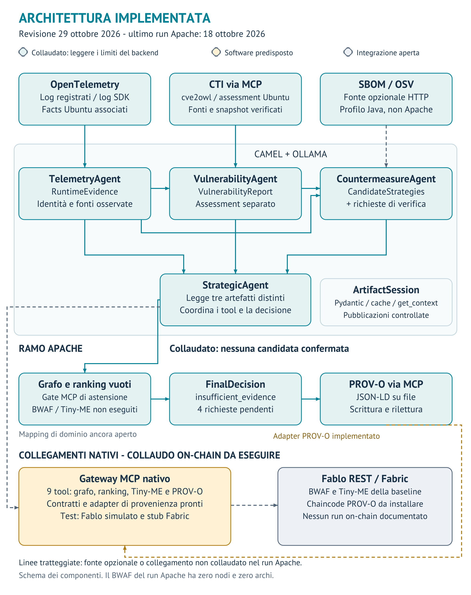
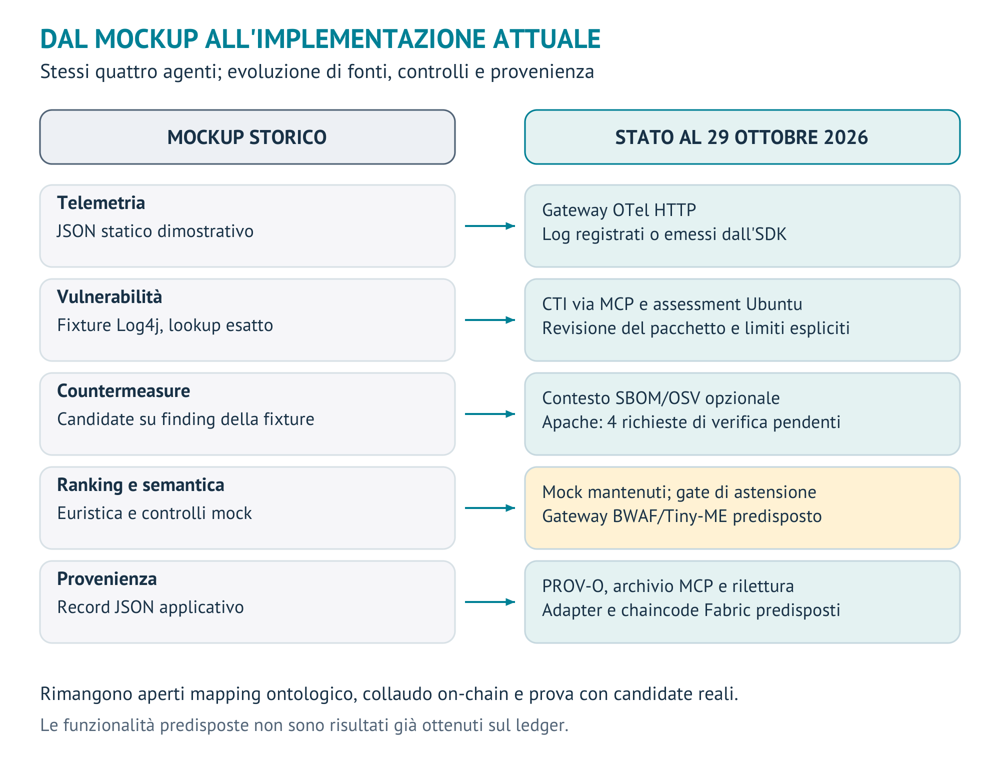

# Aggiornamento della relazione al 29 ottobre 2026

Questo testo prosegue i capitoli 1–18 della relazione modificata manualmente.
I capitoli 1–10 riguardano il mockup; i capitoli 11–18 descrivono le prime
integrazioni. I capitoli 19–24 raccolgono gli sviluppi successivi e costituiscono
il riferimento per lo stato corrente. Le conclusioni delle fasi precedenti
vanno lette nel loro contesto storico, soprattutto quando indicano PROV-O
come lavoro futuro. La data è una revisione documentale, non una nuova prova
sperimentale. Gli ultimi run e controlli qui richiamati sono del 18 ottobre 2026.

## 19. Architettura aggiornata e confronto con il mockup

Il prototipo mantiene quattro agenti di dominio implementati con CAMEL:
TelemetryAgent, VulnerabilityAgent, CountermeasureAgent e StrategicAgent.
L'inferenza viene eseguita con Ollama locale. Il contributo recente riguarda
l'integrazione delle fonti, la rappresentazione dell'incertezza, il controllo
delle pubblicazioni e la registrazione verificabile della provenienza.

Telemetry produce RuntimeEvidence; Vulnerability pubblica un VulnerabilityReport
separato; Countermeasure usa entrambi per costruire CandidateStrategies;
Strategic riceve tutti e tre gli artefatti. I ruoli comunicano attraverso tool
e ArtifactSession, che conserva lo stato autorevole. Il contesto conversazionale
del modello e il risultato gestionale del task non sostituiscono gli artefatti.

La figura distingue il percorso Apache già collaudato dalle operazioni native
Fabric predisposte. Rappresenta componenti e dipendenze, non un grafo BWAF
esportato dal motore. Il grafo argomentativo del run Apache è vuoto perché non
sono presenti contromisure sostenute da finding runtime confermati.

| Dimensione | Mockup | Incremento implementato |
|---|---|---|
| Fonte runtime | Input statico dimostrativo | Gateway HTTP OTel, export registrati e log SDK |
| Identificazione | Nome/versione della fixture | Binding verificati, alias CTI tracciabili e revisione Ubuntu completa |
| Vulnerabilità | Lookup esatto su una fixture Log4j | Assessment CTI MCP, snapshot originali e classificazioni con limiti espliciti |
| Generazione delle proposte | Candidate su finding dimostrativi | Contesto SBOM/OSV opzionale e richieste di verifica per i casi insufficienti |
| Ranking e semantica | Euristica e capacità/policy mock | Mock mantenuti; gate di astensione effettivo; gateway nativi da collaudare on-chain |
| Provenienza | Record JSON applicativo | Export PROV-O, archivio MCP con rilettura e adapter Fabric predisposto |

I servizi reali non sono attivi contemporaneamente in ogni profilo. Il caso
Java utilizza log e SBOM della stessa build con CTI e OSV, mantenendo i tool
strategici mock. Il caso Apache usa facts Ubuntu, non una SBOM Maven, e non
riutilizza l'inventario dell'applicazione Java. La scelta del backend avviene
prima dell'avvio della Workforce attraverso la configurazione.

## 20. Caso Apache e applicabilità al pacchetto Ubuntu

### 20.1 Fonti e identità del software

L'export OpenTelemetry della baseline contiene tre avvii Apache riconosciuti
fra 1.109 record. Le righe sono state confrontate con i log originali dello
scenario russellmitchell, host webserver, dell'AIT Log Data Set V2.0. Il banner
riporta Apache 2.4.29; i facts inventariali identificano Ubuntu 18.04 Bionic e
apache2 2.4.29-1ubuntu4.21. Hash, riferimenti e versioni restano separati.

La risoluzione dell'identità CTI v2 restituisce sei identità equivalenti tra
113 candidate, con una ricerca delimitata e documentata sullo snapshot. Questo
risolve l'identità del prodotto ma non l'applicabilità delle vulnerabilità al
pacchetto della distribuzione. Non basta confrontare il numero upstream per
stabilire lo stato delle patch Ubuntu.

### 20.2 Valutazione della revisione Ubuntu

Il servizio MCP dedicato usa la revisione completa del pacchetto e le fonti
Ubuntu conservate nel manifest. Il risultato distingue 120 CVE nei seguenti
gruppi, senza promuovere l'assenza di informazioni a esito negativo.

| Verdetto | CVE | Ambito della conclusione |
|---|---:|---|
| fixed | 34 | Corrette nella revisione inventariata secondo le fonti conservate |
| not_affected | 28 | Non applicabili al pacchetto secondo Ubuntu |
| potentially_affected | 46 | Possibile applicabilità, condizioni runtime non verificate |
| unknown | 12 | Informazioni insufficienti per classificare il pacchetto |

Per esempio, CVE-2021-44790 risulta fixed nella revisione inventariata .21;
CVE-2022-22720 risulta potentially_affected rispetto alla soglia .22 indicata
dalle fonti conservate. Questi esempi non attestano il processo storico, non
dimostrano uno sfruttamento e non identificano una versione globalmente sicura.

### 20.3 Limite temporale e decisione

I log originali sono del 22–24 gennaio 2022, mentre l'inventario è del 25 gennaio.
La valutazione delle CVE è retrospettiva. Il pacchetto inventariato non attesta
automaticamente la revisione caricata dal processo negli eventi precedenti.
Il contratto conserva quindi runtime_applicability=not_assessed e
historical_runtime_state=not_established.

La funzione lookup_status del modello Ubuntu restituisce not_evaluable quando
l'identità è risolta ma manca la valutazione runtime. La sessione costruisce
quindi insufficient_evidence come stato finale. L'esito dipende dal contratto
e dalle evidenze, non soltanto dal prompt dello StrategicAgent. Una diversa
formulazione del modello non può cambiare questa conclusione autorevole.

## 21. Countermeasure, decisione e provenienza verificabile

### 21.1 Richieste di verifica distinte dalle contromisure

Countermeasure prepara un contesto derivato dall'assessment verificato e
pubblica quattro richieste pendenti. Il contenuto conserva riferimenti agli
artefatti e alle CVE interessate.

| Richiesta | CVE interessate | Evidenza ancora necessaria |
|---|---:|---|
| Stato storico del processo | 58 | Collegamento fra processo osservato e revisione del pacchetto |
| Condizioni runtime | 46 | Configurazione, moduli e condizioni pertinenti ai casi potenziali |
| Stato Ubuntu | 12 | Chiarimento delle classificazioni indeterminate |
| Compatibilità dell'upgrade | 46 | Percorso supportato, dipendenze e vincoli operativi |

Gli insiemi si sovrappongono: il totale è 58 CVE uniche, non la somma delle righe.
Le richieste non sono contromisure, non vengono classificate dal ranking e non
attivano automaticamente acquisizioni o verifiche. L'input Apache non dichiara
capacità operative disponibili e nessuna mitigazione viene eseguita.

### 21.2 Conclusione strategica del ramo senza candidate

Lo StrategicAgent legge separatamente RuntimeEvidence, VulnerabilityReport e
CandidateStrategies. In assenza di candidate il grafo è vuoto. Un servizio MCP
dedicato restituisce astensione esplicita; rifiuta grafi non vuoti e non simula
il ranking BWAF. Il report semantico è vuoto perché non ci sono candidate da
validare. La decisione mantiene insufficient_evidence e conserva le richieste.

La spiegazione autorevole è composta dai campi degli artefatti e dai riferimenti
alle fonti. Il commento libero dell'LLM rimane separato e marcato unverified.
La validazione Pydantic e l'audit non garantiscono la verità di ogni frase
contenuta nel commento generato.

### 21.3 Export PROV-O e archivio MCP

Il record applicativo viene esportato in JSON-LD con entità, attività, agenti
software e relazioni PROV-O. I test leggono il documento come RDF e controllano
identificativi, dipendenze e digest. Il run Apache produce 11 entità, 10 attività
e 143 triple nel grafo del run.

Il servizio di archivio scrive record e bundle PROV-O in file immutabili per
run. Il client effettua una nuova lettura MCP e confronta contenuto e hash.
La ricevuta del run Apache dichiara artifact-files e ledger_status=not_submitted.
È pertanto implementata la serializzazione PROV-O con rilettura verificata;
non è una registrazione su Fabric.

## 22. Collegamenti MCP nativi e integrazione Fabric

### 22.1 Gateway e contratti separati

Il gateway nativo espone nove operazioni MCP Streamable HTTP, distinte dai
contratti storici del MVP. Le richieste sono validate e associate alla risposta
attraverso un digest; gli esiti riportano operazione, canale e chaincode.

| Gruppo | Operazioni implementate |
|---|---|
| Grafo e ranking | store_graph, rank_graph, get_graph, get_rank_result, get_annotated_graph |
| Tiny-ME | analyze_ontology, get_reasoner_result |
| Provenienza | record_provenance, read_provenance |

Il gateway chiama Fablo REST, che inoltra le operazioni ai chaincode. Il processo
degli agenti non importa le librerie BWAF o Tiny-ME. Il ciclo del ranking
comprende memorizzazione, invocazione e recupero di classifica e grafo annotato.
Errori, risultati discordanti o richieste non completate non vengono sostituiti
da un risultato mock.

### 22.2 Mapping e validazione di dominio ancora aperti

Il formato nativo del grafo usa nodes con id/type ed edges con from/to. Il
grafo del MVP contiene anche pesi e tipi support/attack. Una rinomina dei campi
perderebbe informazione, quindi non è stata introdotta una conversione implicita.
Occorre definire la corrispondenza con l'ontologia e giustificare relazioni e
origine dei pesi. Gli score restituiti dal backend nativo vengono conservati
senza clamp o normalizzazione per adattarli allo schema del mock.

Le chiamate Tiny-ME richiedono un'ontologia e due individui e conservano i
risultati di abduzione, bonus e contrazione. La risposta viene riletta dal
ledger e confrontata. La coerenza dell'ontologia non equivale all'accettazione
di una contromisura: manca ancora il mapping di asset, azioni, prerequisiti e
vincoli e la policy di interpretazione dei risultati per la decisione di dominio.

### 22.3 Chaincode PROV-O e stato del collaudo

È stato implementato un chaincode dedicato, separato dalle baseline, per
StoreProvenance e GetProvenance. Conserva record e bundle come documento JSON,
digest e identificativo della transazione di scrittura. Un reinvio identico
è idempotente; un contenuto diverso per lo stesso run viene respinto.

FabricProvenanceTool è collegato alla configurazione della Workforce. Verifica
la risposta, effettua una seconda lettura MCP e conserva export e ricevuta.
Il profilo Apache dedicato alla provenienza Fabric mantiene il gate di
astensione e non abilita ranking non vuoti o Tiny-ME sulle candidate.

I test usano HTTP Fablo simulato e stub Fabric; il chaincode è stato compilato
anche per Linux amd64. Non è ancora stato installato e collaudato sulla rete
di riferimento. Il 18 ottobre Docker e le porte Fablo locali non erano
raggiungibili. La revisione del 29 ottobre non ripete tale verifica.

La ricevuta predisposta distingue rilettura dal peer e verifica indipendente
del commit: peer_readback_verified con block_commit_verified=false. Questa
distinzione è una proprietà del contratto implementato, non l'esito di una
transazione reale già prodotta nella sperimentazione.

## 23. Prova completa con Ollama e livelli di verifica

### 23.1 Fallimento conservato e correzione

La prima prova Apache del 18 ottobre termina dopo 593,92 secondi e 17 richieste
registrate. Telemetry e Vulnerability pubblicano correttamente. Countermeasure
scrive due chiamate di pubblicazione come testo, senza eseguirle; mancando
l'artefatto, il DAG blocca Strategic. Il fallimento è conservato e non viene
completato manualmente.

La correzione introduce CountermeasureToolPolicy per il percorso con contesto
runtime verificato. La policy limita i tool alla fase corrente e richiede una
nuova lettura dopo la preparazione delle verifiche. Il modello deve comunque
generare gli argomenti e invocare il tool: non vengono pubblicati artefatti al
suo posto e non vengono alterati i verdetti del servizio CTI.

### 23.2 Run completato e limiti

La seconda prova utilizza l'alias locale tesi-apache-qwen3:4b-32k, contesto
32768, massimo 8192 token di risposta e temperatura zero. Completa gli artefatti
e supera l'audit, conservando le classificazioni del collaudo programmato.

| Misura | Risultato osservato |
|---|---:|
| Durata del processo CLI | 1.284,92 secondi |
| Richieste LLM registrate | 28 |
| Richieste con risposta registrata | 26 |
| Retry per timeout | 2 |
| Artefatti principali completati | 8 |
| CVE classificate sul pacchetto | 120 |
| Richieste di verifica pendenti | 4 |

Il Countermeasure richiede un retry dopo un timeout; lo Strategic richiede
un retry dopo aver già pubblicato decisione e provenienza, durante la risposta
gestionale successiva. Cache e pubblicazioni immutabili evitano duplicazioni
delle operazioni di dominio. Questo dimostra il recupero sul caso osservato,
non l'affidabilità generale senza interventi di recupero.

Le due prove hanno revisioni e condizioni di esecuzione diverse. Le durate non
sono un confronto controllato e il numero di test automatici non misura la
qualità scientifica del ranking o l'efficacia delle mitigazioni.

### 23.3 Test e riproducibilità

L'ultimo incremento software documentato supera 400 test Python e 2 test Go,
oltre ai controlli statici e alla compilazione Linux del chaincode. I due
warning RDFLib sono deprecazioni già presenti. I test del gateway nativo usano
servizi simulati e non attestano l'esecuzione BWAF, Tiny-ME o Fabric.

La documentazione sperimentale conserva anche il modello programmato dei test,
distinguendolo dall'inferenza effettiva. Manifest, input, snapshot, conversazioni,
artefatti e audit dei run si trovano nelle directory output. Tali file sono
locali ed esclusi da Git: per la consegna vanno inclusi esplicitamente insieme
ai sorgenti della revisione pertinente.

## 24. Allineamento alla proposta e attività successive

La proposta richiede un percorso integrato che parta dalle evidenze runtime,
correli la CTI, produca candidate e grafo, esegua ranking e validazione e
conservi la provenienza. La sezione 14 ammette una mitigazione simulata o una
raccomandazione se descritta come tale. Le sezioni 15 e 16 richiedono casi
vulnerabili e non vulnerabili, confronti e riproducibilità.

| Obiettivo | Stato e lavoro residuo |
|---|---|
| Quattro agenti e contratti | Implementati e collaudati; latenza e recuperi LLM da valutare |
| Runtime e correlazione CTI | Collegati; nel caso Apache rimane il limite temporale dei facts |
| Proposte e argomentazione | Mock disponibili; richieste pendenti per Apache; mapping nativo da formalizzare |
| Ranking e validazione reali | Collegamenti software predisposti; percorso di dominio e collaudo on-chain aperti |
| Provenienza | PROV-O e archivio MCP verificati; chaincode Fabric e adapter da collaudare sulla rete |
| Esperimenti comparativi | Prove distinte disponibili; matrice completa con backend reali ancora da svolgere |

La priorità scelta è completare i collegamenti strategici prima di costruire
il nuovo caso. Servono una rete Fablo raggiungibile, i riferimenti ai contratti
e la conferma del mapping ontologico. Seguono installazione del chaincode
PROV-O, probe nativo e prova Workforce con candidate non vuote.

Per il caso successivo è proposto un ambiente controllato che produca log OTel
e inventario della stessa build, verificando il componente caricato e la
configurazione pertinente. Le fonti possono essere congelate per confronti
ripetibili; le interrogazioni CTI aggiornate devono essere distinte dal replay.
L'applicazione Java esistente fornisce una base, ma non costituisce ancora una
prova positiva del percorso strategico reale.

Sono inoltre proposte, non ancora implementate, decisioni che selezionino un
piano di acquisizione delle evidenze quando non è possibile scegliere una
contromisura. Non si modifica lo stato insufficient_evidence soltanto per
ottenere una selezione. Raccolta continua, attuazione e feedback restano
estensioni separate dal perimetro verificato.

### 24.1 Riferimenti per approfondire

| Argomento | Documento del repository |
|---|---|
| Mappa e percorso di studio | [stato-progetto.md](../stato-progetto.md) |
| Architettura e profili | [architettura-implementata.md](../architettura-implementata.md) |
| Fonti Apache | [apache-recorded-integration.md](../integrazioni/apache-recorded-integration.md) |
| Assessment Ubuntu | [ubuntu-vulnerability-agent.md](../integrazioni/ubuntu-vulnerability-agent.md) |
| Richieste Countermeasure | [ubuntu-countermeasure-agent.md](../integrazioni/ubuntu-countermeasure-agent.md) |
| Ramo senza candidate | [apache-strategic-agent.md](../integrazioni/apache-strategic-agent.md) |
| Prove Ollama | [apache-ollama-use-case.md](../esperimenti.md) |
| Collegamenti nativi | [fabric-native-integration.md](../archivio/fabric-native-integration.md) |
| Requisiti della tesi | [Proposta](../riferimenti/proposta-agentic-cti.pdf), sezioni 9.3, 14–17 |

Gli identificativi sperimentali principali sono apache-ollama-20261018-r1,
apache-ollama-20261018-r2 e fabric-integration-20261018. Il modello della
provenienza usa la [raccomandazione PROV-O](https://www.w3.org/TR/prov-o/);
il mapping implementativo e le verifiche sono descritti nei documenti del
progetto. La descrizione dei backend delle baseline non attribuisce al mock
la formula BWAF o le capacità del reasoner reale.
