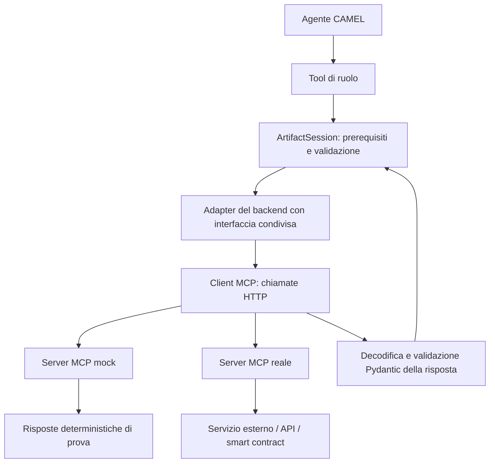

# Integrazione MCP sul branch `full`

Questo documento definisce l'architettura obiettivo e le integrazioni successive.
Sono implementati client MCP e server mock HTTP per il lookup e per i tre tool
strategici: ranking, validazione semantica e registrazione della provenienza.
Comandi, limiti e verifiche sono nella [guida dello Strategic](mcp-strategic.md)
e nella [guida del primo lookup](mcp-lookup.md). Il
[primo ingresso OpenTelemetry](opentelemetry-integration.md) usa HTTP applicativo
su export registrati della baseline. È disponibile anche
l'[ingresso SBOM/OSV](sbom-osv-integration.md), collaudato con inventario
dimostrativo Maven e OSV reale. La [prova dei tre ingressi](observed-app-integration.md)
combina ora log SDK nuovi e SBOM della stessa applicazione locale, con CTI e
OSV reali. Raccolta continua in un deployment, smart contract, Fabric,
store/retrieve generico e PROV-O restano da collegare.

Il primo servizio cve2owl è stato aggiunto nella copia del backend sul branch
`costa-thesis`: espone matching e valutazione delle versioni tramite MCP. Il
client isolato in `tesi` è collaudato su dati sintetici e sull'indice reale
recuperato da Git LFS. Il [mapping verso la Workforce](cti-workforce.md) è
implementato e collaudato con inferenza programmata: conserva esplicitamente
identità ambigue e regole non confrontabili. È completata anche la
[prova Ollama sui tre ingressi](observed-app-ollama.md), con esito negativo valido
e criticità nel giudizio qualitativo gestionale.
Dettagli nella [guida cve2owl](owl-cti-integration.md) e nei
[risultati del collaudo reale](cti-real-runs.md).

## Punto di partenza verificato

- Il branch di lavoro è già `full`. Il branch `mockup` conserva il commit
  `0c8804c` (`updated mockup with doc`), da cui parte anche `full`.
- Prima di questa modifica documentale la working tree era pulita. Il branch
  conserva i file versionati: `.env`, output e ambiente virtuale ignorati da Git
  non diventano copie indipendenti cambiando branch.
- La suite iniziale passa: `95 passed` con `.venv/bin/python -m pytest -q`.
  Questa verifica non avvia inferenze né dimostra un collegamento MCP.
- CAMEL è fissato a `0.2.90`; il lock contiene `mcp==1.30.0` e il progetto
  richiede MCP `<2`. Il solo pacchetto installato non costituisce un'integrazione.
- I quattro agenti chiamano tool Python. `ArtifactSession` accetta già quattro
  backend sostituibili tramite i `Protocol` di `tools/interfaces.py`.

## Architettura proposta

La separazione mock/reale si applica ai servizi, mantenendo i quattro
agenti CAMEL, i loro prompt di ruolo e i contratti di pubblicazione. Non occorre
duplicare ogni agente per introdurre il trasporto MCP. Se in seguito cambieranno
le responsabilità di un ruolo, si valuterà una diversa implementazione del ruolo.

Per i servizi esposti tramite MCP il percorso è:



I due rami rappresentano alternative selezionate dalla configurazione per ogni
servizio, non una chiamata contemporanea a entrambi. Nel server mock e nel server
reale ogni operazione deve esporre lo stesso contratto pubblico concordato.
L'implementazione remota può usare un'API, un reasoner o un agente: per il client
è una black box. MCP standardizza il trasporto e le chiamate, ma non rende
automaticamente equivalenti due contratti di dominio differenti.

`get_context`, pubblicazioni, controllo delle dipendenze e decisione finale
restano operazioni della sessione locale. La rete entra dove sono necessari
i servizi esterni. Gli agenti non ricevono direttamente tutto il catalogo dei
tool scoperti sul server: passano dai tool di ruolo e dai controlli esistenti.

Per esempio, il tool dell'agente `lookup_vulnerabilities()` continua ad accettare
`{}`. È la sessione a leggere software/versione da `RuntimeEvidence` e a passare
un `SoftwareObservation` al backend MCP. L'LLM non sceglie un pacchetto diverso
per eludere il legame con la telemetria.

## Allineamento allo schema finale

Lo schema finale comprende anche tre sorgenti di ingresso esterne. Tutti i
collegamenti a queste sorgenti, ai contratti e al ledger passano da tool remoti.
La black box nasconde implementazione, script e logica interna; rende comunque
disponibili il contratto degli input/output, gli errori e le ricevute necessarie
al chiamante. Non si richiede accesso al sorgente per collaudare un servizio.
MCP espone nomi e schemi dei tool; la specifica distingue anche risultati
strutturati ed errori. Queste informazioni pubbliche sono necessarie alla
[chiamata e validazione dei tool](https://modelcontextprotocol.io/specification/2025-06-18/server/tools).

Le seguenti sono famiglie di operazioni da concordare, non nomi di endpoint
già disponibili nei repository esterni. Ranking, validazione e provenienza
hanno ora contratti v1 propri del prototipo e implementazioni su server mock:

| Consumatore | Servizio esterno | Risposta attesa dal tool |
|---|---|---|
| TelemetryAgent | Servizio di consultazione della telemetria raccolta con OpenTelemetry | Osservazioni normalizzate, servizio osservato, intervallo temporale e fonti |
| VulnerabilityAgent | Servizio OWL CTI / Knowledge Graph | Correlazioni relative al software osservato, identificativi e fonti dei finding |
| CountermeasureAgent | Servizi SBOM / OSV | Inventario dei componenti, versioni e informazioni di vulnerabilità utili a formulare strategie |
| StrategicAgent | Argumentation SC | Identificativo del grafo, ranking e riferimenti dell'operazione |
| StrategicAgent | Semantic Validation SC | Esito e motivazione strutturata della validazione di una candidata |
| Tool di gestione degli artefatti | Servizio di store/retrieve | Riferimento persistente, versione e digest dell'artefatto |
| Tool di provenienza | Servizio di audit del ledger | Ricevuta riferita al documento PROV-O e stato verificabile della registrazione |

Il backend di telemetria offre ora un primo servizio HTTP di lettura su export
registrati, con contratto `otel-observations-v1`: la casella OpenTelemetry nello
schema non identifica da sola un endpoint MCP. Fonti, parser e limiti sono nella
[guida dell'ingresso OTel](opentelemetry-integration.md).
L'SBOM fornisce l'inventario; il servizio OSV offre interrogazioni sulle
vulnerabilità. Il CountermeasureAgent rimane responsabile della generazione
delle strategie, usando questi dati insieme a evidence e report. Le API
effettive vanno selezionate dalla [documentazione OSV](https://google.github.io/osv.dev/api/).

Anche con tre ingressi esterni, si conserva il DAG: Telemetry fornisce il
software/versione al lookup di Vulnerability; Countermeasure usa evidence e
report oltre alle nuove fonti; Strategic riceve i tre artefatti distinti.
Le risposte dei servizi diventano snapshot validati con fonte e identificativo,
riutilizzabili nel run e collegabili all'audit. Policy e capacità del sistema
restano dati espliciti: non si assumono ricavabili dalla sola telemetria.

Lo Strategic è il consumatore principale del MCP Tool Layer nello schema
della tesi; Telemetry potrà usarlo per store/get degli asset. Il lookup MCP
realizzato inizialmente è un esperimento di trasporto riutilizzabile, non un
vincolo per tutte le sorgenti. Gli ingressi OpenTelemetry, OWL CTI e SBOM/OSV
potranno usare API o MCP secondo l'interfaccia pubblica del servizio. Rimangono
black box remote in entrambi i casi. I repository iniziali sono la baseline
da cui esporre le capacità necessarie, preservando i ruoli dei quattro agenti.

`get_context` restituisce lo stato validato della sessione. Un recupero remoto
viene eseguito da un tool dedicato, che verifica versione, digest quando
disponibile e contratto della risposta prima di renderla utilizzabile.
Il ledger mantiene il ruolo di audit, mentre la memoria operativa resta in
`ArtifactSession`. La freccia grafica PROV-O → ledger viene realizzata attraverso
il tool di provenienza del MCP Tool Layer, senza una connessione diretta dagli
agenti a Fabric. Il risultato di ranking/validazione è visibile al chiamante;
non lo è l'implementazione del contratto che lo ha prodotto.

## PROV-O: preparare i dati prima di collegare il ledger

L'attuale `ProvenanceRecord` Pydantic è un punto di partenza, ma il suo JSON
non è già una serializzazione PROV-O. Si propone un exporter deterministico
verso RDF, per esempio JSON-LD con contesto esplicito o Turtle. Il mapping usa:

| Oggetto del prototipo | Termine PROV-O |
|---|---|
| Snapshot delle fonti, artefatto, decisione, ricevuta | `prov:Entity` |
| Acquisizione, correlazione, generazione, ranking, validazione, decisione | `prov:Activity` |
| Istanza dell'agente o servizio responsabile | `prov:SoftwareAgent` |
| Input consumato dall'attività | `prov:used` |
| Artefatto prodotto dall'attività | `prov:wasGeneratedBy` |
| Agente associato all'attività | `prov:wasAssociatedWith` |
| Derivazione documentata fra artefatti | `prov:wasDerivedFrom` |

Questi termini provengono dalla [raccomandazione W3C PROV-O](https://www.w3.org/TR/prov-o/).
Il mapping al nostro processo è una scelta progettuale da testare. SHA-256,
endpoint logico, versione del contratto e transaction ID richiedono proprietà
applicative esplicite; non vanno presentati come termini nativi di PROV-O.

Il client MCP registra `run_id`, identificativo della
chiamata, servizio/tool, stato mock/reale, riferimenti a input/output, orari
osservati ed esito o errore. Si descrive l'invocazione remota osservabile senza
inventare le attività interne del servizio. Il digest identifica una precisa
rappresentazione salvata: va dichiarato come è calcolato.

La serializzazione e la persistenza sono due passi separati: si può verificare
l'export PROV-O senza Fabric, poi inviarlo attraverso il tool MCP di audit.
La ricevuta di registrazione viene conservata separatamente dal documento di
cui attesta l'hash, evitando autoriferimenti. I suoi riferimenti possono entrare
in un successivo record di provenienza. La validazione Pydantic del record
non basta: i test dell'export devono leggere RDF e verificare IRI e relazioni.

Nello schema finale "selected mitigation" e "applied strategy" sono eventi
distinti. Oggi il prototipo seleziona una strategia ma non la applica. Il PROV-O
iniziale descriverà selezione e validazione; un'attività di applicazione e il
feedback runtime saranno aggiunti soltanto quando un servizio di esecuzione
avrà fornito evidenze dell'azione e delle osservazioni successive.

## Trasporto remoto e SDK

Il trasporto proposto è **Streamable HTTP**, con URL esplicito del server MCP.
Il client non avvia comandi `node`, `python`, `npx` o script dei repository
esterni. Il server viene distribuito e avviato separatamente. Nei test può essere
un processo di prova su loopback: verifica il protocollo HTTP reale, ma non va
presentato come prova di un servizio distribuito su un'altra macchina.
Per un'API REST esistente, il server MCP può fungere da adapter remoto.
La distinzione fra trasporto `stdio` e HTTP è definita dalla
[specifica MCP](https://modelcontextprotocol.io/specification/2025-06-18/basic/transports).

CAMEL offre già `MCPToolkit` e `MCPClient`; il codice installato supporta
Streamable HTTP. La [documentazione CAMEL](https://docs.camel-ai.org/key_modules/tools)
descrive l'integrazione dei tool e dei server MCP. Questo incremento usa
un client ristretto basato sull'SDK MCP v1 già installato, dietro agli
adapter tipizzati: non è necessario registrare direttamente i tool remoti nella
Workforce. `MCPToolkit` non è necessario per questo collegamento.

Il client deve coprire handshake, `tools/list`, verifica dei tool richiesti,
`tools/call` e chiusura della sessione. Le firme da seguire sono quelle della
[versione MCP 1.30.0](https://github.com/modelcontextprotocol/python-sdk/tree/v1.30.0),
non esempi per la versione 2. Un aggiornamento SDK sarà una modifica separata.

I backend attuali sono sincroni e CAMEL usa anche esecuzione asincrona. La
facciata implementata delega a un loop dedicato, mantenendo apertura e chiusura
dei context manager MCP nello stesso task proprietario. I test verificano il
percorso sincrono, l'uso durante un loop asincrono e quello della Workforce,
includendo errori di trasporto, timeout e pulizia delle risorse.

## Switch di configurazione

Si tengono separati due assi:

| Scelta | Significato |
|---|---|
| `--mode camel` | Agenti CAMEL con inferenza LLM |
| `--mode fixtures` | Esecuzione deterministica dei contratti, senza agenti LLM |
| Configurazione backend locale | Implementazioni Python del mockup attuale |
| Configurazione MCP mock | Stessi contratti invocati su server mock HTTP |
| Configurazione ibrida | Un servizio reale alla volta, gli altri dichiaratamente mock |
| Configurazione full | Tutti i servizi richiesti dal profilo collegati e identificati come reali |

CLI disponibile:

```bash
python -m thesis_agents.main --mode camel --backends config/backends.mcp-mock.json
python -m thesis_agents.main --mode camel --backends config/backends.mcp-strategic-mock.json
python -m thesis_agents.main --mode camel --backends config/backends.mcp-all-mock.json
python -m thesis_agents.main --mode camel --backends config/backends.local-mock.json
```

`--backends` seleziona trasporto, endpoint e timeout separatamente per
`vulnerability`, `ranking`, `semantic` e `provenance`. Il profilo strategico
mantiene il lookup locale e usa MCP per gli altri tre; `all-mock` richiede il
server lookup sulla porta 8001 e quello strategico sulla porta 8002. Si possono
configurare endpoint diversi per ogni servizio. La configurazione ibrida è
implementata; la compatibilità dei servizi reali resta da verificare. Senza
l'opzione si conserva il comportamento locale. Le credenziali sono risolte da
variabili d'ambiente, senza inserirle nei prompt o nei manifest.

Lo switch si risolve nel codice prima di avviare la Workforce. Se per
"prompt" si intende il terminale, la flag soddisfa direttamente la richiesta.
Un'eventuale interfaccia conversazionale può tradurre una scelta esplicita
dell'utente in configurazione, ma non delega al modello la modifica del backend
nel mezzo di un run. Una connessione reale fallita non attiva un fallback mock
silenzioso. La configurazione effettiva compare nel manifest e nell'audit.

Nel primo incremento `fixtures` resta locale; la parità MCP viene verificata
con test di contratto dedicati. Gli scenari full non vanno dichiarati completi
finché anche le sorgenti richieste, per esempio la telemetria reale, non sono
integrate: il nome del profilo da solo non certifica lo stato del sistema.

## Primo incremento completato: lookup su server MCP mock

Il lookup è un buon primo confine perché ha input/output piccoli e non scrive
sul ledger. Il contratto implementato per il tool remoto è:

```text
lookup_vulnerabilities(software: SoftwareObservation) -> LookupResponse
```

`LookupResponse` contiene versione del contratto, identità e tipo mock/reale del
backend e il `LookupResult`. L'adapter restituisce quest'ultimo alla sessione,
preservando l'interfaccia Python. Il nuovo server di prova è incluso nel
prototipo; il servizio reale verrà collegato dopo averne verificato il contratto.

Sequenza del primo incremento (punti 1–4 implementati; al punto 5 è verificato
CAMEL con modello programmato sul lookup mock. Il successivo run Ollama usa
invece il contratto cve2owl reale e i tre ingressi combinati):

1. Esporre il mock di lookup in un server HTTP separato, senza toccare il mock
   originale. Il riuso del mock appartiene al server di prova, non al client.
2. Scrivere il client MCP e un `MCPVulnerabilityTool` conforme a
   `VulnerabilityTool`. Il client invia dati, non importa il repository esterno.
3. Verificare il contratto senza LLM: caso supportato e caso non coperto,
   preservando package, versione e identificativi delle evidenze.
4. Collegare l'adapter al costruttore già esistente di `ArtifactSession`, prima
   in un test dedicato e poi tramite la configurazione della CLI su `full`.
5. Provare la Workforce con risposte LLM programmate; infine eseguire un caso
   Ollama e poi la matrice dimostrativa, con backend e trasporto annotati.

Questo primo collegamento ha collaudato il client con un contratto piccolo.
Il successivo incremento porta ora su MCP i tool dello Strategic, in accordo
con lo schema finale. Il lookup remoto resta disponibile come profilo separato.
L'acquisizione remota della telemetria e l'ingresso SBOM/OSV usano invece
contratti e tool HTTP aggiunti negli incrementi successivi: non sono una
conseguenza automatica dell'installazione di MCP. `TelemetryTool` e
`SupplyChainTool` affiancano le quattro interfacce di dominio originarie.

La parità riguarda gli output dei backend a parità di input. Non si richiede
uguaglianza byte per byte fra run LLM, che possono generare candidate differenti.

## Test di accettazione del primo incremento

| Prova | Risultato atteso |
|---|---|
| Connessione a server HTTP separato | Handshake e discovery effettivi |
| Lookup supportato/non supportato | Stesso risultato del mock locale per lo stesso input |
| Tool richiesto assente o contratto incompatibile | Errore prima del task dipendente |
| `isError`, payload `ok: false`, JSON o schema errati | Errore esplicito; nessun report pubblicato |
| Package/versione/evidence ID alterati | Rifiuto della risposta incompatibile |
| Timeout, disconnessione, cancellazione | Errore delimitato e risorse chiuse, senza passaggio al mock |
| Run consecutivi e chiamate ripetute | Nessuna contaminazione fra sessioni |
| Percorso CAMEL reale con LLM programmato | Tool remoto eseguito e contratti conservati |
| Regressione locale | Suite esistente ancora verde, senza rete necessaria |

Gli errori di trasporto non si trasformano in `unsupported`: quest'ultimo è un
esito di dominio, non il sintomo di un server irraggiungibile. Un successo HTTP
non basta a dimostrare un successo del tool. I retry di scritture future
richiederanno chiavi idempotenti e verifica dell'esito, soprattutto sul ledger.

File della prima implementazione: `thesis_agents/mcp/client.py`,
`thesis_agents/mcp/mock_server.py`, `thesis_agents/tools/vulnerability_mcp.py`,
configurazione dei backend e test di protocollo/contratto. La CLI è stata
collegata dopo il superamento dei test isolati. In quel primo incremento
`ArtifactSession` non è stata modificata.

## Incremento strategico implementato

`thesis_agents/tools/strategic_mcp.py` implementa `RankingTool`, `SemanticTool`
e `ProvenanceTool` tramite il client comune. Gli agenti mantengono i tool di
ruolo esistenti; il server mock separato esegue gli algoritmi dimostrativi.

| Operazione | Contratto MCP | Controlli aggiuntivi |
|---|---|---|
| `rank_graph(graph)` | `argumentation-ranking-v1` | Digest richiesta, ID grafo e insieme delle strategie |
| `validate_countermeasure(strategy, context)` | `semantic-validation-v1` | Digest di candidata e contesto, ID strategia |
| `record_provenance(record)` | `provenance-record-v1` | Digest richiesta e record, run, conferma di persistenza |

Tutte le risposte dichiarano tipo e identità del backend. Pydantic controlla
gli schemi e gli invarianti; la sessione mantiene i controlli incrociati e
l'ordine di validazione. Nessun errore attiva un backend locale di riserva.
La discovery di tutti i servizi configurati precede l'avvio della Workforce;
un fallimento chiude anche le connessioni già aperte.

Il server strategico persiste i record di provenienza in SQLite con chiave
`run_id`: ripetere lo stesso contenuto restituisce la stessa ricevuta, mentre
un contenuto diverso è rifiutato. `provenance_receipt.json` conserva la ricevuta
verificata fuori dal documento inviato. È una persistenza mock, non Fabric.
Il record rimane JSON applicativo, non ancora PROV-O.

`ArtifactSession` è stata adattata soltanto per indicare il backend di
provenienza configurato e conservare la ricevuta nei retry. Lo schema del
record accetta anche identificativi di backend remoti; il default locale
storico resta valido. La semantica della Workforce e il DAG non cambiano.
Prompt e descrizione generale non affermano più che tutti i backend siano locali.

Il probe supporta `--check-config` per verificare tutti i contratti senza
eseguire operazioni di dominio. Supporta inoltre richieste JSON esplicite per
i tre tool strategici. Le prove CAMEL/HTTP includono i quattro casi dimostrativi
con due run indipendenti ciascuno; l'inferenza è programmata, non Ollama.
La suite completa conclude con **147 test superati**. La
[guida operativa](mcp-strategic.md) documenta comandi, prova CLI e limiti.

## Vincoli delle baseline e integrazioni successive

La [guida del primo lookup OWL CTI](owl-cti-integration.md) documenta il servizio
isolato `assess_software`, implementato nel backend su `costa-thesis`, e il
collaudo su fixture e sul dataset reale. Il profilo ibrido della Workforce è ora
disponibile: [contratti, esiti e comandi](cti-workforce.md). Rimangono i limiti
riscontrati nelle regole di versione della baseline.

La copia privata `agent-based-cti-argumentation-pipeline`, commit
`c2ea54278bc5f44730693cdf7f86fc3584e54f70`, contiene
`mcp-fablo-server/src/index.ts`: usa `StdioServerTransport` ed espone
`store_graph`, `rank_graph`, `get_graph`, `get_rank_result` e
`get_annotated_graph`. Per usarla da remoto serve esporre HTTP sul servizio o
un bridge distribuito sul lato server. Avviare il suo script locale dal client
non soddisfa il requisito concordato.

`graphSchema.ts` accetta `nodes(id,type)` ed `edges(from,to)`. Il nostro
`ArgumentationGraph` usa invece `arguments`, `relations`, pesi e distinzione
supporto/attacco. Una semplice rinomina perderebbe significato. Prima del
ranking reale si devono concordare mapping, semantica degli score, gestione dei
pareggi e casi vuoti; il server esistente richiede almeno un nodo. Il mapping
sarà versionato e testato, senza spacciare l'euristica locale per BWAF reale.

In `toolHandlers.ts` le risposte sono JSON dentro blocchi MCP di testo con
`ok`, `action`, `payload` o `error`. Gli errori sono rappresentati anche da
`ok: false`: controllare soltanto `CallToolResult.isError` non sarebbe sufficiente.
Un server di compatibilità o un adapter esplicito deve normalizzare questo
envelope nel contratto pubblico concordato, sia per il mock sia per il reale.

Le successive integrazioni vanno preparate singolarmente:

- **KG/OSV e telemetria:** concordare identificatori, versioni, fonti e dati
  mancanti. Il report CTI distingue ora `matched`, `ambiguous`, `no_match`,
  `not_evaluable` e `no_findings`; `unsupported` resta per il percorso storico.
  CVSS e confidence mancanti non vengono inventati.
  OpenTelemetry ha ora un confine HTTP di acquisizione distinto dai tool MCP:
  il gateway della baseline è collaudato su export registrati. Una sorgente
  Java locale aggiunge log SDK della nuova esecuzione e SBOM della stessa build.
  L'ingresso SBOM/OSV è
  implementato per un componente Maven associato esplicitamente all'asset;
  la prima SBOM è dimostrativa e non descrive il Collector osservato nel run OTel.
- **Argumentation SC:** dopo il mapping, l'adapter può comporre
  `store_graph → rank_graph → get_rank_result`, correlando le chiamate al run
  e gestendo identificativi idempotenti. Per l'agente resta un tool black box.
- **Semantic Validation SC:** stabilire l'ontologia di capacità, azioni e policy
  e il formato delle risposte, prima di sostituire `SemanticTool`.
- **Ledger/audit:** mantenere il ruolo concordato di registrazione e tracciabilità.
  Invocazioni dei contratti e audit richiedono ricevute effettive. Il nostro
  contratto di ricevuta ora lega il risultato a run e contenuto; il backend
  reale dovrà aggiungere le garanzie e i riferimenti della transazione Fabric,
  senza equiparare il solo `stored: true` a un commit valido sul ledger.

Dopo il collaudo MCP dei quattro backend, le integrazioni successive sono:

1. Completato il collaudo funzionale delle pubblicazioni LLM. Le
   [prove successive](ollama-contract-tests.md) hanno introdotto task più
   espliciti, budget stimato del contesto e memoria integrale nei cloni CAMEL.
   Le prime due ripetizioni negative comparabili hanno dato un successo e un
   fallimento per chiamate finali omesse. È stata quindi introdotta
   la [gestione dei tool per fase e dei payload per fonte](agent-tool-phases.md),
   mantenendo gli agenti CAMEL e i controlli sulle pubblicazioni. Il nuovo
   collaudo completa quattro inferenze su quattro, due per percorso, con audit
   superati e nessun retry. Restano da valutare qualità e ripetibilità delle
   raccomandazioni: le due prove positive selezionano strategie diverse.
2. Estendere la raccolta al deployment d'interesse, valutando continuità,
   ulteriori segnali, inventario ed ecosistemi necessari. Ogni passaggio
   richiede prima test sul servizio isolato e poi sul relativo agente.
3. Verificare il mapping PROV-O sulle chiamate e sugli artefatti osservati.
   La raccolta dei metadati è già prevista nel primo incremento MCP.
4. Collegare Argumentation SC e Semantic Validation SC separatamente, tramite
   contratti black box, poi sostituire la persistenza mock con l'audit remoto.
   Questi servizi possono già usare il ledger internamente: quel comportamento
   rimane esterno, mentre il nostro adapter conserva le ricevute esposte.
5. Integrare il servizio di applicazione delle mitigazioni e il feedback
   runtime come fase successiva, con esiti distinti dalla sola selezione.

Nessuno di questi passi richiede di importare gli script dei backend nel
processo degli agenti. Le osservazioni sulle baseline riportate sopra derivano
dall'analisi precedente; le verifiche future di integrazione si basano sui
contratti pubblici e sulle risposte dei servizi.

Le fonti private già censite sono in [baseline-locali.json](riferimenti/baseline-locali.json)
e [fonti e scelte](fonti-e-scelte.md). Sono state lette, non eseguite o modificate
per questa progettazione. Prima del collegamento a un servizio reale occorrono
URL raggiungibile, contratto esposto, modalità di autenticazione e ambiente di
test: i percorsi dei cloni locali non sono endpoint di servizio.

## Stato dell'integrazione

Lookup, ranking, validazione e provenienza possono usare MCP HTTP su `full`,
con scelta per servizio. Il nuovo adapter cve2owl collega il lookup reale;
richiede validazione semantica locale perché il contratto semantico MCP v1 non
rappresenta il report CTI esteso. Gli output storici sono conservati e il servizio
CTI nel backend è un'aggiunta separata dagli algoritmi preesistenti.
Il TelemetryAgent può acquisire osservazioni da un gateway HTTP separato sugli
export della baseline, conservando lo snapshot e i valori mancanti. Questa
integrazione non modifica i due repository esterni e non usa MCP per la telemetria.
Il CountermeasureAgent acquisisce opzionalmente SBOM/OSV tramite un secondo
gateway HTTP. L'inventario è dichiarato e gli advisory integrano il contesto
senza sostituire il VulnerabilityReport. Sono collaudati sia la SBOM scritta
a mano sia l'inventario Maven della nuova applicazione, con OSV reale e modello
programmato. La seconda prova combina anche log SDK e lookup CTI reali per lo
stesso software osservato. È completata anche l'inferenza Ollama dello stesso
caso, con audit passato e retry documentati; i backend strategici rimangono mock.
Le [verifiche successive](ollama-contract-tests.md) conservano anche i run
falliti. Dopo quegli esiti, la [revisione per fonte e fase](agent-tool-phases.md)
ha completato quattro prove su quattro senza retry e con tutti gli audit
superati. Il risultato riguarda il flusso del campione, non una garanzia
generale di affidabilità o qualità delle strategie. La registrazione dei
tool rispetta gli ingressi configurati; queste scelte non modificano i contratti MCP.
Il default locale è conservato. PROV-O e i servizi strategici reali
rimangono successivi; la [guida strategica](mcp-strategic.md)
distingue il collaudo del trasporto strategico dalla sua futura prova LLM:
il run combinato ora eseguito usa MCP per CTI, ma tool strategici locali.
