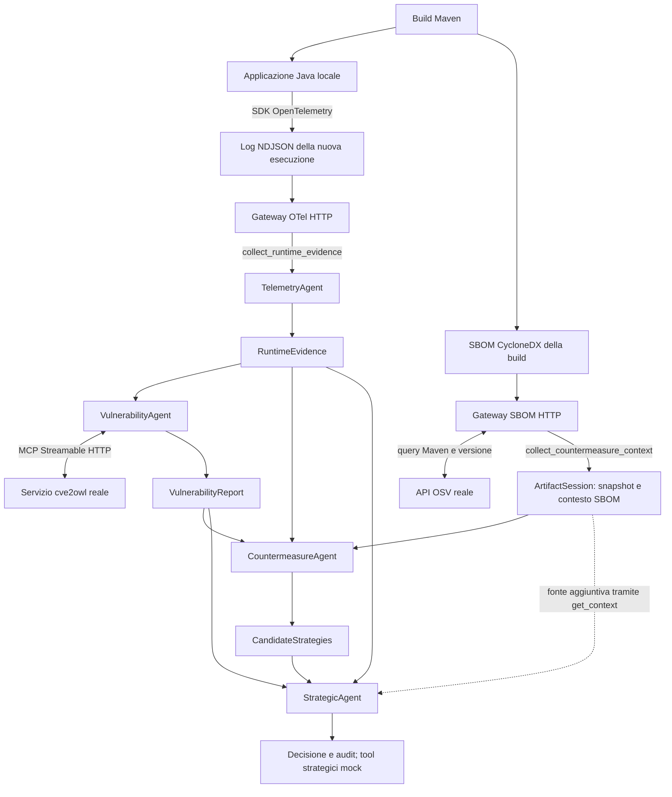

# Tre ingressi coerenti dalla stessa applicazione

Il collaudo collega una piccola applicazione Java eseguita localmente ai tre
ingressi della Workforce: log OpenTelemetry, lookup cve2owl e arricchimento
SBOM/OSV. La versione osservata proviene dal JAR caricato dall'applicazione;
la SBOM proviene dalle dipendenze risolte nella sua build Maven. Questo supera
il limite delle prove precedenti, che osservavano il Collector e descrivevano
Log4j con un inventario dimostrativo scritto a mano.

Il primo collaudo usa i quattro agenti e la Workforce **CAMEL effettivi**, guidati
dal modello programmato `ScriptedToolModel`. È stata completata anche una
[prova con Ollama effettivo](observed-app-ollama.md), riusando le stesse fonti:
`no_findings`, 475,59 secondi, 46 richieste LLM, audit passato con criticità
gestionali documentate. CTI e OSV sono reali; ranking, validazione semantica e
provenienza restano mock locali in entrambe le prove.
I due repository esterni non sono stati modificati in questo incremento.

## Applicazione e fonti

Il progetto è in [examples/observed-app](../examples/observed-app/).
`ObservedApplication` esegue cinque elaborazioni locali di importi dimostrativi,
usa Log4j per registrarle ed emette un log OpenTelemetry per ciascuna. Termina
dopo le cinque operazioni. Non rappresenta un servizio di produzione.

| Componente | Versione/configurazione verificata |
|---|---|
| Applicazione | `it.poliba.thesis:observed-app:1.0.0`, target Java 17 |
| Libreria osservata | `org.apache.logging.log4j:log4j-core:2.26.1` |
| SDK ed exporter OpenTelemetry Java | `1.66.0` |
| Generatore SBOM | `cyclonedx-maven-plugin:2.9.3`, `makeAggregateBom`, JSON 1.6 |
| Ambiente del collaudo | OpenJDK 25.0.2, Maven 3.9.11 |

L'applicazione legge titolo e versione da `LoggerContext.class.getPackage()`
e calcola lo SHA-256 del JAR che contiene la classe caricata. Non riceve la
versione come parametro di osservazione. Ogni esecuzione genera una nuova
`service.instance.id`. Le convenzioni `thesis.software.*` trasportano questi
dati negli attributi della risorsa; non sono attributi standard OTel.

I record sono emessi da `SdkLoggerProvider`, `SimpleLogRecordProcessor` e
dall'exporter pubblico `OtlpJsonLoggingLogRecordExporter`. Quest'ultimo produce
JSON tramite Java Util Logging: il nostro formatter aggiunge soltanto
l'involucro `resourceLogs` richiesto dal gateway e la separazione in righe.
Timestamp, risorsa e record sono serializzati dall'SDK. La strumentazione è
manuale: non è un bridge automatico di tutti i messaggi Log4j.

La modalità di acquisizione è `sdk-file`: esportazione diretta dei log SDK su
file, poi consultazione HTTP. Non sono stati avviati Collector o receiver OTLP;
non vengono raccolti tracce e metriche. Il nome della modalità non certifica
la freschezza: lo script di preparazione controlla che le osservazioni siano
comprese fra avvio e fine della nuova esecuzione Java. Una successiva lettura
dello stesso export resta una lettura di quelle osservazioni.

Maven genera la SBOM con **13 componenti**, incluse le dipendenze OpenTelemetry.
Il gateway la dichiara `sbom_kind=provided`: è fornita dalla build di questa
applicazione dimostrativa, non compilata a mano. Il client supporta ora anche
il qualificatore Maven esatto `?type=jar` prodotto dal plugin; altri tipi e
classifier restano rifiutati. La query OSV valuta soltanto il componente
associato `log4j-core`, non tutte le dipendenze inventariate.

## Collegamenti e controlli



Il DAG e la semantica della Workforce non cambiano. Lo Strategic legge
`RuntimeEvidence`, `VulnerabilityReport` e `CandidateStrategies` tramite
`get_context`; il contesto aggiuntivo è in `external_inputs.countermeasure`.
Gli agenti interrogano soltanto i contratti pubblici HTTP/MCP dei servizi.
Il comando di preparazione è uno strumento della demo, esterno alla Workforce;
non viene invocato dall'LLM e non produce gli artefatti degli agenti.

`prepare.py` confronta identità, versione e SHA-256 del JAR osservato con il
componente della SBOM. Rifiuta fonti discordanti, più istanze e osservazioni
fuori dalla finestra di esecuzione. Genera poi selettore, associazione,
configurazione backend e manifest delle fonti. Il selettore non contiene una
versione statica. La configurazione fissa anche l'hash atteso della SBOM.

Il confronto del JAR è un controllo locale dello script della demo, **non
un'attestazione remota effettuata dagli agenti**. Il codice dell'applicazione
produce gli attributi; gli hash permettono di controllare la coerenza dei file
conservati. Le verifiche della sessione restano quelle dei contratti OTel,
CTI e SBOM. I flag di esposizione e deserializzazione non osservati sono `null`;
le capacità operative sono `[]`, perché la demo non dispone di attuatori.

## Ripetere il collaudo

Servono JDK 17 o successivo, Maven e l'ambiente Python del progetto con le
dipendenze di sviluppo. La prima build scarica gli artefatti Maven; OSV richiede
Internet. Le prove non usano servizi LLM a pagamento.

Dalla radice di `tesi`, scegliere una directory nuova:

```sh
.venv/bin/python examples/observed-app/prepare.py \
  --output output/observed-app-sources-03
```

Il comando esegue `mvn -B -ntp package`, avvia Java e verifica le fonti.
`--skip-build` riusa la build presente in `target/`, ma esegue nuovamente
l'applicazione; il manifest registra esplicitamente `build_executed=false`.
Non usare questa opzione dopo modifiche a sorgenti o dipendenze. Le directory
non vengono sovrascritte. Il classpath usa i JAR nella cache Maven: la copia
di `application.jar` non è una distribuzione autosufficiente.

Avviare ciascun servizio in un terminale separato. Dalla radice di `tesi`:

```sh
.venv/bin/python services/otel_gateway/server.py \
  --file output/observed-app-sources-03/otel.jsonl \
  --source-id observed-app-sdk --acquisition sdk-file --port 8004
```

```sh
.venv/bin/python services/sbom_gateway/server.py \
  --sbom output/observed-app-sources-03/sbom.cdx.json \
  --source-id observed-app-build --sbom-kind provided \
  --service-name thesis-observed-app --runtime-package 'Apache Log4j Core' \
  --component-ref 'pkg:maven/org.apache.logging.log4j/log4j-core@2.26.1?type=jar' \
  --port 8005
```

L'associazione è salvata anche in `binding.json`. Se si cambia dipendenza,
usare i valori della nuova build. Questi server ascoltano soltanto su loopback.
Dal clone CTI, avviare il servizio separato già realizzato:

```sh
cd /Users/reucalion/Desktop/agent-based-cti-argumentation-pipeline
PYTHONPATH=app/src /Users/reucalion/tesi/.venv/bin/python -m cti_mcp.server \
  --sqlite app/data/cve2owl_20260523_143950.affected.sqlite \
  --dataset-id cve2owl_20260523_143950 --dataset-kind real --port 8003
```

È lo stesso interprete usato nel collaudo locale; il servizio resta un processo
distinto. Percorso del clone e dataset devono esistere. La
[guida CTI](cti-workforce.md) descrive contratto e configurazione.
Dalla radice di `tesi`, avviare la Workforce programmata:

```sh
.venv/bin/python tests/support/sbom_workforce_smoke.py \
  --backends output/observed-app-sources-03/backends.json \
  --input output/observed-app-sources-03/input.json \
  --output-dir output/observed-app-workforce-03
```

Per porte diverse il runner accetta `--telemetry-url`, `--supply-chain-url` e
`--cti-url`. La prova conservata ha usato rispettivamente 18044, 18045 e 18043.
Ogni ripetizione dello script `prepare.py` crea una nuova istanza e nuovi log;
riusare un suo output in più run CAMEL riusa invece quelle fonti. OSV viene
interrogato nuovamente per ogni nuova sessione e può restituire dati diversi.
Al termine fermare i tre server con `Ctrl+C` nei rispettivi terminali.

## Risultati del collaudo programmato

| Evidenza locale | Contenuto |
|---|---|
| [source_manifest.json](../output/observed-app-sources-20261007-02/source_manifest.json) | Build eseguita, comando Java, intervallo, cinque record, versione e hash del JAR, hash dei file |
| [Cartella delle fonti](../output/observed-app-sources-20261007-02/) | SBOM della build, export SDK, JAR applicativo, POM, log, input e profilo |
| [summary.json](../output/observed-app-workforce-20261007-01/summary.json) | Esito validato, `sdk-file`, SBOM `provided`, OSV `live`, CTI `real`, `llm_used=false` |
| [source_crosscheck.json](../output/observed-app-workforce-20261007-01/source_crosscheck.json) | Verifica locale aggiuntiva degli hash fra fonti preparate e snapshot ricevuti |
| [strategic_context.json](../output/observed-app-workforce-20261007-01/strategic_context.json) | Risposta `get_context` effettivamente ricevuta dallo Strategic |
| [countermeasure_context_received.json](../output/observed-app-workforce-20261007-01/countermeasure_context_received.json) | Risposta consegnata al Countermeasure |
| [Artefatti](../output/observed-app-workforce-20261007-01/artifacts/) e [run.log](../output/observed-app-workforce-20261007-01/run.log) | Snapshot OTel/CTI/SBOM, risposta OSV, pubblicazioni, audit e log CAMEL |

Il lookup su `Apache Log4j Core 2.26.1` ha restituito `no_findings` entro
l'identità e le regole CTI valutate. La query OSV non ha restituito advisory
per quel componente/versione. Candidate e ranking sono vuoti; la decisione è
`no_findings`, senza strategia selezionata o applicata. Non è una verifica di
sicurezza dell'intero inventario né una certificazione della versione.

I warning CAMEL sull'analisi qualitativa gestionale sono dovuti al modello
programmato, che non implementa quella risposta. I quality score di fallback
non vengono usati come misure sperimentali. La prova dimostra l'acquisizione,
la coerenza e la consegna dei dati, non la qualità della generazione LLM.

La suite completa ha concluso con **239 test superati in 49,93 secondi**.
I nove nuovi casi verificano l'associazione delle fonti, il rifiuto di hash,
versioni, istanze o tempi discordanti e i qualificatori Maven non supportati.
Questi test sono offline; la build Java e la prova con OSV reale descritte sopra
sono collaudi aggiuntivi, separati dalla suite. Comandi di verifica:

```sh
.venv/bin/pytest -q
.venv/bin/ruff check .
.venv/bin/ruff format --check .
```

## Inferenza Ollama e riferimenti

Il profilo generato può essere usato dalla CLI con Ollama configurato.
L'inferenza sui tre ingressi è stata completata usando le fonti conservate in
`observed-app-sources-20261007-02`; [misure e audit](observed-app-ollama.md)
distinguono l'esito valido dai retry qualitativi e dalla chiamata errata respinta.
Le [prove successive su prompt, memoria e budget](ollama-contract-tests.md)
riusano le stesse fonti con sessioni nuove: comprendono un successo e un
fallimento nelle due ripetizioni comparabili, oltre ai tentativi di sviluppo.
Il risultato storico riuscito non dimostra quindi affidabilità su ogni run.
Il collaudo della [revisione con pubblicazioni per fonte e tool per fase](agent-tool-phases.md)
conclude invece con due ripetizioni OTel complete e due complete sul caso
statico con finding, tutte con audit superati e senza retry. Questo risultato
verifica il completamento del flusso nel campione; le strategie selezionate
nei due casi positivi sono diverse e la loro qualità richiede una valutazione
separata. I dati OTel sono ancora quelli della raccolta conservata.
Per una nuova directory di fonti, il comando corrispondente è:

```sh
.venv/bin/python main.py --mode camel --workflow pipeline \
  --backends output/observed-app-sources-03/backends.json \
  --input output/observed-app-sources-03/input.json \
  --output output/observed-app-ollama-03
```

Il caso negativo ha verificato la conservazione delle fonti e la pubblicazione
di candidate vuote. Non dimostra l'assenza di errori nelle chiamate o nel testo
LLM: questi sono documentati nel resoconto. Il
[collaudo aggiornato del caso con finding](agent-tool-phases.md#risultati-delle-nuove-inferenze)
usa telemetria statica e SBOM dimostrativa, con capacità esplicite: non è una
nuova esecuzione dell'applicazione Java. Raccolta continua, analisi di
tutte le dipendenze, servizi strategici reali, PROV-O e Fabric restano incrementi
distinti; il default mock e gli scenari storici restano disponibili.

Le fonti tecniche consultate sono la
[documentazione Java SDK OpenTelemetry](https://opentelemetry.io/docs/languages/java/sdk/),
il [modulo logging-otlp](https://github.com/open-telemetry/opentelemetry-java/tree/main/exporters/logging-otlp)
e i [sorgenti della versione 1.66.0](https://repo.maven.apache.org/maven2/io/opentelemetry/opentelemetry-exporter-logging-otlp/1.66.0/opentelemetry-exporter-logging-otlp-1.66.0-sources.jar)
per il comportamento dell'exporter; la
[documentazione CycloneDX Maven](https://cyclonedx.github.io/cyclonedx-maven-plugin/)
e il [goal makeAggregateBom](https://cyclonedx.github.io/cyclonedx-maven-plugin/makeAggregateBom-mojo.html)
per la generazione della SBOM; le
[release note Log4j](https://logging.apache.org/log4j/2.x/release-notes.html)
per la libreria. Le versioni effettive sono fissate nel POM, indipendentemente
dai default delle documentazioni aggiornate. La scelta del workload, gli
attributi `thesis.*`, l'associazione dei file e lo script di preparazione sono
nostre scelte implementative. Le fonti dei contratti di consultazione sono
nella [guida OTel](opentelemetry-integration.md) e nella
[guida SBOM/OSV](sbom-osv-integration.md).
