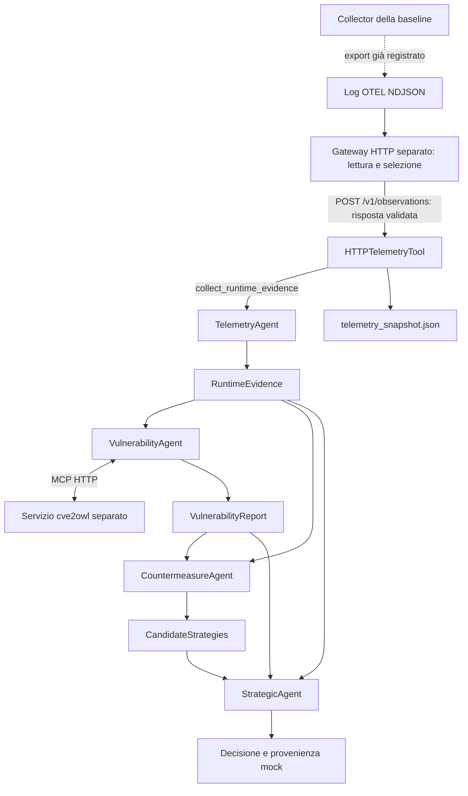

# Primo ingresso OpenTelemetry nella Workforce

Il TelemetryAgent può acquisire osservazioni da un servizio HTTP separato e
pubblicare `RuntimeEvidence` con riferimenti alla fonte. Il collaudo usa gli
export OpenTelemetry presenti nella baseline della tesi: è un'acquisizione
di **telemetria registrata**, non una nuova raccolta live. Il default statico
e la modalità `fixtures` restano disponibili.

Il successivo [collaudo dei tre ingressi](observed-app-integration.md) usa
osservazioni nuove da una piccola applicazione Java con SDK OpenTelemetry e
SBOM della stessa build. I risultati storici del Collector descritti qui
restano una prova distinta.

## Ricognizione dei due repository

Sono state esaminate le copie locali sulla Scrivania, prima di scegliere
l'ingresso. Nessun file dei due repository è stato modificato per questo
incremento; entrambi risultano puliti al termine del collaudo.

| Baseline privata | Revisione esaminata | Componenti rilevanti |
|---|---|---|
| `agent-based-cti-argumentation-pipeline` | `3b483624286262f2e0ac94b4b950b904a5dc2ad4` | `opentelemetry/docker-compose.yaml`, `otel-collector-config.yaml`, export in `opentelemetry/data/`, `app/src/utils/preprocessing.py` |
| `semantic-cti-ledger-argumentation` | `a3dab4a5def79dda356dd753aa34306e03ea346a` | `monitoring/docker-compose.yaml`: Prometheus, Grafana e Pushgateway sulla rete Fabric |

La prima baseline configura receiver `filelog` per log Docker, file YAML e
log del dataset Zenodo, con esportazione su file. Negli export possono quindi
coesistere log runtime e configurazioni: una stringa `image:` in un YAML non
dimostra che quel software fosse in esecuzione. La pipeline applicativa della
baseline comprende anche estrazione LLM e matching; il nostro processo degli
agenti non la importa né la avvia. Nella seconda baseline non è stato trovato
un servizio equivalente di consultazione OTel nelle configurazioni esaminate.

È stato riutilizzato `opentelemetry/data/small-otel-docker-logs.json` del primo
repository: 40.601 byte, 164 record e una osservazione riconoscibile dal parser
implementato. Il suo SHA-256 è:

```text
63c7e5d06f003cf077ae4998fb0c91fa18622d307f259ac6cff91c23295e5082
```

Il record riporta `otelcol-contrib`, versione `0.148.0`, istanza
`279d7212-ec98-40d8-9e1a-3aee4879572f`. La data di osservazione nel sistema di
raccolta è `2026-04-01T09:05:49.558966170Z`. Si tratta del Collector stesso,
non di una nuova osservazione di Log4j o dell'intero inventario applicativo.

Il daemon Docker non era raggiungibile durante la ricognizione. Non sono stati
avviati Collector, Fabric o nuove applicazioni strumentate. Gli attuali mount
Docker della baseline vanno verificati per l'ambiente macOS prima di una nuova
raccolta. Questo incremento non richiede nuove dipendenze Python.

## Flusso implementato



La consultazione della telemetria usa **HTTP applicativo**, non MCP. Il gateway
non è un receiver OTLP e non sostituisce il Collector. Il lookup CTI continua a
usare MCP. I quattro agenti, lo scheduling CAMEL e il DAG restano gli stessi:
lo Strategic legge i tre artefatti separati tramite `get_context`.

Il codice del gateway è in [services/otel_gateway](../services/otel_gateway/).
Il client conosce soltanto URL e contratto pubblico; solo il processo server
legge il file della baseline. Il gateway attuale ascolta su loopback e serve
al collaudo locale: un deployment su un altro host richiederà un servizio
esposto e autenticato. Il client non avvia script remoti o locali del backend.

## Input, mapping e controlli

`TelemetryInput` contiene servizio, istanza, nome software e finestra temporale,
oltre a capacità e policy esplicite. È un selettore: versione, esposizione e
deserializzazione non sono fornite dall'input, ma vengono dalle osservazioni.
Il primo incremento supporta un software per run, senza discovery dell'inventario.

Il parser riconosce due forme delimitate:

1. Attributi di risorsa `service.name`, `service.instance.id`,
   `thesis.software.name` e `thesis.software.version`.
2. Il self-log strutturato del Collector presente nella baseline, con identità
   nella proprietà `resource` del JSON nel body e metadati `otelcol.*`.

I campi `thesis.*` sono **convenzioni applicative del prototipo**, non attributi
standard OTel. I flag opzionali sono `thesis.endpoint.exposed` nella risorsa e
`thesis.deserialization.observed` nel record. Sono accettati solo booleani:
assenza o disaccordo fra osservazioni producono `null`. Testo libero, immagini
Docker dichiarate e righe YAML non vengono usati per inventare identità.
Il mapping è deterministico; non introduce un estrattore LLM.

La finestra è `[start_time, end_time)`, al massimo 24 ore, e seleziona
`observedTimeUnixNano`. Questo è il tempo di osservazione da parte del sistema
di raccolta, distinto dall'ora dell'evento originario. `acquired_at` è invece
l'ora in cui il gateway legge l'export. La distinzione segue il
[modello dei log OpenTelemetry](https://opentelemetry.io/docs/specs/otel/logs/data-model/).

Il gateway limita export a 16 MiB, richieste a 8 KiB e risultati a 100 record;
una query troppo ampia viene rifiutata senza troncamento silenzioso. File
incompleti o modificati/ruotati durante la lettura non producono snapshot
accettati. Il client limita la risposta a 1 MB, applica un timeout e verifica
Pydantic, fonte, modalità di acquisizione, query e digest della richiesta.
Errori HTTP, risultati vuoti o versioni multiple non attivano fallback statico.

`acquisition=recorded` dichiara l'uso di un export conservato.
`collector-file` permette di configurare un file alimentato dal Collector, ma
non dimostra da solo che i record siano recenti: i timestamp restano essenziali.
Questa seconda modalità non è stata collaudata con una nuova raccolta live.
`sdk-file` identifica invece l'esportazione diretta di log dell'SDK, verificata
con l'applicazione locale: non implica la presenza di un Collector e non
certifica da sola la freschezza. La nuova guida documenta il controllo dei tempi.
Identità e hash dichiarati dal servizio non costituiscono un'attestazione
indipendente di autenticità né dimostrano un exploit.

`ArtifactSession` consente la pubblicazione soltanto dopo
`collect_runtime_evidence()`, richiede l'evidence derivata esattamente dallo
snapshot e ne ricontrolla l'integrità fino alla decisione e alla provenienza.
Una nuova chiamata nello stesso run riusa lo snapshot; un nuovo run acquisisce
nuovamente. L'LLM non può cambiare il selettore attraverso gli argomenti del tool.

| File del run | Contenuto |
|---|---|
| `input.json` | Selettore, capacità e policy validati |
| `telemetry_snapshot.json` | Osservazioni selezionate, query, fonte, hash, conteggi e riferimenti ai record |
| `runtime_evidence.json` | Fatti pubblicati, valori sconosciuti e riferimento allo snapshot |
| `telemetry_events.jsonl` | Esito della chiamata HTTP, tempi e digest |
| `provenance.json` | Entità dello snapshot e dipendenza dell'attività Telemetry dalla raccolta |

Lo snapshot non contiene il corpo integrale dei log. Per ciascuna osservazione
conserva numero di riga, JSON Pointer e hash del record con la risorsa. Gli hash
di richiesta/snapshot usano il JSON canonico di `mcp.client.digest`; l'hash della
fonte riguarda i byte dell'export. Gli hash delle entità in `provenance.json`
riguardano i byte dei file salvati: sono rappresentazioni distinte.
Questa provenienza rimane JSON applicativo mock, senza PROV-O o ricevute Fabric.

I vecchi schemi MCP v1 sono congelati e verificati da test di regressione.
Il profilo OTel richiede per ora `semantic: local-mock`, perché il contratto
semantico MCP v1 non rappresenta l'evidence estesa con fonte e flag sconosciuti.
La configurazione rifiuta questa combinazione incompatibile.

## Esecuzione riproducibile

Dalla radice di `tesi`, con l'ambiente del progetto installato, avviare il
gateway in un terminale:

```sh
.venv/bin/python services/otel_gateway/server.py \
  --file /Users/reucalion/Desktop/agent-based-cti-argumentation-pipeline/opentelemetry/data/small-otel-docker-logs.json \
  --source-id baseline-small-otel-docker --acquisition recorded --port 8004
```

In un altro terminale, il collaudo CAMEL programmato con lookup e tool strategici
mock usa questo comando. Il runner richiede le dipendenze di sviluppo, non LLM:

```sh
.venv/bin/python tests/support/otel_workforce_smoke.py \
  --backends config/backends.otel-recorded.json \
  --input config/input.otel-recorded.json
```

Per aggiungere il lookup reale, avviare il servizio della
[guida CTI](cti-workforce.md#comandi) sulla porta 8003 e scegliere:

```sh
.venv/bin/python tests/support/otel_workforce_smoke.py \
  --backends config/backends.otel-cti.json \
  --input config/input.otel-recorded.json
```

Il runner salva una directory nuova in `output/`. Sono disponibili override
`--telemetry-url`, `--cti-url` e `--output-dir`. Nel collaudo conservato sono state
usate le porte 18044/18043. Il file di input seleziona deliberatamente il periodo
dell'export storico; cambiare soltanto l'orario con quello odierno non genera dati.

La CLI con inferenza effettiva richiede Ollama configurato in `.env` e i servizi
in esecuzione. Il comando seguente riguarda l'export storico del Collector;
la [prova LLM completata](observed-app-ollama.md) usa invece il profilo combinato
con log SDK dell'applicazione Java e SBOM della stessa build:

```sh
.venv/bin/python main.py --mode camel --workflow pipeline \
  --backends config/backends.otel-cti.json \
  --input config/input.otel-recorded.json --output output/otel-cti-ollama-01
```

`--mode fixtures` rifiuta gli ingressi remoti. Senza profilo backend rimane il
percorso statico originale.

## Prove e limiti

Il collaudo completo su export della baseline e database cve2owl reale è salvato
in [output/otel-cti-recorded-20261007-01](../output/otel-cti-recorded-20261007-01/):

- [summary.json](../output/otel-cti-recorded-20261007-01/summary.json): run validato,
  `llm_used=false`, lookup `ambiguous`, decisione `insufficient_evidence`.
- [strategic_context.json](../output/otel-cti-recorded-20261007-01/strategic_context.json):
  ricezione verificata dei tre artefatti distinti da parte dello Strategic.
- [run.log](../output/otel-cti-recorded-20261007-01/run.log) e `artifacts/`: log,
  snapshot, audit delle chiamate e artefatti validati.

Il modello programmato pilota chiamate effettive nella Workforce CAMEL, ma non
misura la qualità di un LLM. Gli avvisi dell'SDK sull'analisi qualitativa del
gestore dipendono dal fatto che il modello di test non implementa quella
risposta: i relativi quality score di fallback non sono risultati sperimentali.
Il lookup ambiguo non dimostra né vulnerabilità confermate né assenza di CVE.

I test dedicati coprono selezione per istanza/intervallo/software, flag mancanti,
versioni discordanti, file malformati/ruotati, pubblicazioni alterate, mancato
fallback e consegna dei tre artefatti allo Strategic attraverso HTTP e CAMEL.
La verifica completa ha concluso con **203 test superati in 47,17 secondi**;
Ruff e controllo della formattazione sono passati. La suite si esegue con
`.venv/bin/pytest -q`; per controlli statici:
`.venv/bin/ruff check .` e `.venv/bin/ruff format --check .`.

La [sorgente applicativa locale](observed-app-integration.md) aggiunge ora log
SDK recenti e una SBOM generata dalla build per lo stesso asset, insieme a CTI
e OSV reali. Restano da verificare raccolta continua, eventuali tracce e metriche
e i servizi strategici reali. La [prova Ollama sui tre ingressi](observed-app-ollama.md)
è completata: il resoconto riporta misure, verifica dei contesti e criticità,
distinte dal precedente collaudo programmato.

## Fonti e scelte del prototipo

Le fonti private effettivamente consultate sono i file e i commit della tabella
iniziale. Il [Collector OpenTelemetry](https://opentelemetry.io/docs/collector/)
fornisce raccolta, elaborazione ed esportazione della telemetria; il contratto
di consultazione HTTP qui esposto è invece una nostra aggiunta.
Il [modello dei log](https://opentelemetry.io/docs/specs/otel/logs/data-model/)
documenta risorsa, attributi e timestamp. Il selettore, il mapping a
`RuntimeEvidence`, i campi `thesis.*` e i controlli della sessione sono scelte
implementative originali, senza attribuzione a paper o ad algoritmi esterni.
