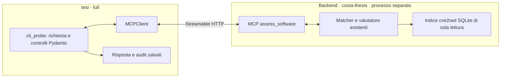
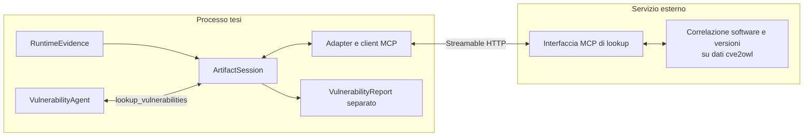

# Primo backend reale: correlazione OWL CTI / cve2owl

Stato: servizio MCP di lookup implementato nella copia locale di
`agent-based-cti-argumentation-pipeline`, sul branch `costa-thesis`. `tesi`
rimane su `full` e dispone sia del client isolato sia dell'adapter per la Workforce.
L'interoperabilità HTTP è verificata con dati sintetici e con il database reale
recuperato da Git LFS. Il [primo collaudo reale](cti-real-runs.md) documenta sette
richieste e i limiti emersi nella risoluzione dei prodotti e nelle regole di
versione. Il [collegamento al VulnerabilityAgent](cti-workforce.md) è implementato
e verificato con inferenza programmata; la nuova prova Ollama resta da svolgere.

## Interfacce documentate nella baseline

La copia locale di `agent-based-cti-argumentation-pipeline` contiene estrazione
degli asset, matching contro un indice SQLite derivato da cve2owl e valutazione
delle regole sulle versioni. Sono stati esaminati README e sorgenti alla baseline
`c2ea54278bc5f44730693cdf7f86fc3584e54f70`. Il servizio riusa
`ProductIdentityMatcher`, `SQLiteProductStore` e `assess_product_matches`, con
gli helper di identità già presenti; non introduce un algoritmo di correlazione.

La CLI `--product-match-only` esegue anche generazione OWL, costruzione del
grafo e tentativo di invio al ledger. Non costituisce quindi una semplice
operazione remota di lookup isolata. Il backend di lookup che ci serve deve
esporre soltanto correlazione e valutazione, senza attivare queste altre fasi.

Il README di `mcp-fablo-server` elenca `store_graph`, `rank_graph`, `get_graph`,
`get_rank_result` e `get_annotated_graph`, usando il trasporto stdio. Non vi è
documentato un tool per interrogare le vulnerabilità di un software.
Questo non dimostra l'assenza di servizi distribuiti altrove: occorre verificare
con chi gestisce il backend se esiste già un'API utilizzabile.

Nel backend sono stati aggiunti `app/src/cti_mcp/`, test e dipendenze minime
dedicate. È stato avviato soltanto questo servizio, prima su dati sintetici e
poi sull'indice reale. Gli algoritmi esistenti e la pipeline completa non
sono stati modificati.
La seconda copia, `semantic-cti-ledger-argumentation`, resta invariata.

## Collegamento isolato implementato



Il contratto pubblico è `cve2owl-assessment-v1`. Il client ne conserva una copia
in [cti_contracts.py](../thesis_agents/mcp/cti_contracts.py), senza importare il
motore esterno. La discovery confronta gli schemi; i controlli successivi
verificano query, evidence ID, hash della richiesta, tipo dichiarato del backend
e coerenza tra candidati e valutazioni. Il client non avvia il server.

La risposta conserva separatamente `matching` e `assessment`, con regole,
motivazioni, riferimenti IRI, identificativo e hash del dataset e hash dei
quattro moduli riutilizzati. Il matching usa SQLite esatto/per token, senza
Weaviate; soltanto i candidati `high` vengono valutati. Gli altri restano nel
matching. I punteggi sono euristiche della baseline, non probabilità.

Il numero di candidati è limitato e non garantisce copertura completa. Più
identità esatte possono mantenere confidenza alta. Inoltre, l'aggregazione della
baseline può produrre `not_vulnerable` anche con alcune regole non valutabili:
si conservano quindi i dettagli e non si equipara tale stato a software sicuro.
Non vengono inventati CVSS o CWE assenti. La lettura di questo indice derivato
da cve2owl non costituisce un'inferenza OWL né una consultazione completa del KG.

### Avvio manuale su dati reali

La [guida nel backend](/Users/reucalion/Desktop/agent-based-cti-argumentation-pipeline/app/CTI_MCP.md)
descrive installazione dedicata, struttura del dataset e test. Dalla sua radice:

```sh
python3.11 -m venv app/.venv
app/.venv/bin/python -m pip install -r app/requirements-mcp.txt
PYTHONPATH=app/src app/.venv/bin/python -m cti_mcp.server \
  --sqlite /percorso/al/dataset.affected.sqlite \
  --dataset-id identificativo-del-dataset \
  --dataset-kind real
```

Il percorso e l'identificativo vanno sostituiti con quelli del dataset fornito.
Il server rifiuta un file assente, uno schema incompatibile, un WAL non vuoto
o un indice modificato durante il servizio. Usare una copia fissa e checkpointed;
i controlli sui file non sostituiscono il controllo di scrittori concorrenti.
Il server iniziale è privo di autenticazione e usa loopback. Un deployment su
altro host richiederà una configurazione di accesso autenticata tramite HTTPS.

In un altro terminale, dalla radice di `tesi`:

```sh
.venv/bin/python -m thesis_agents.mcp.cti_probe \
  --url http://127.0.0.1:8003/mcp --expected-kind real \
  --product 'nome prodotto nel dataset' --vendor 'vendor' --version 'versione osservata' \
  --evidence-id probe-E1 --output-dir output/cti-real-probe-01
```

Questo comando salva `request.json`, `assessment.json`, `audit.json` e
`summary.json`. Rifiuta directory esistenti. Un errore resta tale e non produce
un report di dominio. Il risultato è una risposta del backend, non ancora un
`VulnerabilityReport`, una decisione degli agenti o una provenienza PROV-O.

### Prove eseguite e riproducibilità

- 20 test del servizio: versioni e intervalli, prodotto assente/ambiguo, regole
  mancanti, query indipendenti, integrità del dataset, discovery e chiamate HTTP.
- Test del client: rifiuto di risposte incoerenti e confusione tra fixture e
  dati reali; audit dei fallimenti e protezione degli output precedenti.
- Collaudo tra repository in processi separati: cinque risposte valide
  (vulnerabile, fuori intervallo, versione ignota, prodotto assente, identità
  ambigua) e rifiuto del server fixture quando è richiesto un backend reale.

Al termine del primo incremento isolato la suite di `tesi` concludeva con
**162 test superati**; quella del
servizio con **20 test superati**. Ruff e il controllo di formattazione passano
in `tesi` e sui nuovi sorgenti/test del backend. Per queste verifiche è stato
usato l'interprete `.venv` di `tesi`, avviando il backend in un processo distinto;
non è stata ancora verificata una nuova installazione del servizio in un
ambiente virtuale dedicato.

Le prove usano prodotti e CVE sintetici, `dataset.kind: fixture` e
`backend_kind: mock`, pur eseguendo il matcher e il valutatore effettivi della
baseline. Nessun LLM, servizio cloud o ledger viene invocato. Il collaudo HTTP
è riproducibile da `tesi`:

```sh
.venv/bin/python tests/support/cti_backend_smoke.py \
  --backend-root /Users/reucalion/Desktop/agent-based-cti-argumentation-pipeline
```

Il runner di test prepara una fixture e avvia il server in sottoprocessi; questa
possibilità appartiene al collaudo, non al client o al processo CAMEL.
Evidenza della prova:
`output/cti-mcp-smoke-20261003T075742Z-e2566241/summary.json`.
Il server viene terminato alla fine. La prova verifica il confine HTTP sulla
stessa macchina, non un deployment su host remoto o l'accuratezza su dati reali.

## Collegamento implementato alla Workforce



Il servizio isolato fornisce il confine HTTP di questo flusso; l'adapter
`CTIVulnerabilityTool` implementa il mapping tra risposta e artefatti della
Workforce. Configurazione, nuovi esiti e verifiche sono nella
[guida dell'adapter](cti-workforce.md).
Questa scelta non impone MCP a tutti gli altri ingressi dell'architettura.
`tesi` conserva solo contratti, client e adapter: non importa la pipeline esterna,
non apre il suo indice SQLite e non lancia i suoi script dal processo CAMEL.
Il servizio può inizialmente essere un processo/container separato sulla stessa
macchina per collaudare il confine HTTP; ciò non dimostra ancora un deployment
su un host remoto.

L'operazione richiesta è di sola lettura. La generazione delle candidate rimane
nel CountermeasureAgent; costruzione del grafo e decisione nello Strategic.
I backend di ranking, validazione e provenienza restano mock in questo incremento.

## Differenze rispetto al contratto iniziale

Il nuovo contratto isolato mantiene i dati della baseline. La tabella riassume
le differenze che hanno motivato l'adapter; gli esiti e i metadati sono ora
implementati. Rimane aperto l'arricchimento dell'identità con vendor/purl/IRI.

| Tema | Contratto iniziale in tesi | Requisito per il collegamento reale |
|---|---|---|
| Identità software | `package`, `version`, `evidence_id` | Identità non ambigua; concordare vendor/prodotto, ecosistema, purl o IRI secondo le capacità del backend |
| Matching | Fixture esatta | Distinguere identificazione del prodotto e valutazione della versione; mantenere metodi, esiti e riferimenti della fonte |
| Esiti | `matched` oppure `unsupported` | Distinguere finding, ricerca valutabile senza finding e dati insufficienti/non coperti |
| Metadati CVE | CVSS e confidence numerica obbligatori | Conservare dati realmente disponibili, rendendo esplicite le assenze; non inventare valori |
| Confidenza | Valore numerico in `[0,1]` | Non trasformare automaticamente categorie come `high` in probabilità o numeri arbitrari |
| Fonte | Stringa `source` | Riferimenti alle evidenze, versione del dataset/backend e, quando disponibili, IRI delle corrispondenze |
| Errori | Eccezioni MCP, timeout e controllo degli schemi | Rimanere errori tecnici; non convertirli in lista vuota o ricerca senza finding |

Una ricerca senza finding non certifica che il software sia sicuro. Si deve
conoscere se il prodotto è stato identificato, la versione è stata valutata e
quale copertura ha il dataset. Un'assenza in un output che riporta solo i match
vulnerabili non fornisce da sola tutte queste informazioni.

Lo schema `vulnerability-lookup-v1` resta invariato e verificato nella discovery.
Il nuovo profilo sceglie esplicitamente `cve2owl-assessment-v1`. I test confrontano
gli schemi MCP v1 precedenti e verificano gli artefatti storici e i profili mock.
Il servizio semantico MCP v1 non può ricevere il contesto CTI esteso: il nuovo
profilo richiede per ora il mock semantico locale.

## Impatto nel prototipo

Le modifiche applicate usano il nuovo contratto e risposte reali catturate,
conservando l'orchestrazione esistente:

- sintesi CTI nel lookup e nel report: identità, copertura, dati mancanti e fonti;
- contratto MCP e adapter: normalizzazione e validazione della risposta;
- `ArtifactSession`: coerenza tra lookup, report, candidate ed esito finale;
- prompt degli agenti: gestione dei nuovi esiti, senza trasformare assenze in fatti;
- spiegazioni e audit: descrizione coerente dei risultati e dei limiti della fonte;
- un profilo ibrido con l'endpoint reale soltanto per `vulnerability`.

`LookupResult`, `VulnerabilityReport`, prompt, spiegazioni e decisione finale
distinguono ora una ricerca valutabile senza finding da dati insufficienti e
da candidate tutte rifiutate. Non vengono riparate le regole della baseline né
dedotti alias dai nomi osservati. Gli hash e il contenuto dello snapshot
`cti_assessment.json` sono verificati fino alla conclusione del run.

`RuntimeEvidence` rimane prodotto da Telemetry e disponibile al lookup, a
Countermeasure e a Strategic. `VulnerabilityReport` mantiene un'identità e una
provenienza autonome. Il nuovo servizio non può riscrivere il software osservato.

## Sequenza di collaudo

1. Completato su fixture: servizio di correlazione isolato, contratto versionato
   e client di collaudo HTTP, senza agenti o altre fasi della pipeline.
2. Completato il primo collaudo isolato sullo snapshot reale, identificato tramite
   SHA-256. Restano da acquisire informazioni sul generatore e casi di riferimento
   indipendenti, chiarendo le regole non confrontabili emerse nelle prove.
3. Completati adeguamento degli artefatti e test dell'adapter: versione
   vulnerabile, negativa, identità ambigua, regole non valutabili, dati mancanti,
   riferimenti incoerenti, dataset inatteso e snapshot alterato.
4. Completata la prova della Workforce con inferenza programmata e dataset reale
   su cinque casi. I tre artefatti restano distinti; **187 test** passano nella
   suite completa, inclusa la regressione MCP dei profili mock.
5. Eseguire una prova completa con Ollama e il profilo ibrido, conservando
   configurazione, artefatti e audit delle chiamate. Una prova LLM/MCP con tutti
   i backend mock può precederla per isolare eventuali problemi di tool calling.

Un tool che si dichiara `backend_kind: real` non certifica la propria provenienza:
la verifica comprende il servizio effettivamente avviato, la versione del dataset
e il confronto con i casi di riferimento. Un dataset reale fissato a una versione
costituisce già una prima integrazione reale; non implica aggiornamento continuo.

## Riferimenti e informazioni ancora necessarie

- [README della copia locale della pipeline](/Users/reucalion/Desktop/agent-based-cti-argumentation-pipeline/README.md): sezioni Pipeline Architecture, Stage 3, Stage 4 e Run Matching and Semantic Stages.
- [README del ponte MCP/Fablo](/Users/reucalion/Desktop/agent-based-cti-argumentation-pipeline/mcp-fablo-server/README.md): tool pubblicati e trasporto stdio.
- [Contratti MCP attuali](../thesis_agents/mcp/contracts.py), [adapter lookup](../thesis_agents/tools/vulnerability_mcp.py) e [modelli di vulnerabilità](../thesis_agents/schemas/vulnerability.py).
- [Registro delle baseline](riferimenti/baseline-locali.json): identificazione delle copie censite nella revisione bibliografica; non certifica lo stato di un servizio distribuito.

È confermata la disponibilità delle copie locali. Il servizio isolato e
il suo contratto sono stati realizzati; il dataset reale è stato recuperato e
collaudato. I [risultati](cti-real-runs.md) richiedono un confronto con l'autore
sulla rappresentazione delle versioni. Il profilo Workforce
`config/backends.cti-real.json` seleziona il mapping specifico:
`cve2owl-assessment-v1` non è intercambiabile con `vulnerability-lookup-v1`.
Cambiare soltanto l'URL in un profilo precedente fallirebbe correttamente la
discovery. Non sono stati modificati gli algoritmi preesistenti nel backend.
