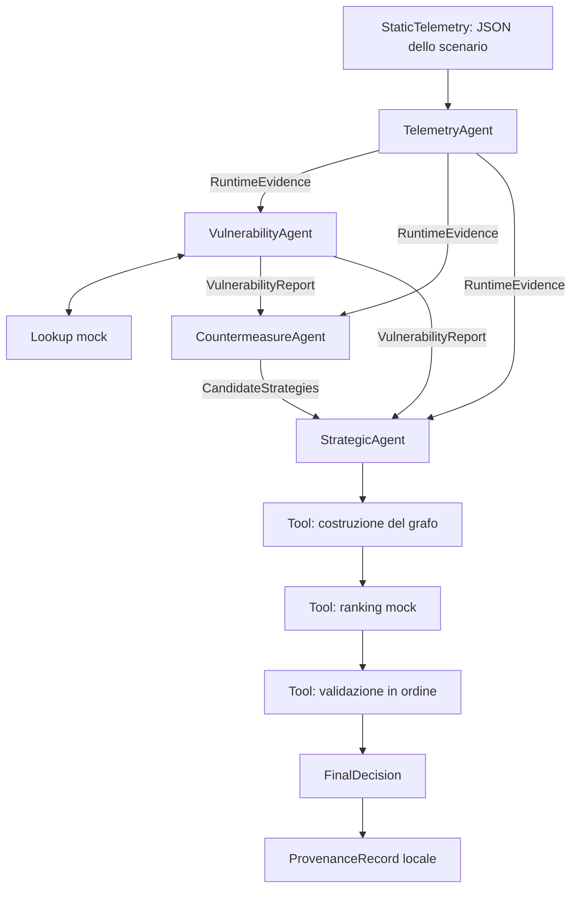

# Prototipo multi-agente per Agentic CTI

## Sintesi

Il progetto verifica se quattro agenti basati su LLM possano
collaborare mantenendo separati evidenze osservate, correlazioni di vulnerabilità,
proposte e decisioni. Il contributo implementativo consiste nel DAG esplicito,
nei contratti Pydantic, nello stato condiviso validato e nei controlli che
impediscono di sostituire le pubblicazioni con dichiarazioni di successo.
Il prototipo esegue CAMEL con Ollama locale e usa mock per i servizi esterni.
La valutazione comprende test automatici e quattro scenari ripetuti due volte.
I risultati sostengono la fattibilità del flusso sui casi provati; non dimostrano
la qualità operativa delle contromisure né l'affidabilità su inventari reali.
Il lavoro successivo riguarda l'integrazione progressiva dei servizi esterni
e l'estensione dei criteri di valutazione.

La relazione descrive il repository `tesi` e il package Python
`thesis_agents`. Presenta l'architettura realizzata,
le scelte implementative, le attività svolte e i comandi per riprodurre le prove.
Le evidenze sperimentali sono conservate nel repository e nell'ambiente locale
di lavoro. La parte teorica esplicita il modello adottato nel prototipo;
le interfacce dei componenti esterni dovranno essere verificate nei rispettivi
repository prima della loro integrazione.

L'impostazione dei ruoli e del flusso deriva dalla proposta di tesi [TESI].
I riferimenti teorici e tecnici sono raccolti nella bibliografia.

Nel documento, **CTI** indica la Cyber Threat Intelligence, **LLM** un modello
linguistico di grandi dimensioni, **DAG** un grafo diretto aciclico e **KG** un
grafo di conoscenza. Un **mock** è un'implementazione simulata e limitata di un
servizio; una **fixture** è un insieme di dati o risultati prefissati usato nelle
prove. Una **policy** esprime i vincoli sulle azioni consentite nello scenario.

## 1. Obiettivo e stato del lavoro

Il progetto studia un flusso di supporto alla decisione nel quale informazioni
sull'esecuzione di un servizio vengono correlate a vulnerabilità note. A partire
da queste evidenze, un agente propone contromisure; un agente strategico usa
strumenti di ranking e validazione per individuare una proposta compatibile con
le capacità e le policy dello scenario, conservandone la provenienza.

Il mockup è un prototipo eseguibile: i quattro agenti CAMEL utilizzano realmente
un LLM locale e invocano tool Python. Le integrazioni esterne sono rappresentate
da backend mock, con interfacce esplicite e risultati validati. Nessuna
contromisura viene applicata all'infrastruttura.

La valutazione comprende **otto esecuzioni complete e verificate su otto**, due per
ciascuno dei quattro scenari, e una suite automatica di **95 test superati**.
Questo risultato riguarda i casi e la configurazione
provati; non misura l'affidabilità generale del sistema.

## 2. Principi del modello

### 2.1 Evidenza, conoscenza, proposta e decisione

Il flusso distingue quattro responsabilità:

1. **Osservare:** rappresentare software, versione e condizioni runtime.
2. **Correlare:** cercare vulnerabilità associate al software osservato.
3. **Proporre:** generare alternative e stime di beneficio e impatto.
4. **Decidere:** ordinare le alternative, verificarne l'ammissibilità e motivare
   una selezione oppure un esito senza selezione.

Una correlazione di vulnerabilità non dimostra che sia avvenuto un exploit.
Una strategia proposta non è una strategia eseguita. Una stima generata dal
modello non è una misura empirica. Queste distinzioni determinano i contratti
degli artefatti e il significato degli esiti finali.

### 2.2 Agenti generativi e controlli deterministici

Nel prototipo un agente combina istruzioni di ruolo, un modello LLM, un insieme
di tool e un contesto di esecuzione gestito da CAMEL. L'LLM interpreta il task,
sceglie le chiamate consentite e produce gli argomenti. Il codice Python esegue
le operazioni e valida i dati proposti.

Questa separazione consente di usare la generazione linguistica per formulare
strategie e coordinare i passaggi, mantenendo controlli ripetibili sui fatti
critici, sui riferimenti e sulle condizioni di selezione. Il modello non può
rendere valida una strategia rifiutata semplicemente dichiarandola accettata.
Rimane possibile che produca descrizioni imprecise o chiamate errate: i controlli
limitano gli effetti sullo stato autorevole senza dimostrare la correttezza di
ogni frase generata.

### 2.3 Artefatti e DAG

Un artefatto è un risultato di dominio tipizzato, pubblicato attraverso un tool,
conservato nella sessione e serializzato in JSON. È distinto dal messaggio
conversazionale o dal riepilogo con cui un worker conclude un task CAMEL.

Le dipendenze sono descritte da un grafo diretto aciclico, o DAG. Un arco indica
che un task richiede i dati di un produttore precedente; non indica che il nuovo
risultato cancelli o sostituisca la fonte autorevole precedente. Nel caso
attuale i prerequisiti portano a un ordine sequenziale, ma i tre artefatti
strategici conservano identità, contenuto e produttore distinti.

## 3. Architettura implementata



| Task | Prerequisiti diretti | Pubblicazione principale |
|---|---|---|
| `telemetry` | nessuno | `RuntimeEvidence` |
| `vulnerability` | `telemetry` | `VulnerabilityReport` |
| `countermeasure` | `telemetry`, `vulnerability` | `CandidateStrategies` |
| `strategic` | tutti e tre i produttori | Grafo, ranking, validazioni, decisione, provenienza |

La dipendenza Telemetry → Vulnerability è necessaria: il lookup deve conoscere
il pacchetto e la versione effettivamente osservati. Il report delle vulnerabilità
non incorpora né sostituisce l'evidenza runtime. Il CountermeasureAgent usa
entrambi; lo Strategic legge separatamente i tre output mediante `get_context`.

Il diagramma sintetizza le dipendenze fra i quattro
agenti. Il successivo percorso di grafo, ranking, validazione, decisione e
registrazione della provenienza è svolto attraverso i tool dello StrategicAgent
ed è descritto nella sezione 6.

La modalità predefinita è `pipeline`. Il codice fornisce a CAMEL task e dipendenze
con `pipeline_add(..., auto_depend=False)` e `pipeline_build()`. L'opzione
`--workflow auto` delega la decomposizione al framework, mantenendo i controlli
sugli artefatti, ma non è la modalità valutata nella matrice qui presentata.

Fonte implementativa: [workforce.py](../thesis_agents/orchestration/workforce.py).

## 4. Come vengono usati CAMEL e l'LLM

### 4.1 Dichiarazione degli agenti

I file [agents/](../thesis_agents/agents/) definiscono `PROMPT` e `TOOLS` dei
quattro ruoli. Gli oggetti CAMEL sono creati in `build_workforce`, non nei moduli
dei prompt. Il seguente estratto ridotto mostra la costruzione:

```python
agent = ChatAgent(
    system_message=BaseMessage.make_assistant_message(
        role_name=role, content=COMMON + "\n" + module.PROMPT
    ),
    model=backend_factory(),
    tools=[publications.resolve(name) for name in module.TOOLS],
    max_iteration=20,
    retry_attempts=1,
    step_timeout=300,
)
workforce.add_single_agent_worker(
    description=f"{role}: {module.PROMPT}",
    worker=agent,
    pool_max_size=1,
    enable_workflow_memory=False,
)
```

Ogni ruolo riceve i propri tool. Per esempio, il CountermeasureAgent pubblica
strategie ma non possiede il tool per pubblicare la decisione finale. La
Workforce gestisce assegnazione, esecuzione, risultati e recuperi. Sono presenti
anche componenti gestionali CAMEL, fra cui coordinatore e task agent: non sono
ulteriori produttori di evidenze di dominio, ma contribuiscono alle richieste LLM.

Le memorie conversazionali dei worker non sono condivise (`share_memory=False`).
Lo stato di dominio comune è la stessa `ArtifactSession`, accessibile attraverso
i metodi associati ai tool.

Il riferimento scientifico generale a CAMEL è [CAMEL]; per le API utilizzate
fa fede il repository alla versione 0.2.90 [CAMEL-SDK]. Il DAG e i controlli
aggiunti nel progetto non sono risultati attribuiti al paper.

### 4.2 Ruolo del modello per ciascun agente

| Agente | Uso dell'LLM | Vincolo imposto dal codice |
|---|---|---|
| Telemetry | Legge il caso e propone l'evidenza strutturata | Identità software e fatti critici devono coincidere con l'input |
| Vulnerability | Invoca il lookup e pubblica il report | Il report deve coincidere con il risultato del tool |
| Countermeasure | Genera alternative, motivazioni, prerequisiti e stime | Schema valido e riferimenti a CVE presenti nel report |
| Strategic | Legge i tre input, invoca i tool in sequenza e propone la selezione | Ranking, tentativi semantici e selezione devono essere coerenti |

Il contributo generativo principale riguarda le strategie candidate. Le
trasformazioni di Telemetry e Vulnerability sono più vincolate, ma nel percorso
CAMEL sono comunque eseguite da agenti che effettuano chiamate reali al modello.
La formula di ranking e il controllo delle capacità non sono calcolati dall'LLM.

### 4.3 Backend di inferenza locale

[config.py](../thesis_agents/config.py) costruisce il backend con
`ModelFactory.create`. L'endpoint Ollama espone un'API compatibile con il client
usato dall'SDK; l'impiego dell'SDK OpenAI come client non significa che le
richieste vadano al servizio cloud OpenAI.
Questa modalità è documentata da Ollama [OLLAMA-API].

La configurazione valutata usa `tesi-qwen3:4b`, derivato da `qwen3:4b-instruct`,
con profilo in [Modelfile](../Modelfile), contesto configurato a 16.384 token e
temperatura 0. Il limite di 2048 token riguarda invece ciascuna risposta.
Le due grandezze non coincidono. Temperatura 0 non garantisce esecuzioni identiche.
I parametri sono descritti in [OLLAMA-MODELFILE]; il tag del modello è
documentato in [QWEN]. La configurazione sperimentale è una scelta del progetto.

## 5. Stato condiviso, artefatti e validazione

### 5.1 ArtifactSession e get_context

[ArtifactSession](../thesis_agents/orchestration/artifacts.py) mantiene modelli
Pydantic in memoria, conserva copie profonde e scrive i file pubblicati. Una
pubblicazione identica può essere ripetuta; una riscrittura differente viene
rifiutata. Il report semantico è accumulato progressivamente, perché deve
registrare anche i tentativi rifiutati.

`get_context()` restituisce input e artefatti sotto chiavi distinte, gli schemi
delle tre pubblicazioni principali e `artifact_producers`. Lo Strategic legge:

```text
artifacts.runtime_evidence       : TelemetryAgent
artifacts.vulnerability_report   : VulnerabilityAgent
artifacts.candidate_strategies   : CountermeasureAgent
```

I produttori sono metadati dichiarati dal prototipo, non identità certificate
crittograficamente. In modalità fixture hanno il prefisso `fixture:`.

### 5.2 File prodotti

Oltre alla copia `input.json`, ogni esecuzione completa produce otto output:

| File | Contenuto e significato |
|---|---|
| `runtime_evidence.json` | Servizio, software/versione, ID dell'evidenza e fatti runtime |
| `vulnerability_report.json` | Esito del lookup e finding con riferimenti all'evidenza |
| `candidate_strategies.json` | Alternative, categorie di azione, stime e prerequisiti |
| `argumentation_graph.json` | Proiezione delle candidate in nodi e relazioni |
| `ranking.json` | Ordine e punteggi restituiti dal backend |
| `semantic_validation.json` | Tentativi di validazione, rifiuti e relativo motivo |
| `final_decision.json` | Selezione o esito senza selezione, spiegazione e fonti |
| `provenance.json` | Entità, hash dei file, attività e ruoli del run |

### 5.3 Dove interviene Pydantic

I modelli sono in [schemas/](../thesis_agents/schemas/). La classe comune
`Message` vieta campi aggiuntivi e abilita la validazione delle assegnazioni.
Alcuni campi adottano controlli più specifici: booleani `StrictBool`, ID univoci,
stime finite in `[0,1]` e coerenza fra stato della decisione e strategia selezionata.
Questo non implica che tutti i tipi usino conversioni strettamente disabilitate.

La validazione avviene in più punti:

1. La CLI costruisce `StaticTelemetry` dall'input JSON.
2. [PublicationTools](../thesis_agents/orchestration/publication_tools.py) valida
   gli oggetti proposti ai tre tool di pubblicazione.
3. I metodi della sessione leggono i payload con `model_validate_json` e
   confrontano i risultati con gli altri artefatti.
4. `require` ricostruisce un modello validato quando un consumatore lo richiede.
5. `assert_complete` controlla tutti gli output, la corrispondenza memoria/file
   e la derivazione della spiegazione finale.

I vincoli interni a un modello e quelli fra modelli sono distinti. Un CVE può
avere sintassi corretta ma non provenire dal lookup: serve il confronto della
sessione. Analogamente, Pydantic può validare una frase non vuota senza provarne
la veridicità.
Le operazioni di validazione, copia e serializzazione sono documentate da
Pydantic [PYDANTIC]; gli invarianti tra artefatti sono implementati dal progetto.

### 5.4 Payload strutturati e risultato dei task

I tre tool di pubblicazione esposti a CAMEL accettano un oggetto `payload`;
l'LLM non deve generare una stringa che contenga un secondo JSON con escape.
L'adapter ricava lo schema dai modelli e serializza l'oggetto validato per
l'API della sessione. Anche un set vuoto deve essere pubblicato realmente:

```json
{"payload": {"strategies": []}}
```

[ArtifactTaskHandler](../thesis_agents/orchestration/task_results.py) adatta
il gestore di output strutturato dell'SDK. Verifica gli input prima dell'inferenza
e gli output prima di accettare un `TaskResult` con `failed=false`. Scrivere
«pubblicato» nel riepilogo non crea il relativo artefatto.

In pipeline, `ArtifactWorkforce` blocca i discendenti di un produttore fallito
definitivamente. Il recupero del produttore rimane gestito da CAMEL. Gli hook
usano API interne della versione fissata 0.2.90 e richiedono verifica in caso
di aggiornamento del framework.

## 6. Backend mock e logica della decisione

### 6.1 Lookup delle vulnerabilità

[MockVulnerabilityTool](../thesis_agents/tools/vulnerability_mock.py) contiene
una corrispondenza esatta: `log4j-core` versione `2.14.1` produce la fixture
`CVE-2021-44228`. La fonte dichiara esplicitamente che non è una query a un KG live.
Non vengono interrogati OWL CTI, OSV o feed aggiornati.
Il riferimento esterno per CVE-2021-44228 è il bollettino Apache [LOG4J];
il servizio e le osservazioni runtime dello scenario sono dati dimostrativi.

Per coppie non coperte il risultato è `unsupported`. Questo significa
informazione non disponibile nel lookup, senza attestare assenza di
vulnerabilità, stato del supporto del vendor o sicurezza del pacchetto.

### 6.2 Grafo argomentativo e ranking

Il prototipo rappresenta una candidata con un nodo strategia e due contributi:
beneficio di sicurezza come supporto e impatto operativo come attacco.
È una rappresentazione didattica di contributi favorevoli e contrari alla
proposta, non un'implementazione delle semantiche del BWAF finale.

[build_graph e MockRankingTool](../thesis_agents/tools/ranking_mock.py) applicano:

```text
score(s) = clamp(0.5 + 0.5 * beneficio(s) - 0.5 * impatto(s), 0, 1)
```

Il calcolo usa i pesi originali con un solo passo, arrotonda a otto decimali
e ordina per score decrescente; a parità di score usa l'ID. Non implementa
propagazione iterativa, risoluzione generale di cicli o smart contract.
`clamp` limita il valore all'intervallo indicato. Per la candidata upgrade delle
fixture: `0.5 + 0.5*0.95 - 0.5*0.20 = 0.875`.

La funzione è deterministica rispetto alle candidate ricevute. Le stime delle
candidate CAMEL sono però generate dall'LLM: ordinamenti diversi fra run
possono essere coerenti con lo stesso algoritmo.

**Origine e fondamento della formula.** Si tratta di un'euristica del mockup,
non di una formula tratta da un paper o dal contratto BWAF delle baseline.
Ponendo `B = beneficio` e `I = impatto`, la formula prima dell'arrotondamento è
`(1 + B - I) / 2`: una trasformazione affine di `B - I` da `[-1,1]` a `[0,1]`.
I coefficienti uguali attribuiscono lo stesso peso ai due contributi; `0.5`
è il valore per contributi uguali. In questo grafo il clamp è ridondante,
perché le stime sono già limitate. Ordinare per score equivale a ordinare per
`B - I`, salvo i pareggi introdotti dall'arrotondamento.

Queste proprietà matematiche non giustificano scientificamente la scelta dei
pesi, non calibrati su dati, né rendono lo score una probabilità di successo.
La regola serve a verificare ordinamento e fallback. I riferimenti
[BWAF-MN] e [BWAF-P] inquadrano le semantiche argomentative e la distinzione
fra aggregazione e influenza; non sono la fonte di questa formula.

### 6.3 Validazione e fallback

[MockSemanticTool](../thesis_agents/tools/semantic_mock.py) confronta capacità
e policy, senza ragionamento ontologico Tiny-ME. I requisiti obbligatori sono:

| Azione | Capacità richieste dal tool |
|---|---|
| `upgrade` | `package_upgrade`, `maintenance_window` |
| `isolate` | `network_isolation` |
| `block_deployment` | `deployment_control` |
| `monitor` | `monitoring` |

Il tool unisce questi requisiti a quelli aggiuntivi della candidata, verifica
le capacità mancanti, le azioni proibite e i riferimenti alle CVE note. I caveat
nel campo libero `constraints` non vengono interpretati semanticamente.

Lo Strategic deve validare in ordine di ranking e fermarsi al primo accettato.
Un rifiuto provoca il passaggio alla candidata successiva, conservando il motivo.
La selezione è una proposta compatibile con questi controlli limitati, non una
prova che l'azione sia sufficiente o sicura in produzione.

| Stato finale | Significato nel prototipo |
|---|---|
| `selected` | Selezionato il primo candidato accettato |
| `no_valid_strategy` | Tutte le candidate pubblicate sono state rifiutate |
| `insufficient_evidence` | Lookup non coperto, senza candidate fondate sul report |

Un crash o un timeout è invece un fallimento dell'esecuzione: non è uno di
questi esiti. Con ranking vuoto non si valida un ID inesistente; la pubblicazione
della decisione senza selezione crea anche il report semantico vuoto.
Il motore Tiny-ME è descritto in [TINYME]; i controlli del mock non ne
implementano i servizi di ragionamento.

### 6.4 Spiegazioni e provenienza

Le spiegazioni libere possono contenere versioni consigliate o deduzioni non
sostenute dalle fonti. Per questo il contratto conserva il testo
dell'agente in `agent_commentary`, marcato `unverified`. Il tool compone invece
`FinalDecision.explanation` da campi strutturati, con metodo `artifact-derived-v1`.

`explanation_claims` distingue dati riportati, stime, decisione e limiti. Ogni
claim cita artefatto, JSON Pointer e produttore. La sessione ricostruisce i claim
dai dati correnti per verificarli. La coerenza con un mock non trasforma i dati
del mock in fatti verificati nel mondo reale; le descrizioni delle strategie
rimangono da valutare criticamente. Le decisioni prive dei metadati di derivazione
sono trattate come `legacy-unverified`.

La provenienza locale registra otto hash: input e sette output di dominio,
escludendo il record di provenienza stesso. Le attività collegano dati usati e
generati ai ruoli. È una registrazione locale dichiarativa, senza firma,
conformità PROV-O attestata o transazione Hyperledger Fabric. I log SDK
conservano separatamente conversazioni e chiamate; gli hash non sostituiscono
un registro completo dell'esecuzione.
Il riferimento concettuale per entità, attività e agenti è PROV-O [PROVO],
previsto anche nella proposta [TESI, § 8].

## 7. Struttura del repository

```text
tesi/
  main.py                         # Entrypoint dalla radice
  pyproject.toml                  # Package, dipendenze e strumenti
  requirements.lock              # Versioni fissate per l'ambiente
  Modelfile                      # Profilo Ollama locale
  .env.example                   # Esempio di configurazione
  thesis_agents/
    main.py                      # CLI e avvio del run
    config.py                    # Creazione del backend LLM
    fixtures.py                  # Prova senza inferenza
    demo.py                      # Runner della matrice
    demo_audit.py                # Audit dei file e dei messaggi SDK
    agents/                      # Prompt e tool dei quattro ruoli
    schemas/                     # Contratti Pydantic
    orchestration/
      workforce.py               # Agenti CAMEL, task, DAG e blocchi
      task_results.py            # Prerequisiti e verifica delle pubblicazioni
      artifacts.py               # Stato validato e tool di dominio
      publication_tools.py       # Adapter dei payload strutturati
      explanations.py            # Spiegazione derivata dagli artefatti
    tools/
      interfaces.py              # Protocol dei backend sostituibili
      *_mock.py                  # Implementazioni locali
    data/                        # Caso base e quattro scenari JSON
  tests/                         # Contratti, CLI, integrazione SDK, runner
  docs/                          # Architettura, guide e resoconti
  output/                        # Risultati locali, esclusi da Git
```

La [guida alla lettura](reading-guide.md) collega i file commentati alle
responsabilità. `.env`, ambiente virtuale, cache e output non sono versionati.
Il manifest di una matrice identifica i sorgenti con hash; per distribuire una
versione riproducibile occorre conservare anche il codice corrispondente.

## 8. Scelte implementative e gestione degli errori

| Ambito | Soluzione implementata | Evidenza |
|---|---|---|
| Strutturazione | Quattro ruoli, modelli Pydantic, sessione comune, DAG con convergenza dei tre artefatti | [Architettura](architecture.md), sorgenti e test |
| Esecuzione LLM | Pipeline locale con Ollama e recupero dei task per output mancanti | [Integrazione locale](ollama-first-run.md) |
| Scenari limite | Prove con policy e capacità diverse, gestione degli insiemi vuoti e limiti alla generazione | [Scenari](demo-scenarios.md), [prove](ollama-demo-runs.md) |
| Pubblicazioni | Payload a oggetto, pubblicazione esplicita delle candidate vuote e blocco dei task dipendenti | [Tool strutturati](structured-tools-runs.md) |
| Spiegabilità | Spiegazione derivata dagli artefatti e commento LLM separato | [Spiegazioni](artifact-explanations.md) |
| Riproducibilità | Runner, matrice sperimentale e audit degli esiti | [Runner](demo-runner.md), [matrice](demo-matrix-runs.md) |

I problemi sono stati affrontati al confine fra generazione e stato autorevole:
payload malformati, dichiarazioni di successo senza pubblicazione, chiamate
su ranking vuoto e inferenze a valle di produttori falliti. I test negativi
verificano che questi casi non generino decisioni incoerenti. I log distinguono
i tentativi falliti dagli esiti finali delle esecuzioni.

## 9. Comandi di preparazione e riproduzione

I comandi di questa sezione vanno eseguiti dalla radice del repository e
descrivono la preparazione dell'ambiente e l'avvio delle prove. I manifest
sperimentali identificano la configurazione e gli argomenti delle esecuzioni
valutate.

### 9.1 Ambiente Python

```bash
python3.12 -m venv .venv
source .venv/bin/activate
python -m pip install -r requirements.lock
python -m pip install --no-deps -e .
```

Il progetto dichiara Python 3.11–3.12. L'ambiente della matrice usa Python
3.12.6, CAMEL 0.2.90 e Pydantic 2.12.0. L'installazione delle dipendenze non
avvia inferenza. Per lo sviluppo senza riprodurre esattamente il lock è
disponibile anche `python -m pip install -e '.[dev]'`.

### 9.2 Profilo Ollama

Se il modello base non è già presente:

```bash
ollama pull qwen3:4b-instruct
```

Con Ollama avviato, dalla radice del repository:

```bash
ollama create tesi-qwen3:4b -f Modelfile
```

Per la CLI generale, configurare `.env` a partire da `.env.example` senza
sovrascrivere un file personale già compilato:

```dotenv
LLM_MODEL=tesi-qwen3:4b
LLM_API_KEY=local
LLM_BASE_URL=http://localhost:11434/v1
LLM_TIMEOUT_SECONDS=300
LLM_TEMPERATURE=0
LLM_MAX_TOKENS=2048
```

Il runner della demo imposta questi valori localmente per il processo figlio,
senza dipendere dalle eventuali credenziali cloud in `.env`. La CLI generale
rispetta invece la configurazione scelta e la precedenza delle variabili shell.

### 9.3 Un caso, senza e con LLM

```bash
.venv/bin/python main.py --mode fixtures \
  --input thesis_agents/data/demo_01_nominal.json

LLM_MODEL=tesi-qwen3:4b LLM_API_KEY=local \
LLM_BASE_URL=http://localhost:11434/v1 LLM_TEMPERATURE=0 \
LLM_TIMEOUT_SECONDS=300 LLM_MAX_TOKENS=2048 \
.venv/bin/python main.py --mode camel --workflow pipeline \
  --input thesis_agents/data/demo_01_nominal.json
```

`fixtures` esercita gli stessi contratti usando proposte prefissate, senza
inferenza LLM. `camel` esegue i worker con il modello configurato. Ogni run usa una directory
distinta; la CLI rifiuta destinazioni non vuote.

### 9.4 Test, schemi e matrice

```bash
.venv/bin/python -m pytest -q
.venv/bin/ruff check .
.venv/bin/ruff format --check .
git diff --check

.venv/bin/python main.py --export-schemas output/schemas
.venv/bin/python -m thesis_agents.demo --mode fixtures --repetitions 1
.venv/bin/python -u -m thesis_agents.demo --mode camel --repetitions 2
```

L'export degli schemi non usa LLM. Il runner avvia processi separati, imposta
un limite esterno di 300 secondi per run e salva anche i risultati parziali.
Per una prova mirata si può aggiungere, ad esempio,
`--scenarios demo_02_no_maintenance demo_03_all_actions_prohibited`.

## 10. Valutazione e risultati

### 10.1 Tre livelli di verifica

| Livello | Che cosa viene eseguito | Che cosa dimostra |
|---|---|---|
| Fixture e test dei contratti | Proposte prefissate e tool locali | Coerenza e gestione dei casi positivi/negativi |
| Integrazione SDK nei test | Workforce e tool CAMEL reali con risposte del modello programmate | Scheduling, pubblicazioni, passaggio del contesto e recuperi |
| Matrice Ollama | Agenti CAMEL con inferenza locale effettiva | Comportamento osservato del modello sui quattro casi |

La suite di 95 test e i controlli Ruff hanno esito positivo nella configurazione
valutata. I dodici casi dedicati al runner coprono timeout reale di un subprocess, interruzione,
prosecuzione dopo un errore, protezione degli output e rilevamento di alterazioni.
I test automatici non sostituiscono la valutazione dei testi generati dall'LLM.

### 10.2 Scenari

| Scenario | Variazione | Esito delle fixture | Esito LLM nelle due ripetizioni |
|---|---|---|---|
| Nominale | Tutte le capacità presenti | `S_UPGRADE` | `S_UPGRADE` entrambe |
| Senza manutenzione | Assente `maintenance_window` | Upgrade rifiutato, poi `S_ISOLATE` | Upgrade rifiutato, poi `S_MONITOR` entrambe |
| Azioni vietate | Tutte e quattro le categorie vietate | `no_valid_strategy` | `no_valid_strategy` entrambe |
| Lookup non supportato | Pacchetto sintetico non coperto | `insufficient_evidence` | `insufficient_evidence` entrambe |

La diversa scelta del caso senza manutenzione è coerente con le stime e
l'ordine generati nei run LLM. Il monitoraggio selezionato supera i controlli
di capacità e policy; ciò non significa che rimuova la vulnerabilità.

### 10.3 Risultati della matrice sperimentale

Comando effettivamente eseguito:

```bash
.venv/bin/python -u -m thesis_agents.demo --mode camel --repetitions 2
```

Il batch sperimentale è identificato nel [resoconto della matrice](demo-matrix-runs.md).
Configurazione e hash sono in `manifest.json`; i risultati in `summary.json`
e `summary.md`. La matrice comprende due esecuzioni indipendenti per scenario.

| Scenario | Ripetizione 1: secondi / richieste | Ripetizione 2: secondi / richieste |
|---|---:|---:|
| Nominale | 125,43 / 22 | 135,10 / 27 |
| Senza manutenzione | 118,50 / 23 | 116,81 / 23 |
| Azioni vietate | 114,49 / 25 | 113,10 / 25 |
| Lookup non supportato | 150,78 / 37 | 111,14 / 30 |

Tutti gli otto run hanno codice 0, otto output validi, input conservato,
hash corrispondenti, spiegazioni coerenti con le fonti e messaggi SDK contenenti
i tre input distinti consegnati allo Strategic. La somma dei tempi dei processi
è 985,35 secondi, circa 16 minuti e 25 secondi; le richieste LLM sono 212,
incluse quelle gestionali. Le misure si riferiscono a questa macchina e batch.

Il secondo nominale ha richiesto un recupero dello Strategic dopo una conclusione
prematura senza decisione e provenienza. Nei due casi non supportati il quality
check CAMEL ha richiesto rispettivamente tre e due retry, giudicando insufficienti
i risultati vuoti, che erano conformi allo scenario. Nel primo è stata respinta
anche una chiamata di validazione su ranking vuoto. Gli output finali sono
corretti secondo i contratti, ma non tutti i percorsi sono stati privi di errori.

`failed_task_attempts` conta il percorso SDK `failed (attempt ...)`; i retry
del quality check sono distinti e vanno letti nel log. Il [resoconto completo](demo-matrix-runs.md)
li distingue esplicitamente. Un punteggio di qualità assegnato dall'LLM non
sostituisce la verifica deterministica degli artefatti.

## 11. Componenti effettivi, mock e integrazioni future

| Componente concettuale | Stato attuale | Collegamento successivo |
|---|---|---|
| Agenti e orchestrazione CAMEL | Implementati e provati con inferenza | Valutazione su più casi e possibili affinamenti dei quality check |
| LLM | Ollama locale, tool calling reale | Confronto di modelli a parità di contratti, se necessario |
| Telemetria/OpenTelemetry | Input statico validato | Adapter per normalizzare osservazioni e relativa provenienza |
| SBOM, OSV, OWL CTI/KG | Lookup esatto su una fixture | Adapter per inventario, identificazione/versioni e correlazione con fonti reali |
| MCP | Non usato come trasporto applicativo dei tool | Esposizione o invocazione dei servizi esterni dietro gli adapter |
| Argumentation SC / BWAF | Grafo e ranking mock a un passo | Backend argomentativo reale e normalizzazione del risultato |
| Semantic Validation SC / Tiny-ME | Controllo locale di capacità e policy | Mapping ontologico e adapter per il ragionamento previsto |
| Hyperledger Fabric / provenienza | JSON e hash locali | Mapping concordato di entità/attività e persistenza con ricevute reali |

La presenza della dipendenza MCP nell'ambiente non equivale a un collegamento
MCP già implementato. Allo stesso modo, costruire un grafo con supporti e attacchi
non equivale a eseguire l'algoritmo BWAF o un contratto su blockchain.

I punti di sostituzione sono i quattro `Protocol` in
[tools/interfaces.py](../thesis_agents/tools/interfaces.py) e la dependency
injection di `ArtifactSession`: `vulnerability_tool`, `ranking_tool`,
`semantic_tool`, `provenance_tool`. Per la telemetria servirà inoltre un adapter
di ingresso; non basta cambiare il nome del file statico in OpenTelemetry.

Le firme effettive dei servizi esterni, i formati BWAF, le ontologie e le ricevute
di transazione richiedono verifiche di compatibilità prima di implementare
gli adapter. Le integrazioni elencate sono una mappa di lavoro, non chiamate
già collaudate. Un ampliamento a inventari multi-componente potrà richiedere
anche l'evoluzione del contratto, oggi limitato a una singola osservazione software.

I riferimenti generali sono [OTEL], [MCP], [OWL], [OSV], [SBOM] e [FABRIC].
Essi definiscono tecnologie e formati; non attestano implementazioni nel mockup.

Le baseline private [BASE-PIPELINE] e [BASE-LEDGER], ai commit rispettivamente
`c2ea542` e `a3dab4a`, forniscono i componenti esterni previsti dall'architettura.
Il backend delega il ranking da `RankGraph` a
`ComputeRank`, quindi a `Graph::newCalculateRank_new()` mediante un wrapper
C++. La copia consultata contiene l'header e la libreria `libgraph.so`, ma
non è stato trovato il corpo della funzione nei due alberi locali.
Non è quindi possibile attribuire al backend una formula completa o uno dei
paper citati sulla sola base di queste interfacce. Il dettaglio dell'esame,
i file e gli hash sono in `docs/fonti-e-scelte.md` e
`docs/riferimenti/baseline-locali.json`. I repository sono stati letti, non eseguiti
né integrati. La proposta [TESI, § 9] li identifica come lavori preesistenti,
distinti dal contributo implementativo del mockup.

## 12. Percorso della dimostrazione e lavoro successivo

Per la presentazione si può partire dall'input di uno scenario e seguire:

1. `RuntimeEvidence` e `VulnerabilityReport`, mostrando identità e produttori distinti.
2. Candidate e stime, quindi grafo e ranking calcolato dal mock.
3. Tentativi semantici, motivo di un rifiuto e primo candidato accettato.
4. Decisione, riferimenti della spiegazione e commento LLM non verificato.
5. Provenienza locale e confronto con il riepilogo della matrice.

Una prova live nominale permette di osservare CAMEL e Ollama in azione. Gli
output già verificati permettono di discutere anche gli altri scenari senza
dipendere dai tempi o dal comportamento di una nuova generazione.

Restano aperti la valutazione qualitativa delle candidate, la gestione più
consapevole degli esiti vuoti nei quality check CAMEL, una sperimentazione più
ampia e gli adapter dei backend reali. Il passo successivo concordabile con il
docente è scegliere un'integrazione alla volta, mantenendo artefatti e test di
contratto come confine fra agenti e servizi.

## Riferimenti interni e tracciabilità

Le cartelle `output/` contengono le evidenze locali e non vengono distribuite automaticamente
con Git; per consegnarle occorre includere esplicitamente il batch pertinente.

La documentazione di supporto è organizzata nei seguenti percorsi,
relativi alla radice del repository:

| Documento | Percorso nel repository |
|---|---|
| Installazione e avvio | `README.md` |
| Architettura e guida al codice | `docs/architecture.md`, `docs/reading-guide.md` |
| Dati e scenari dimostrativi | `thesis_agents/data/README.md`, `docs/demo-scenarios.md` |
| Integrazione locale | `docs/ollama-first-run.md` |
| Prove e correzioni dei tool | `docs/ollama-demo-runs.md`, `docs/structured-tools-runs.md` |
| Spiegazioni e fonti | `docs/artifact-explanations.md` |
| Runner e risultati della matrice | `docs/demo-runner.md`, `docs/demo-matrix-runs.md` |

## Bibliografia e fonti consultate

Riferimenti verificati nella revisione del 17 settembre 2026. Le fonti teoriche
aggiunte in questa fase non sono attribuite retroattivamente allo sviluppo.
Ambito e parti consultate sono registrati in `docs/riferimenti/fonti.json`.
Le fonti grafiche sono [POLIBA] e [PT-SANS]; il logo proviene dal sito
dell'Ateneo, con URL e hash in `docs/materiali/assets/sources.json`.

**[TESI]** Alessandro Costa. *Toward Explainable Agentic Cyber Threat Intelligence: Semantic Smart Contracts, Argumentation Ranking and Runtime Observability*. 2026.

Fonte: [riferimenti/proposta-agentic-cti.pdf](riferimenti/proposta-agentic-cti.pdf).

**[CAMEL]** Guohao Li and Hasan Abed Al Kader Hammoud and Hani Itani and Dmitrii Khizbullin and Bernard Ghanem. *CAMEL: Communicative Agents for "Mind" Exploration of Large Language Model Society*. 2023.

Fonte: [https://arxiv.org/abs/2303.17760](https://arxiv.org/abs/2303.17760).

**[CAMEL-SDK]** CAMEL-AI. *CAMEL repository, versione v0.2.90*. s.d..

Fonte: [https://github.com/camel-ai/camel/tree/v0.2.90](https://github.com/camel-ai/camel/tree/v0.2.90).

**[PYDANTIC]** Pydantic contributors. *Models — Pydantic documentation*. s.d..

Fonte: [https://docs.pydantic.dev/latest/concepts/models/](https://docs.pydantic.dev/latest/concepts/models/).

**[OLLAMA-API]** Ollama. *OpenAI compatibility*. s.d..

Fonte: [https://docs.ollama.com/api/openai-compatibility](https://docs.ollama.com/api/openai-compatibility).

**[OLLAMA-MODELFILE]** Ollama. *Modelfile Reference*. s.d..

Fonte: [https://docs.ollama.com/modelfile](https://docs.ollama.com/modelfile).

**[QWEN]** Ollama. *qwen3:4b-instruct — model library entry*. s.d..

Fonte: [https://ollama.com/library/qwen3:4b-instruct](https://ollama.com/library/qwen3:4b-instruct).

**[LOG4J]** Apache Software Foundation. *Apache Logging Services — Security, CVE-2021-44228*. s.d..

Fonte: [https://logging.apache.org/security.html](https://logging.apache.org/security.html).

**[BWAF-MN]** Till Mossakowski and Fabian Neuhaus. *Modular Semantics and Characteristics for Bipolar Weighted Argumentation Graphs*. 2018.

Fonte: [https://arxiv.org/abs/1807.06685](https://arxiv.org/abs/1807.06685).

**[BWAF-P]** Nico Potyka. *Extending Modular Semantics for Bipolar Weighted Argumentation*. 2019.

Fonte: [https://www.ifaamas.org/Proceedings/aamas2019/pdfs/p1722.pdf](https://www.ifaamas.org/Proceedings/aamas2019/pdfs/p1722.pdf).

**[TINYME]** Michele Ruta and Floriano Scioscia and Ivano Bilenchi and Filippo Gramegna and Giuseppe Loseto and Saverio Ieva and Agnese Pinto. *A multiplatform reasoning engine for the Semantic Web of Everything*. 2022.

Fonte: [https://sisinflab.poliba.it/publications/2022/RSBGLIP22/Ruta_et_al_JWS2022_Tiny-ME_CR.pdf](https://sisinflab.poliba.it/publications/2022/RSBGLIP22/Ruta_et_al_JWS2022_Tiny-ME_CR.pdf).

**[PROVO]** W3C. *PROV-O: The PROV Ontology*. 2013.

Fonte: [https://www.w3.org/TR/prov-o/](https://www.w3.org/TR/prov-o/).

**[OTEL]** OpenTelemetry. *What is OpenTelemetry?*. s.d..

Fonte: [https://opentelemetry.io/docs/what-is-opentelemetry/](https://opentelemetry.io/docs/what-is-opentelemetry/).

**[MCP]** Model Context Protocol contributors. *Architecture — specification 2025-06-18*. 2025.

Fonte: [https://modelcontextprotocol.io/specification/2025-06-18/architecture](https://modelcontextprotocol.io/specification/2025-06-18/architecture).

**[OSV]** OpenSSF. *Open Source Vulnerability format*. s.d..

Fonte: [https://ossf.github.io/osv-schema/](https://ossf.github.io/osv-schema/).

**[OWL]** W3C. *OWL 2 Web Ontology Language Document Overview, Second Edition*. 2012.

Fonte: [https://www.w3.org/TR/owl2-overview/](https://www.w3.org/TR/owl2-overview/).

**[FABRIC]** Hyperledger Fabric contributors. *Smart Contracts and Chaincode*. s.d..

Fonte: [https://hyperledger-fabric.readthedocs.io/en/latest/smartcontract/smartcontract.html](https://hyperledger-fabric.readthedocs.io/en/latest/smartcontract/smartcontract.html).

**[SBOM]** CISA. *Framing Software Component Transparency: Establishing a Common Software Bill of Materials, Third Edition*. 2024.

Fonte: [https://www.cisa.gov/sites/default/files/2024-10/SBOM%20Framing%20Software%20Component%20Transparency%202024.pdf](https://www.cisa.gov/sites/default/files/2024-10/SBOM%20Framing%20Software%20Component%20Transparency%202024.pdf).

**[POLIBA]** Politecnico di Bari. *Piano della comunicazione 2022*. 2022.

Fonte: [https://www.poliba.it/sites/default/files/piano_comunicazione_2022_3_aprile_2022.pdf](https://www.poliba.it/sites/default/files/piano_comunicazione_2022_3_aprile_2022.pdf).

**[PT-SANS]** ParaType and Google Fonts. *PT Sans — Google Fonts distribution*. s.d..

Fonte: [https://github.com/google/fonts/tree/main/ofl/ptsans](https://github.com/google/fonts/tree/main/ofl/ptsans).

**[BASE-PIPELINE]** sisinflab-swot (organizzazione del repository; autori individuali da confermare). *agent-based-cti-argumentation-pipeline*. s.d..

Fonte: [https://github.com/sisinflab-swot/agent-based-cti-argumentation-pipeline/tree/c2ea54278bc5f44730693cdf7f86fc3584e54f70](https://github.com/sisinflab-swot/agent-based-cti-argumentation-pipeline/tree/c2ea54278bc5f44730693cdf7f86fc3584e54f70).

**[BASE-LEDGER]** sisinflab-swot (organizzazione del repository; autori individuali da confermare). *semantic-cti-ledger-argumentation*. s.d..

Fonte: [https://github.com/sisinflab-swot/semantic-cti-ledger-argumentation/tree/a3dab4a5def79dda356dd753aa34306e03ea346a](https://github.com/sisinflab-swot/semantic-cti-ledger-argumentation/tree/a3dab4a5def79dda356dd753aa34306e03ea346a).
