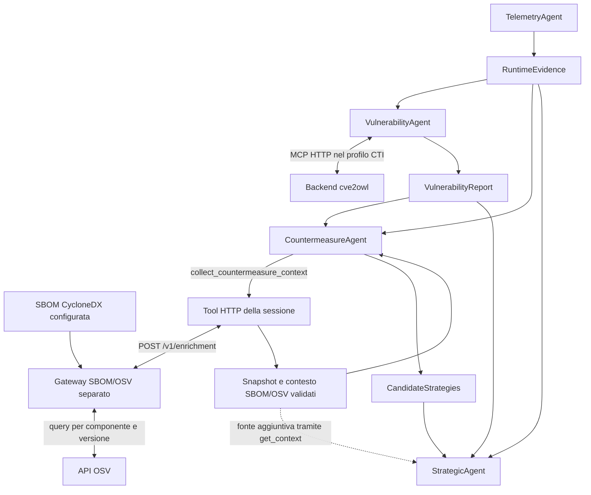

# Ingresso SBOM/OSV per CountermeasureAgent

Il CountermeasureAgent può acquisire un contesto aggiuntivo da un servizio HTTP
che legge una SBOM e interroga OSV per il componente associato al software
osservato. L'agente continua a generare `CandidateStrategies`; `RuntimeEvidence`
e `VulnerabilityReport` restano input autorevoli distinti. Il profilo è opzionale:
senza configurazione rimane il comportamento precedente.

È disponibile anche un [collaudo con tre ingressi coerenti](observed-app-integration.md):
log SDK di una nuova esecuzione Java, SBOM generata dalla sua build, CTI e OSV
reali. La SBOM scritta a mano e i risultati statici descritti qui restano una
prova distinta.

## Verifica delle baseline e origine dei dati

La ricerca nelle due copie locali ha riguardato nomi di file, marcatori
`bomFormat`/`spdxVersion`, riferimenti CycloneDX e chiamate OSV nei sorgenti e
nelle configurazioni, escludendo dipendenze installate e grandi dataset. Non è
emersa una SBOM applicativa utilizzabile. Non è una certificazione dell'assenza
di inventari in altri branch, archivi o servizi non presenti nelle copie.

| Repository privato | Commit esaminato | Risultato pertinente |
|---|---|---|
| `agent-based-cti-argumentation-pipeline` | `3b483624286262f2e0ac94b4b950b904a5dc2ad4` | Servizio cve2owl già collegato; nessun ingresso SBOM/OSV individuato |
| `semantic-cti-ledger-argumentation` | `a3dab4a5def79dda356dd753aa34306e03ea346a` | `ontology/automation.py`, funzione `enrich_exploits_with_osv`: richieste `GET /v1/vulns/{id}` e aggiornamento dell'ontologia |

Lo script OSV della seconda baseline è stato consultato, senza importarlo,
eseguirlo o modificarlo. Non espone un servizio remoto per inventari. Il nuovo
gateway usa invece `POST /v1/query` per pacchetto e versione, come descritto dalla
[API OSV ufficiale](https://google.github.io/osv.dev/post-v1-query/).
I due repository esterni rimangono invariati.

La [SBOM dimostrativa](../services/sbom_gateway/data/log4j-demo.cdx.json) è stata
creata da zero per il caso esistente: applicazione dichiarata `payment-api-demo`,
componenti `log4j-core` e `log4j-api` alla versione `2.14.1`, coordinate Maven e
relazioni di dipendenza illustrative. **Non deriva da una scansione, build o
applicazione in esecuzione.** I metadati dichiarano `thesis:sbom-kind=demo` e
`thesis:inventory-completeness=illustrative-only`. Non sono attestazioni runtime.

Il documento è stato verificato con `jsonschema` contro lo
[schema ufficiale CycloneDX 1.6](https://raw.githubusercontent.com/CycloneDX/specification/master/schema/bom-1.6.schema.json).
Il [resoconto della verifica](../output/sbom-osv-live-20261007-01/sbom-schema-validation.json)
conserva URL, hash degli schemi consultati e lista degli errori vuota. Questa
verifica documentale non equivale a verificare la veridicità dell'inventario.

## Architettura e responsabilità



Il processo degli agenti conosce URL e contratto `sbom-osv-v1`; solo il gateway
legge la SBOM e contatta OSV. Non avvia script del backend. Come per il primo
ingresso OTel, il trasporto di questo ingresso è HTTP applicativo; MCP rimane
disponibile per CTI e tool strategici secondo i profili già implementati.
Il gateway locale ascolta su loopback e non ha autenticazione integrata: una
distribuzione su altro host richiederà un servizio esposto e autenticato.

`--backends` seleziona `countermeasure_input.transport`: `disabled` oppure
`http`. L'opzione si applica alla fonte, senza duplicare gli agenti. CAMEL
mantiene quattro ruoli e lo stesso DAG. Nessuna funzione genera o pubblica le
strategie al posto del CountermeasureAgent.

## Associazione dell'asset e contratto

La richiesta del tool non ha argomenti controllati dall'LLM. La sessione ricava
servizio, pacchetto, versione ed evidence ID da `RuntimeEvidence`, dopo la
pubblicazione del report. Il gateway usa l'associazione configurata:

```text
service_name + runtime_package -> component_ref nella SBOM
```

Servizio e nome osservato devono corrispondere esattamente all'associazione;
la versione della SBOM deve coincidere con quella osservata. Il componente
selezionato deve avere `group`, `name`, `version`, `bom-ref` e un PURL Maven
coerente. Da questi campi si costruisce la query OSV con `ecosystem=Maven`,
`name=group:name` e la versione separata. Il nome non viene corretto dall'LLM.

Il primo sottoinsieme supportato è **CycloneDX JSON 1.5/1.6, componenti Maven
al primo livello e PURL senza qualificatori oppure con il solo `?type=jar`**,
come nell'output Maven verificato. Altri qualificatori, componenti annidati, formati
diversi o identità incomplete vengono rifiutati. Non è un lettore universale
CycloneDX/SPDX. Il parser valida i campi utilizzati, non applica a ogni richiesta
l'intero schema ufficiale. Interroga un solo componente associato; non percorre
né valuta tutte le dipendenze della SBOM.

Una query OSV può essere paginata: il gateway segue `next_page_token`, anche
quando una pagina non contiene advisory. Un errore, un token ripetuto o il
superamento dei limiti impedisce di accettare il risultato parziale. Il client
ricontrolla tutta la sequenza delle richieste. Questo comportamento deriva dal
[contratto di paginazione OSV](https://google.github.io/osv.dev/post-v1-query/#pagination).

Limiti del prototipo: SBOM di 1 MiB e massimo 500 componenti al primo livello,
dieci pagine OSV, 2 MiB per pagina, 200 advisory totali, risposta al client di
8 MiB e contesto LLM di 32 KiB. Non si eseguono troncamenti silenziosi. Il file
SBOM viene letto all'avvio del server; per aggiornarlo si riavvia il servizio.

## Come il contesto viene usato dagli agenti

Con l'ingresso abilitato il CountermeasureAgent esegue:

1. `get_context`: legge evidence e report separati.
2. `collect_countermeasure_context()`: acquisisce e valida lo snapshot.
3. `get_context`: legge `external_inputs.countermeasure.context`.
4. Genera e pubblica `CandidateStrategies`.

La pubblicazione viene rifiutata se manca l'acquisizione configurata, anche
quando il report CTI è vuoto. La fonte viene acquisita una volta per sessione;
i retry riusano lo snapshot. Una nuova sessione effettua una nuova query.
Errori del servizio non vengono convertiti in assenza di vulnerabilità e non
attivano fallback ai mock. La modalità `fixtures` rifiuta il profilo remoto.

La proiezione locale `ArtifactSession.collect_countermeasure_context` confronta
ID/alias OSV con le CVE **già nel report**. Considera solo record attivi con una
voce `affected.package` riferita alle stesse coordinate Maven. Conserva i range
con tipo, ordine degli eventi ed eventuale repository, senza ricalcolare
autonomamente il confronto delle versioni. Il significato di `aliases`,
`withdrawn`, `affected` e degli eventi deriva dallo
[schema OSV](https://ossf.github.io/osv-schema/).

| Campo del contesto | Significato |
|---|---|
| `advisories` | Advisory attivi associabili a CVE già presenti nel report; range del pacchetto esatto |
| `other_osv_ids` | Advisory attivi sul componente che non coincidono con le CVE del report |
| `withdrawn_ids` | Record ritirati, esclusi dalle informazioni usate per le proposte |
| `uncorrelated_ids` | Record senza una voce di pacchetto esattamente corrispondente |
| `report_cves_without_osv_match` | CVE del report senza riscontro OSV accettato in questa query |

La mancanza di un riscontro OSV non annulla il finding CTI. Viceversa, gli ID
aggiuntivi OSV non diventano nuovi finding autorevoli e non giustificano
strategie con CVE assenti dal report. Questo incremento rende visibili le
divergenze; una futura fusione delle due fonti richiederà una policy distinta.

Un evento `fixed` riguarda un range/advisory: non certifica la sicurezza globale
di una versione, la compatibilità o il supporto del vendor. Il prototipo non
seleziona automaticamente la versione più alta e non introduce un campo
`safe_version`. Prompt e spiegazione finale conservano queste limitazioni.
Rationale, beneficio e impatto restano output generativi non verificati
semanticamente; il collegamento della fonte non certifica la qualità del testo.

## Artefatti e provenienza

| File aggiuntivo | Contenuto |
|---|---|
| `supply_chain_snapshot.json` | SBOM letta dal servizio, associazione, query runtime, richieste e risposte OSV complete, fonte e timestamp |
| `countermeasure_context.json` | Proiezione limitata per gli agenti, componente, correlazioni e limiti |
| `supply_chain_events.jsonl` | Esito HTTP osservato dal client, tempi e hash |

Il corpo integrale della SBOM e i dettagli liberi OSV rimangono nello snapshot,
fuori dal contesto LLM. `source_sha256` identifica i byte della SBOM; i profili
dimostrativi ne fissano il valore. `document_sha256`, digest delle richieste e
`snapshot_sha256` usano il JSON canonico del progetto. Fonte, tipo SBOM e modalità
OSV sono controllati rispetto alla configurazione; non sono firme o attestazioni.

`ArtifactSession` ricontrolla snapshot e proiezione prima di accettare le
candidate, costruire il grafo, decidere e registrare la provenienza. I due file
sono entità dell'audit, collegate alle attività di acquisizione e generazione.
La spiegazione finale cita il contesto e distingue SBOM `demo`/`provided` da
OSV `mock`/`live`. La provenienza resta JSON applicativo, senza PROV-O/Fabric.

Gli otto artefatti principali, gli schemi di pubblicazione delle strategie e i
contratti MCP preesistenti conservano la propria funzione. Lo Strategic riceve
sempre i tre artefatti dei produttori, più il contesto aggiuntivo identificato.

## Comandi

Dalla radice di `tesi`, con l'ambiente Python esistente e dipendenze di sviluppo,
avviare il gateway per l'input statico storico `log4j-core`:

```sh
.venv/bin/python services/sbom_gateway/server.py \
  --sbom services/sbom_gateway/data/log4j-demo.cdx.json \
  --source-id log4j-demo --sbom-kind demo \
  --service-name payment-api --runtime-package log4j-core \
  --component-ref log4j-core --port 8005
```

Il default del gateway consulta **OSV reale**. In un altro terminale, CAMEL con
modello programmato, lookup CTI locale mock e OSV reale:

```sh
.venv/bin/python tests/support/sbom_workforce_smoke.py \
  --backends config/backends.sbom-osv.json
```

Per il profilo con CTI reale, avviare invece il gateway con
`--runtime-package 'Apache Log4j Core'` e avviare il servizio cve2owl della
[guida CTI](cti-workforce.md#comandi) sulla porta 8003. Poi:

```sh
.venv/bin/python tests/support/sbom_workforce_smoke.py \
  --backends config/backends.cti-sbom-osv.json \
  --input config/input.cti-sbom-demo.json
```

Il secondo input dichiara esplicitamente il nome canonico usato nel collaudo
CTI: è uno scenario distinto, non una correzione nascosta dell'evidenza.
Il runner crea una directory nuova; supporta `--supply-chain-url`, `--cti-url`,
`--telemetry-url` e `--output-dir`. Per i test automatici il gateway può usare
`--osv-kind mock --osv-url http://127.0.0.1:PORT/query`, solo su loopback.
Il profilo client deve allora dichiarare `expected_kind: mock`.

Per una SBOM fornita dall'utente si configurano file, associazione, `source_id`,
`sbom_kind: provided` e hash atteso. Il client non riceve un percorso locale del
backend. Nessuna nuova dipendenza di runtime è stata aggiunta.

La CLI applicativa con il modello configurato è predisposta:

```sh
.venv/bin/python main.py --mode camel --workflow pipeline \
  --backends config/backends.cti-sbom-osv.json \
  --input config/input.cti-sbom-demo.json --output output/sbom-ollama-01
```

Occorrono modello e servizi in esecuzione. La
[prova Ollama completata](observed-app-ollama.md) usa il profilo combinato con
log SDK e SBOM generata dalla build, con esito `no_findings`; non è una prova
LLM sul caso statico 2.14.1 del comando sopra. I collaudi programmati restano
distinti dall'inferenza effettiva.

## Risultati e passi successivi

Il [collaudo salvato](../output/sbom-osv-live-20261007-02/summary.json) attraversa
CAMEL, gateway HTTP, OSV reale e servizio CTI reale. Usa telemetria statica,
SBOM dimostrativa e `llm_used=false`: tre advisory OSV sono associati ai finding
CTI e altri quattro sono conservati separatamente. La decisione `selected`
si basa sulle candidate prefissate e sui tool strategici mock; non è una
validazione dell'efficacia delle contromisure o delle capacità di un LLM.

Nella stessa directory sono conservati `run.log`, gli artefatti e le risposte
`get_context` effettivamente consegnate da CAMEL al Countermeasure e allo
Strategic. Gli avvisi SDK sulla valutazione qualitativa derivano dal modello
di test e dai fallback del gestore; quei quality score non sono misure di qualità.

La suite completa ha concluso con **230 test superati**. Le nuove prove
verificano associazioni e versioni, paginazione, record ritirati, risultati
vuoti, errori di trasporto, integrità dei file e mancata promozione degli ID
OSV a finding CTI. Le prove HTTP usano due processi locali separati e risposte
OSV sintetiche, senza Internet. Comandi:

```sh
.venv/bin/pytest -q
.venv/bin/ruff check .
.venv/bin/ruff format --check .
```

Il primo percorso OTel osserva `otelcol-contrib`, mentre la SBOM scritta a mano
descrive Log4j. L'associazione fra questi asset viene correttamente rifiutata.
La [nuova applicazione locale](observed-app-integration.md) fornisce invece
osservazioni SDK e inventario Maven coerenti, già collaudati insieme nella
Workforce. Estensione ad altri ecosistemi/SPDX, analisi completa delle dipendenze
e servizi strategici reali rimangono incrementi separati.

Il gateway, l'associazione configurata e la proiezione del contesto sono scelte
implementative originali. I riferimenti consultati sono esplicitati sopra;
non si attribuisce a una baseline o a un paper un algoritmo di fusione o di
selezione di versioni sicure che questo incremento non implementa.
