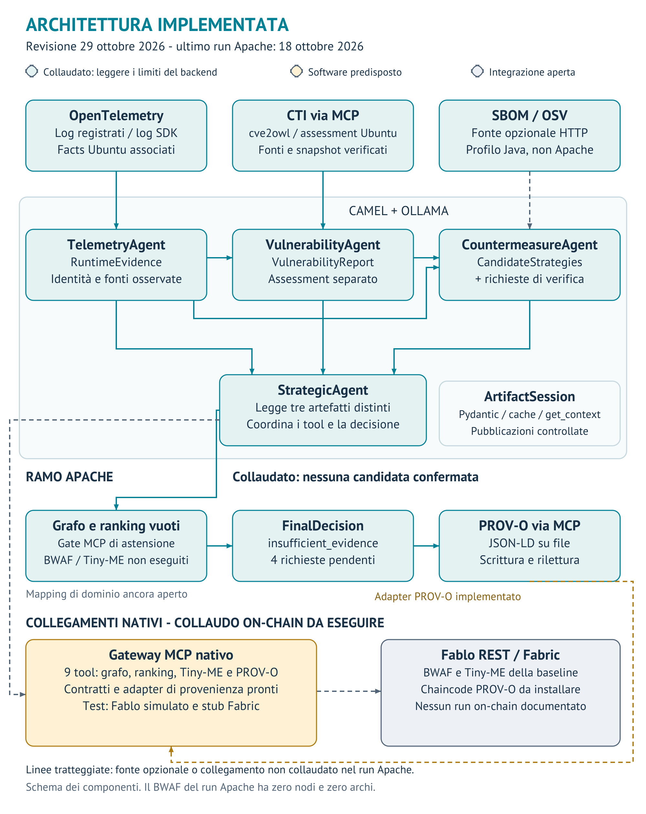
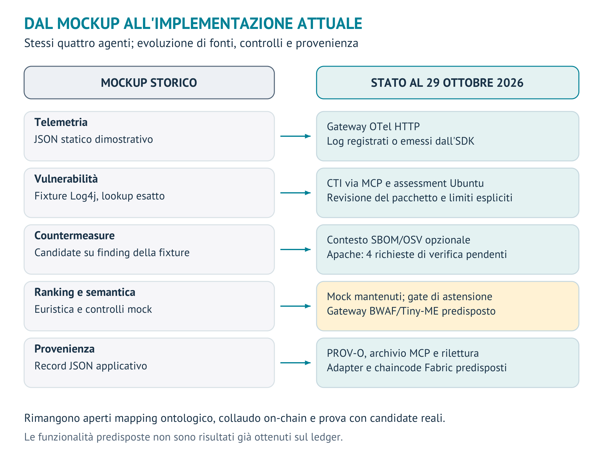

# Stato del progetto e percorso di studio

Revisione documentale: **29 ottobre 2026**. Le ultime prove sperimentali qui
riportate sono quelle del **18 ottobre 2026**: questa revisione non avvia nuove
inferenze, non riesegue il caso Apache e non attesta una nuova verifica della
disponibilità di Docker/Fablo.

## 1. Che cosa realizza oggi il progetto

Il prototipo coordina quattro agenti CAMEL con inferenza locale Ollama.
`ArtifactSession` conserva gli artefatti autorevoli e controlla pubblicazioni,
dipendenze, riferimenti alle fonti e completezza. Gli agenti consultano servizi
tramite tool; gli adapter verificano le risposte prima che diventino artefatti.
Sono disponibili profili mock, profili con ingressi reali e collegamenti Fabric
implementati ma non ancora collaudati on-chain.

Il caso completo più recente usa log Apache registrati, un inventario Ubuntu
associato, un assessment CTI via MCP e provenienza PROV-O su file via MCP.
Conclude con `insufficient_evidence`: il flusso termina correttamente ma non
seleziona contromisure. Non esercita BWAF, Tiny-ME o il ledger reale.

La figura seguente rappresenta componenti e dipendenze. **Non è il grafo BWAF
prodotto dal run Apache**, che ha zero nodi e zero archi.

Figure esportabili: [SVG](materiali/architettura-aggiornata.svg),
[PDF](materiali/architettura-aggiornata.pdf).

## 2. In che cosa differisce dal mockup

| Aspetto | Mockup storico | Stato attuale |
|---|---|---|
| Agenti e DAG | Quattro ruoli CAMEL e artefatti separati | Stessi ruoli; controlli sulle fasi Strategic e Countermeasure, cloni e recuperi |
| Telemetria | Input JSON dimostrativo | Gateway HTTP per export OTel registrati e log SDK di un'applicazione Java |
| Inventario | Dati della fixture | Binding dei facts Ubuntu; nel profilo Java, SBOM della build e hash del JAR caricato |
| Vulnerabilità | Fixture Log4j con corrispondenza esatta | Servizi CTI via MCP, snapshot e assessment Ubuntu con revisione completa del pacchetto |
| Countermeasure | Proposte su finding della fixture | Contesto SBOM/OSV opzionale; per Apache, richieste di verifica distinte dalle contromisure |
| Ranking con candidate | Euristica mock a un passo | Ancora mock nei percorsi Workforce collaudati con candidate; gateway BWAF nativo implementato separatamente |
| Ramo senza candidate | Grafo e classifica vuoti | Gate MCP esplicito di astensione, verificato nel caso Apache |
| Semantica | Controlli mock di capacità e policy | Ancora mock nel percorso con candidate; chiamate Tiny-ME native implementate, mapping di dominio aperto |
| Provenienza | Record JSON e ricevuta mock | Export PROV-O JSON-LD, parsing RDF, archivio MCP con rilettura; adapter e chaincode Fabric predisposti |
| Evidenze sperimentali | Matrice dimostrativa su fixture | Prove distinte su fonti registrate e applicazione osservata, con audit e limiti conservati |
| Attuazione | Nessuna azione sul sistema | Nessuna azione sul sistema; selezione o raccomandazione non equivalgono a esecuzione |

## 3. Come attraversare il codice

| Passaggio | Responsabilità | File da leggere |
|---|---|---|
| Avvio | Selettore, configurazione LLM, directory del run | `thesis_agents/main.py`, `config.py` |
| Collegamenti | Profilo, discovery MCP, adapter e audit | `thesis_agents/backends.py`, `mcp/client.py` |
| Osservazioni | Snapshot OTel e mapping controllato | `services/otel_gateway/`, `tools/telemetry_http.py`, `schemas/telemetry_source.py` |
| Vulnerabilità Ubuntu | Assessment remoto, risposta integrale e sintesi | `tools/ubuntu_mcp.py`, `mcp/ubuntu_contracts.py`, `schemas/ubuntu.py` |
| Verifiche pendenti | Richieste derivate dai gruppi CVE | `tools/package_verification.py`, `schemas/verification.py` |
| Ciclo degli agenti | Task, tool per ruolo, fasi e recuperi | `orchestration/workforce.py`, `countermeasure_policy.py`, `strategic_policy.py` |
| Stato autorevole | Pubblicazione, cache, confronti e decisione | `orchestration/artifacts.py`, `explanations.py` |
| Provenienza verificata | PROV-O e archivio su file | `thesis_agents/provenance.py`, `tools/evidence_strategic_mcp.py` |
| Fabric predisposto | Gateway, adapter PROV-O e chaincode | `services/strategic_gateway/fabric*.py`, `tools/fabric_provenance.py`, `services/provenance_chaincode/` |

I percorsi abbreviati nella tabella, salvo `services/`, sono relativi a
`thesis_agents/`. La [guida al codice](reading-guide.md) contiene i collegamenti
puntuali e i test pertinenti.

Ordine di studio consigliato:

1. [Architettura corrente](architettura-implementata.md): ruoli, profili e confini.
2. [Contratti e stato condiviso](architecture.md): significato degli artefatti e controlli.
3. [Caso Apache](apache-recorded-integration.md) e [assessment Ubuntu](ubuntu-vulnerability-agent.md).
4. [Countermeasure](ubuntu-countermeasure-agent.md) e [ramo strategico Apache](apache-strategic-agent.md).
5. [Prova Ollama](apache-ollama-use-case.md): risultati, fallimento, correzione e limiti.
6. [Gateway Fabric](fabric-native-integration.md): implementazione preparata e integrazione ancora aperta.
7. [Aggiornamento del report](materiali/aggiornamento-relazione-20261029.md): esposizione discorsiva delle ultime modifiche.

## 4. Come interpretare la decisione Apache

Il banner osservato è `Apache 2.4.29`. I facts riportano il pacchetto Ubuntu
`apache2 2.4.29-1ubuntu4.21`. I log originali sono del 22–24 gennaio 2022;
l'inventario è del 25 gennaio. La revisione del pacchetto è valutabile come
inventario, ma non attesta retroattivamente il processo in esecuzione nei log.
La valutazione delle CVE è retrospettiva, sulle fonti conservate nel progetto.

| Verdetto sul pacchetto inventariato | Numero di CVE |
|---|---:|
| `fixed` | 34 |
| `not_affected` | 28 |
| `potentially_affected` | 46 |
| `unknown` | 12 |
| Totale | 120 |

Il contratto Ubuntu attuale dichiara `runtime_applicability=not_assessed` e
`historical_runtime_state=not_established`. Quando l'identità è risolta,
`UbuntuPackageEvidence.lookup_status()` restituisce comunque `not_evaluable`.
La sessione traduce questo stato in `insufficient_evidence`. Non è una scelta
che l'LLM possa cambiare con una spiegazione più assertiva.

Il Countermeasure conserva quattro richieste: stato storico del processo,
condizioni runtime, stato Ubuntu dei casi indeterminati e compatibilità di un
eventuale upgrade. Interessano **58 CVE uniche**, con gruppi sovrapposti.
Le richieste restano pendenti, non diventano strategie, non sono ordinate
dal ranking e non fanno acquisire automaticamente nuove evidenze.

Un risultato più operativo, come la selezione di un piano di verifica,
è una proposta di sviluppo: **non è ancora implementato**. Nuove fonti coerenti
richiederebbero anche l'estensione dei contratti, oltre alla raccolta dei dati.

## 5. Che cosa dimostrano le prove disponibili

| Evidenza | Risultato documentato | Limite |
|---|---|---|
| Apache Ollama r1 | Fallimento dopo 593,92 s; 17 richieste | Pubblicazioni Countermeasure scritte come testo, non eseguite |
| Apache Ollama r2 | Audit superato; 1.284,92 s; 28 richieste registrate, 26 risposte | Due retry per timeout; nessuna contromisura selezionata |
| Provenienza Apache r2 | 11 entità, 10 attività, 143 triple RDF; scrittura e rilettura MCP | Archivio su file, nessuna transazione Fabric |
| Incremento Fabric del 18 ottobre | 400 test Python, 2 test Go, compilazione Linux amd64 | Fablo simulato e stub Fabric; nessuna esecuzione on-chain |
| Applicazione Java osservata | Log SDK e SBOM coerenti, prova Ollama con `no_findings` | Un caso negativo; tool strategici mock |

I conteggi dei test sono risultati delle revisioni in cui sono stati eseguiti,
non misure ottenute nuovamente durante l'aggiornamento documentale.
Le durate r1/r2 non sono un benchmark controllato: revisioni, stato del modello
e carico della macchina differiscono. Un run riuscito non dimostra affidabilità
generale o correttezza di ogni frase del commento LLM, che resta `unverified`.

Fonti locali dei numeri: `output/apache-ollama-20261018-r1/`,
`output/apache-ollama-20261018-r2/` e
`output/fabric-integration-20261018/readiness.json`. Gli output non sono inclusi
automaticamente in Git e devono essere consegnati separatamente per riprodurre
gli audit sui dati originali.

## 6. Prossimi passi concordati e questioni aperte

La priorità scelta è completare i collegamenti strategici prima del nuovo caso.
L'ordine operativo rimane:

1. Individuare la rete Fabric/Fablo, accessi, versioni e chaincode disponibili.
2. Installare il chaincode PROV-O e collaudare il probe nativo completo.
3. Formalizzare il mapping evidenze/candidate/ontologia e l'interpretazione di pesi e risultati Tiny-ME.
4. Collegare il percorso Workforce con grafo non vuoto, ranking e validazione reali.
5. Acquisire un caso controllato con runtime e inventario coerenti; conservare le fonti per il replay.
6. Valutare casi positivi, negativi, incompleti e incompatibili con i vincoli operativi.

La [proposta](riferimenti/proposta-agentic-cti.pdf), sezioni 9.3, 14–16,
richiede il percorso integrato e confronti sperimentali; ammette mitigazioni
simulate o raccomandate se dichiarate come tali. Il perimetro del caso
principale e l'ambiente blockchain restano da confermare con il docente.
Non è documentata una sua risposta alle richieste formulate nella conversazione.

## 7. Come aggiornare e studiare il report

La copia manuale `docs/materiali/relazione.docx` contiene i capitoli 1–18 e
rimane la base editoriale. La nuova copia
[relazione aggiornata](materiali/relazione-aggiornata-20261029.docx) conserva
quel contenuto, aggiunge una nota di lettura e i capitoli 19–24 con il diagramma.
L'[aggiornamento Markdown](materiali/aggiornamento-relazione-20261029.md) e il
relativo [PDF](materiali/aggiornamento-relazione-20261029.pdf) consentono di
studiare le novità separatamente.

I vecchi `relazione.pdf`, `presentazione.pptx`, `architettura.png` e
`relazione-mockup.md` restano materiali storici: non sono stati rigenerati né
presentati come export dell'ultima copia Word. Per una consegna unitaria,
il nuovo DOCX va aperto e impaginato nell'editor utilizzato dallo studente.
