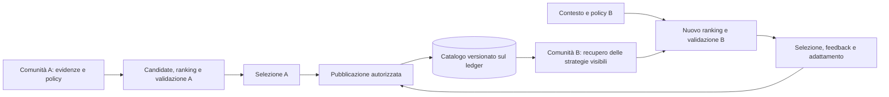

# D3FEND, comunità multi-tenant e conoscenza condivisa delle strategie

Ispezione del 16 novembre 2026. Questo documento descrive lo stato verificato e
una proposta di integrazione; non attesta l'implementazione delle nuove funzioni.
«Def3nder» è stato chiarito dall'utente come riferimento a MITRE D3FEND.
Il report accademico e le evidenze sperimentali precedenti restano invariati.

## 1. Revisioni effettivamente controllate

Verificate le teste remote tramite `git ls-remote`, usando l'accesso Git locale:

| Repository | `principe-thesis` remoto | Differenze rispetto al porting adottato |
| --- | --- | --- |
| Pipeline CTI | `18384d7c168225deacb347c5218e10f897b2a6c3` | Rispetto a `4410132`: artefatti del testbed e gestione delle eccezioni nella ricerca vettoriale |
| Servizi semantici / Fabric | `5a31ca8403bf34f6344683787412be0967936d89` | Rispetto a `023b711`: testbed consortile, distribuzione Docker/e2e, metadati del dataset completo e piccoli raccordi applicativi |

Il riferimento locale `origin/principe-thesis` del repository ledger era fermo a
`a16be9e`: la lettura di quel solo riferimento avrebbe escluso il testbed nuovo.
La revisione aggiornata è stata scaricata in una copia Git di ispezione nel
workspace. Non sono stati aggiornati riferimenti o working tree esterni.
Entrambi i repository esterni rimangono su `costa-thesis`; nessun merge o porting.

La directory di evidenze è
`output/integration-inspection-20261116/`: revisioni, hash dei sorgenti estratti,
elenchi delle differenze, confronto con i componenti correnti e prova isolata
del classificatore D3FEND. Il connettore GitHub non aveva accesso ai repository;
la verifica Git remota è invece riuscita.

## 2. Componenti già disponibili e limiti verificati

### D3FEND

`D3FENDEnricher` e `SelectiveRecomputationEngine` presenti su `costa-thesis`
coincidono byte per byte con quelli della testa remota di Principe. Non serve
riscriverli o importarne una versione diversa per iniziare.

Il classificatore dispone di otto profili incorporati, mapping esplicito,
matching lessicale euristico, motivazione, confidenza, release e produzione di
triple RDF. Il vocabolario conservato nello snapshot della pipeline è un
sottoinsieme di 846 byte con sette classi dichiarate: non è l'ontologia MITRE
completa. Il costruttore usa come etichetta predefinita `v0.9.3`; la sola
etichetta non certifica provenienza o completezza del vocabolario.
L'integrazione deve configurare un percorso di vocabolario realmente disponibile
anche nel container, verificarne il digest e conservarlo nel manifest. Il nuovo
compose SaaS monta i certificati, non il vocabolario della pipeline.

Prova eseguita caricando in memoria soltanto il modulo esistente, senza SaaS,
Fabric o LLM:

| Ingresso controllato | Risultato |
| --- | --- |
| Upgrade software / vendor patch | `SoftwareUpdate`, mapping euristico, confidenza 0,98 |
| Isolate process / sandbox | `ProcessIsolation`, mapping euristico, confidenza 0,98 |
| Monitor / monitoring and detection coverage | `unmapped`, nessuna tecnica, confidenza 0 |
| Tecnica personalizzata dichiarata | Ammessa come mapping esplicito personalizzato, confidenza 0,85 |

Le confidenze sono calcolate dalle regole del modulo; non misurano efficacia o
correttezza empirica. Le estensioni personalizzate vanno distinte dalle classi
effettivamente approvate nel vocabolario D3FEND.

Nel percorso corrente, `canonical_artifact` costruisce candidate con ID/nome del
KG e grafo esplicito, senza trasferire descrizione e mapping D3FEND. Il SaaS
restituisce subito quel grafo e non percorre il ciclo di arricchimento. Inoltre,
la disponibilità di `toRdfTriples` non equivale all'inserimento di tali triple
nell'ontologia ALN effettivamente utilizzata. In C1 il mapping risulta nullo.

D3FEND fornisce un vocabolario delle tecniche difensive e delle loro relazioni;
non stabilisce da solo priorità, efficacia o applicabilità di una contromisura.
[Fonte MITRE](https://d3fend.mitre.org/faq/).

### Multi-tenant e Fabric

Il nuovo `testbed` contiene già:

- Org1 e Org2, con due peer ciascuna e un'organizzazione di ordinamento;
- un canale comune `consortium` e contratti `argumentation` / `user-registry`;
- due nodi SaaS, porte host 8801/8802, MSP, CA e peer di riferimento distinti;
- generatore parametrico, script di gestione e monitoraggio.

È una configurazione disponibile, non un deployment verificato in questa
ispezione. Il codice corrente di Costa aggiunge controlli su identità, parsing,
validazione operativa, commit e finalizzazione che il sorgente upstream non
contiene tutti: il porting va fatto selettivamente, preservandoli.
Le comunità richiedono due Workforce e sessioni applicative indipendenti, con
tool, artefatti e memorie distinti. Possono usare lo stesso server del modello:
la separazione del contesto non richiede due modelli o due host di inferenza.

Punti concreti da sistemare o verificare nell'integrazione:

1. Il compose monta i certificati ma non un volume persistente per i dati SaaS.
   Le decisioni, gli asset e le evidenze backend locali richiedono volumi
   separati per organizzazione: ricreare un container può perdere i metadati
   necessari alla rilettura applicativa, pur conservando il ledger.
2. I nomi delle immagini e delle variabili dei chaincode vanno raccordati ai
   binding correnti, distribuendo le correzioni di Costa a tutti i peer
   interessati. Vanno controllati ontologia, digest ed endorsement effettivi.
3. Il generatore offre più canali, ma il compose scrive ancora
   `CHANNEL_NAME=consortium` e i chaincode sono assegnati al primo canale:
   la configurazione multi-channel non è completa per il routing applicativo.
4. Lo script di avvio contiene rimozioni di container basate su nomi generici;
   il reset include anche `docker volume prune`. Non è stato eseguito.
   Occorre circoscrivere le operazioni alla rete di test e verificare la
   compatibilità dei comandi GNU con l'host macOS.
5. I metadati del dataset completo aggiornati upstream non dimostrano che
   l'ontologia corretta sia distribuita nei reasoner. Servono manifest e
   verifica delle proiezioni realmente utilizzate.

### Asset, decisioni e ricalcolo

`AssetRecord` descrive software: vendor, prodotto, versione, CPE e CVE osservate.
`searchAssets` interroga RAM/disco del SaaS senza consultare la blockchain;
non è un catalogo condiviso di strategie. Le rotte di lettura upstream ammettono
anche l'assenza del token e il tipo non contiene proprietario o visibilità:
non vanno riutilizzate come controllo di accesso delle strategie.

Le finalizzazioni di Costa sono invece registrate sul ledger, legate a un tenant
autenticato e leggibili tramite i metodi di dominio soltanto dal proprietario.
Non esistono ancora ricerca consortile delle strategie, pubblicazione selettiva,
contratto di composizione o recupero delle strategie come input degli agenti.
La politica di visibilità è quindi un'estensione esplicita, non lo sblocco
generale della lettura delle decisioni altrui.

Snapshot, revisioni, provenance, analisi di impatto e ricalcolo sono basi utili.
Il ricalcolo selettivo unisce però anche score ricalcolati su un sottoinsieme a
score precedenti: il loro confronto non è automaticamente equivalente al ranking
del nuovo grafo completo. Per il primo feedback si propone il ricalcolo completo
di ranking e validazioni nel nuovo contesto.

Gli artefatti recenti della pipeline contengono anche grafi OpenSearch con due
strategie. Sono materiale da ispezionare, non casi automaticamente utilizzabili:
lo stesso individuo strategico compare in due CVE, mentre il proiettore corrente
rifiuta un individuo appartenente a CVE diverse. Va verificata anche la
fondatezza delle associazioni alle fonti. Riusare un modello di strategia richiede
istanze contestuali distinte, non il riuso indiscriminato dello stesso nodo.

## 3. Integrazione proposta: strategia riusabile e decisione contestuale

Si propone di estendere i servizi e il contratto esistenti con un **asset di
strategia versionato**, distinto dalla raccomandazione del singolo tenant.
I nomi dei campi e delle operazioni sotto sono proposte, non API già presenti.

Un asset condivisibile dovrebbe conservare almeno:

- identità stabile, versione immutabile, proprietario e digest del contenuto;
- tecnica D3FEND e versione/digest del vocabolario, origine del mapping;
- descrizione dell'azione, profilo semantico, precondizioni, effetti attesi e limiti
  fondati su fonti, con una proiezione compatibile con il reasoner;
- componenti e ordine di esecuzione, se la strategia è composta;
- provenienza pubblicabile e livello dell'evidenza disponibile;
- politica di visibilità e stato di disponibilità, sostituzione o revoca.

Il template può essere condiviso; l'individuo ontologico concreto è istanziato
per CVE, tenant e contesto, con un riferimento alla versione sorgente. Questo
preserva identità e lineage senza unire impropriamente profili di asset diversi.

### Politica fondata su D3FEND

1. Identificare e verificare un piccolo insieme di tecniche pertinenti alla demo,
   riusando il classificatore. Un mapping euristico resta una proposta; un
   mapping sconosciuto/custom non diventa una classe MITRE validata.
2. Conservare mapping, fonti e digest prima di fissare gli input di ranking.
   Collegare le annotazioni anche al percorso con grafo esplicito e alla
   proiezione semantica, senza sostituirlo con la topologia legacy.
3. Recuperare soltanto asset visibili e versioni ammesse dal catalogo; usare
   D3FEND per classificazione e ricerca, poi verificare contesto e prerequisiti.
4. Ricalcolare ranking, compatibilità semantica e policy operativa nel tenant
   destinatario. Lo score storico e la popolarità non sostituiscono il giudizio.
5. Pubblicare, tramite un'operazione autenticata del proprietario, una versione
   condivisibile della strategia selezionata e accettata, con prova del relativo
   livello di qualificazione. Le astensioni possono produrre feedback negativo
   contestuale, non strategie etichettate come riuscite.

La politica di ammissione e riuso va versionata separatamente da D3FEND e dalla
policy operativa. L'aggiornamento di una versione non modifica retroattivamente
le esecuzioni già concluse.

### Raccordi necessari nei componenti esistenti

- **Framework:** `CountermeasureCandidate` non contiene oggi un riferimento a
  un asset strategico versionato; `action` è una singola categoria. Servono
  origine/versione della proposta e un contratto esplicito per la sequenza di
  azioni. `RealSourceSession` e il preparatore richiedono esattamente i binding
  configurati ai rimedi KG: il recupero dal catalogo richiede un percorso
  controllato aggiuntivo per binding e proiezione, preservando quello esistente.
- **Agenti e MCP:** aggiungere contratti di ricerca/lettura delle strategie
  visibili al ruolo che produce le candidate, e pubblicazione/feedback dopo
  qualificazione. I nomi precisi delle API vanno definiti; non sono tool già
  esposti. Aggiornare schemi, permessi del client e discovery, mantenendo il
  backend autorevole per identità e autorizzazioni.
- **SaaS e ledger:** estendere i servizi e `ArgumentationContract` con versioni
  immutabili, eventi di feedback e ricerca paginata. Il testbed usa LevelDB:
  servono chiavi composite/range o un indice off-chain verificabile, non query
  JSON ricche assunte disponibili. Proteggere i nuovi namespace anche dalle API
  generiche di scrittura, come già fatto per le raccomandazioni.
- **Semantica e provenance:** conservare profilo e proiezione versionati e
  collegamenti `prov:used` / `prov:wasDerivedFrom`. L'adattamento di B crea un
  nuovo asset/versione con autore B e riferimento al modello di A; non riscrive
  la versione di A e non eredita automaticamente la sua accettazione.

Per il prototipo si propone un piccolo catalogo curato e una composizione a
due passi. Un'intera ontologia D3FEND importata senza verifica non sostituisce
la proiezione nel sottoinsieme logico supportato dal reasoner.

## 4. Feedback, composizione e visibilità

Il ciclo minimo è:

Il ledger diventa la fonte verificabile di versioni pubblicate e feedback.
Un indice locale può accelerare la ricerca, ma il recupero deve verificare
versione, digest, stato e autorizzazione rispetto al record condiviso; l'indice
deve essere ricostruibile dal ledger e funzionare dopo il riavvio dei due SaaS.
La sola replica dei blocchi non popola le cache applicative e non fornisce un
tool di ricerca agli agenti.

Gli eventi devono distinguere almeno: proposta, validazione, selezione,
riuso nel ragionamento, esecuzione dichiarata e risultato operativo osservato.
Attualmente `action_execution=not_performed`: si può dimostrare il riuso di una
strategia validata in simulazione, non una mitigazione applicata con successo.
L'efficacia richiederebbe evidenze successive, con origine verificabile.

Per contenere lo scope, la composizione può iniziare con due passi dichiarati
e versionati. Occorrono ordine, precondizioni, effetti e incompatibilità tra i
passi, oltre alla policy del tenant. Una semplice lista di tecniche o la loro
congiunzione non prova la fattibilità della sequenza. Il monitoraggio resta
un'azione di osservazione e non assume l'effetto correttivo dell'upgrade.
Il planner generale e l'esecuzione autonoma non sono necessari alla demo.

### Decisione richiesta sulla visibilità

| Modello | Condivisione ottenuta | Limite / intervento |
| --- | --- | --- |
| Canale consortile comune con dati controllati | Catalogo accessibile ai membri; API tenant separate | Lo stato pubblico e i payload pubblici sono visibili ai peer membri, anche se le API negano una lettura |
| Stesso canale, catalogo pubblico e dati privati in collection | Strategie approvate condivise; contesto riservato alle organizzazioni ammesse | Servono private data/transient, accesso MSP e revisione dei flussi di grafi, ranking e finalizzazione |
| Canali privati più un canale di condivisione | Separazione dei ledger e pubblicazione consortile esplicita | La conoscenza non attraversa automaticamente i canali; servono pubblicazione e raccordo dei riferimenti |

Per una demo circoscritta è sufficiente il primo modello, dichiarandone la
visibilità consortile e utilizzando dati non sensibili. Se il requisito include
riservatezza rispetto agli amministratori dei peer degli altri tenant, è
necessario il secondo o un'architettura a canali separati. Le collection sono
native di Fabric, ma il loro uso nelle operazioni CTI non è già realizzato dal
solo test generico `privateData.test.ts`.

Con le collection, i contenuti riservati devono passare attraverso i transient
field e non come normali argomenti di transazioni pubbliche. Va classificato
l'intero percorso: salvare soltanto la finalizzazione in privato non nasconde
eventuali dati sensibili già scritti da `StoreGraph` o dal ranking. Anche la
provenance pubblica va ridotta alle sole informazioni autorizzate.
[Fabric: private data](https://hyperledger-fabric.readthedocs.io/en/latest/private-data/private-data.html),
[Fabric: canali](https://hyperledger-fabric.readthedocs.io/en/latest/channels.html).

## 5. Caso di studio e confronto CAMEL

Un solo scenario controllato, due tenant e due/tre alternative sono sufficienti.
I profili devono permettere realmente una validazione favorevole in almeno un
contesto; D3FEND non risolve da solo l'insufficienza semantica osservata in C1.
Le capacità introdotte come configurazione dell'operatore non vanno presentate
come fatti dedotti dalla telemetria.

1. Prima tornata: stesso finding, policy diverse; per esempio upgrade consentito
   in A e vietato in B. Ognuno produce la propria decisione. Si ricerca nel pilota
   un caso in cui una candidata antecedente non sia accettabile e una successiva
   lo sia, preservando ordine, pareggi e score effettivi del servizio.
2. Pubblicazione: il proprietario rende condivisibile una strategia qualificata,
   con versione e provenance consentita. Nessun accesso al contesto privato altrui.
3. Seconda tornata: l'altra comunità recupera quella versione come input,
   la istanzia nel proprio contesto e la accetta, adatta o rifiuta dopo nuova
   validazione. Il nuovo feedback riferisce la versione riusata.
4. Per valutare la composizione si aggiunge una sola sequenza di due passi con
   effetti e compatibilità dichiarati, senza estendere il caso a un planner.

La CLI reale accetta oggi solo CAMEL: serve un percorso deterministico sugli
stessi backend, con proposte di riferimento fissate prima della raccolta.
Le fixture mock esistenti non costituiscono questo confronto.

La matrice completa è tenant A/B × CAMEL/deterministico × catalogo
disponibile/assente: otto condizioni, tre ripetizioni per condizione se si
desidera una prima misura della variabilità. Le tornate devono usare snapshot
del catalogo fissati; gli eventi prodotti da una replica non possono contaminare
le repliche successive. La preparazione del catalogo va distinta dalla misura.

Misure: candidate nuove/recuperate e riferimenti alle versioni; tool, retry e
recuperi; validazioni e motivo del fallback; tempo complessivo; dinieghi di
accesso, completezza della provenance, commit/rilettura e ricostruzione degli
indici. Gli score restano contestuali e non diventano un punteggio universale
di efficacia. La matrice include dodici run CAMEL: ai tempi storici di circa
20–21 minuti, il solo loro completamento richiede circa quattro ore, oltre a
baseline, preparazione e tentativi eventualmente falliti.

## 6. Effort e confine consigliato

Stime indicative in giornate-persona per un dimostratore curato, due tenant e
un piccolo vocabolario. Comprendono sviluppo e verifiche; non sono tempi già
misurati né una promessa di calendario.

| Intervento | Effort |
| --- | --- |
| Porting selettivo del testbed, identità, persistenza e collegamenti dei due SaaS | 1–2 giornate |
| Mapping D3FEND controllato, policy e raccordo a contratti/proiezione canonica | 2–3 giornate |
| Asset strategici versionati, pubblicazione, accesso e recupero dal ledger | 3–4 giornate |
| Feedback negli agenti e baseline deterministica equivalente | 2–3 giornate |
| Composizione a due passi, collaudi delle tornate e sintesi dei risultati | 2–3 giornate |
| **Totale con visibilità consortile dichiarata** | **10–15 giornate-persona** |

La riservatezza completa sul ledger con collection/transient e revisione delle
transazioni CTI aggiunge indicativamente **5–8 giornate**, da affinare dopo la
configurazione e le policy di endorsement fornite dal professore. Eventuali
attuatori, misure reali di efficacia e composizione generale richiederebbero
un perimetro separato, non incluso in queste stime.

La stima precedente di 5–10 giornate riguardava i tre esperimenti iniziali.
La memoria condivisa, la gestione della visibilità e il feedback aggiungono
funzioni architetturali. Il nuovo testbed riduce l'effort infrastrutturale,
ma D3FEND non implementa già il catalogo, le autorizzazioni o l'apprendimento.

Ordine consigliato: fissare la visibilità; scegliere due/tre strategie con fonti
e profili adeguati; raccordare D3FEND e il testbed; realizzare pubblicazione e
riuso versionato; infine misurare CAMEL e baseline. È una memoria verificabile
di casi contestuali, senza assumere apprendimento automatico del modello o
successo operativo delle strategie.

## 7. Punti di riscontro nel codice

| Evidenza | Posizione |
| --- | --- |
| Classificatore riusato e prova isolata | `fablo-rest/src/services/D3FENDEnricher.ts`, `output/integration-inspection-20261116/d3fend-probe.json` |
| Grafo canonico con candidati ID/nome | `thesis_agents/canonical/preparation.py`, funzione `canonical_artifact` |
| Vincoli di identità/topologia | `thesis_agents/canonical/contracts.py`, classe `CanonicalGraph` |
| Proprietà esclusiva degli individui rispetto alla CVE | `app/semantic_preparation/upstream/app/tools/build_aln_projection.py`, `validate_strategy_ownership` nel repository pipeline |
| Isolamento MSP delle finalizzazioni | `chaincode-argumentation/recommendation_contract.go`, `recommendation_record.go` nel repository ledger |
| Asset software locali e ricerca senza blockchain | `fablo-rest/src/services/SaaSServiceAdapter.ts`, `saveAsset`, `searchAssets` |
| Testbed remoto congelato | `output/integration-inspection-20261116/principe-ledger/testbed/` |
| Differenze complete dal porting | `output/integration-inspection-20261116/pipeline-changes-since-porting.txt`, `ledger-changes-since-porting.txt` |

Sono verifiche statiche, confronti di hash e una prova pura del classificatore.
Non sono stati avviati il testbed, suite SaaS con accesso agli store, nuovi run
CAMEL o transazioni Fabric. I file estratti hanno manifest SHA-256 e revisione
remota fissata; stato dei repository e materiali del report sono ricontrollati
alla chiusura dell'ispezione.
